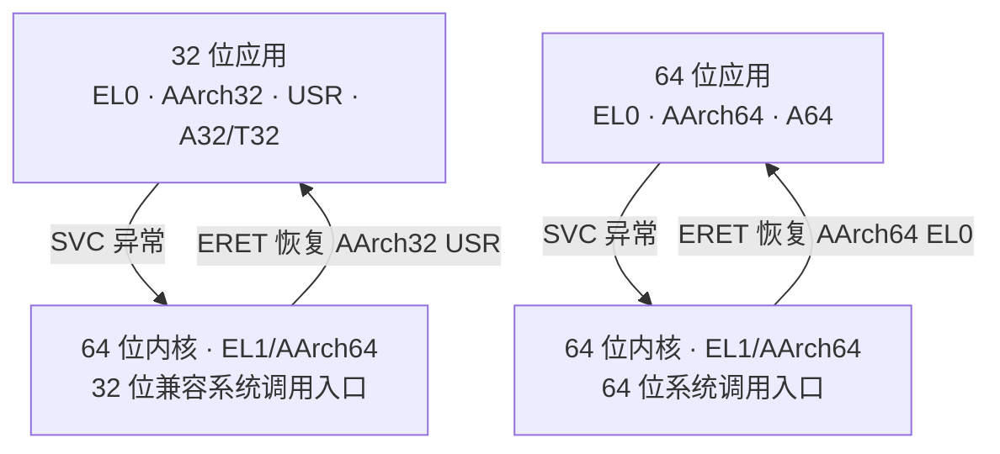

# Armv7-A 与 Armv8-A：处理器模式、异常级与 32 位兼容

> Armv8-A 为 AArch32 模式定义了与异常级的对应关系；64 位 Linux 运行 32 位应用时，通常是 EL0/AArch32 与 EL1/AArch64 之间切换，内核不会因此改成 AArch32 SVC 模式。

## TL;DR

- **Armv7-A 用模式表达权限和异常处理环境**：USR、SVC、IRQ、FIQ 等不构成一条逐级升高的权限阶梯。
- **Armv8-A 引入 EL0～EL3，并支持两种执行状态**：AArch32 保留旧模式；AArch64 使用 EL 与栈选择等状态，不再使用 SVC/IRQ 等处理器模式。
- **常见对应是多对一**：USR → EL0，SVC/IRQ/FIQ/ABT/UND/SYS → EL1，HYP → EL2，MON → EL3；还须检查目标 EL 的执行状态与安全状态。
- **32 位应用只需要 AArch32 EL0**：不要求内核、Hypervisor 和固件也能在 AArch32 执行，更不会让应用获得 EL1～EL3 权限。

范围：**Arm A-profile**，以 Arm《AArch64 Exception Model》1.3 和 Linux **6.18.62** 核对。Cortex-M 的 Thread/Handler 模式、MSP/PSP 是另一套模型；本文不展开 RME 的 Root/Realm 状态。

## 先分清六个概念

| 概念 | 回答的问题 | 例子 |
| --- | --- | --- |
| 架构版本 | 遵循哪一代架构规范？ | Armv7-A、Armv8-A |
| 执行状态 | 使用哪套寄存器与执行模型？ | AArch32、AArch64 |
| 指令集 | 正在解码哪类指令？ | AArch32 下的 A32/T32，AArch64 下的 A64 |
| 处理器模式 | AArch32 当前的权限和异常环境是什么？ | USR、SVC、IRQ、HYP、MON |
| 异常级 | 当前处于哪一层特权环境？ | EL0、EL1、EL2、EL3 |
| 安全状态 | 属于哪个硬件访问域？ | Secure、Non-secure |

Armv8-A **不等于** AArch64：实现可以只支持 AArch32，也可以按 EL 选择支持的执行状态。AArch32 也不等于“每条指令都是 32 位”：T32 包含 16/32 位编码；A64 指令则是 32 位编码。

## Armv7-A：模式混合了权限与异常类别

USR 是非特权模式；SVC、IRQ、FIQ、ABT、UND、SYS 属于常见的特权模式。安全扩展增加 MON，虚拟化扩展增加 HYP，具体处理器不一定具备这些扩展。

- **SVC 与 IRQ 不存在谁更高一级的问题**：从 SVC 切到 IRQ 是异常环境变化，通常仍处于 PL1。
- SVC、IRQ 等模式有各自的 banked SP/LR 和 SPSR；FIQ 还对 r8～r12 使用独立寄存器组，方便保留被打断的上下文。
- USR 和 SYS 共享通用寄存器组，SYS 是特权模式，但二者没有各自的异常模式 SPSR。
- Armv7-A 的 PL0/PL1，以及虚拟化扩展中的 PL2，与 Armv8-A 的 EL 模型不能直接混为一谈。MON 是安全扩展中的模式，不能据此声称 Armv7-A 原生存在 EL3。

例如，32 位内核的典型系统调用是 `USR → SVC → USR`；IRQ 可让处理器进入 IRQ 模式。此时模式名既在表达权限，也在区分保存和处理异常的环境。

## Armv8-A：异常级与执行状态分开描述

| 异常级 | 常见用途 | 说明 |
| --- | --- | --- |
| EL0 | 普通应用 | 非特权；可执行 AArch64 应用，也可在支持时执行 AArch32 应用 |
| EL1 | OS 内核 | 普通 Linux 内核、Secure 世界的 Trusted OS 等 |
| EL2 | Hypervisor | 可选；支持 VHE 时宿主内核也可在此执行 |
| EL3 | 安全监控与固件 | 可选；传统 TrustZone 中管理安全状态与下层上下文 |

EL 的编号不表示应用必须依次经过所有层。例如普通系统调用可直接从 EL0 进入 EL1，不需要经过 EL2/EL3。进入异常时可以保持 EL 或升高 EL；异常返回可以保持 EL 或降低 EL，仍须满足目标配置与合法性检查。

AArch64 中的 `EL1t` / `EL1h` **不是两个权限等级**：二者都是 EL1，分别选择 SP_EL0 / SP_EL1 作为当前栈。它们也不是 AArch32 的 User/Supervisor 模式改名。

### AArch32 模式与 EL 的完整对照

下面是 **Armv8-A 对 AArch32 模式的归类**；模式编码列取状态中的低 5 位。它不是把 Armv7-A 的硬件模式重新实现成一套 EL 寄存器，也不是由 Linux 临时建立的映射。

| AArch32 模式 | 编码 | 常见对应 EL | 典型含义 |
| --- | --- | --- | --- |
| USR（User） | `0x10` | EL0 | 非特权应用 |
| SYS（System） | `0x1f` | EL1* | 使用 USR 寄存器组的特权模式 |
| SVC（Supervisor） | `0x13` | EL1* | 32 位 OS 的监督/系统调用环境 |
| IRQ | `0x12` | EL1* | 32 位 IRQ 处理环境 |
| FIQ | `0x11` | EL1* | 32 位 FIQ 处理环境 |
| ABT（Abort） | `0x17` | EL1* | 取指/数据中止处理环境 |
| UND（Undefined） | `0x1b` | EL1* | 未定义指令处理环境 |
| HYP（Hyp） | `0x1a` | EL2 | 仅在 EL2 使用 AArch32 且具备对应支持时存在，属于 Non-secure |
| MON（Monitor） | `0x16` | EL3 | 仅在 EL3 使用 AArch32 时存在；AArch64 EL3 不使用 MON 模式 |

**星号的边界很重要**：上述六个特权模式在 Non-secure 状态对应 EL1；当 EL3 使用 AArch64 时，Secure AArch32 特权模式也可对应 S-EL1。**若 EL3 自身使用 AArch32，Secure 的这些特权模式归入 EL3，而非简单归入 EL1。** USR 仍对应 EL0。

因此，不能只看到 `SVC` 或 `SYS` 就脱离架构、安全状态及 EL3 配置推断当前 EL；“模式到 EL”也不是每种模式都对应一个不同 EL。

## AArch64 内核如何运行 32 位程序

日常所说“64 位 CPU/系统运行 32 位程序”，通常指 **64 位内核托管 AArch32 用户进程**，并不表示 CPU 处于 AArch64 状态时直接解码 A32/T32 指令。

以未被更高 EL 截获的普通 Linux 系统调用为例，假设内核运行于 EL1：

这条 32 位兼容路径的关键是：

1. **执行应用时**，PE 处于 EL0/AArch32，使用 A32 或 T32 指令和 AArch32 用户态寄存器视图。
2. **执行 SVC 时**，异常进入 AArch64 EL1 的“来自低 EL、AArch32”向量；没有先在 EL1 运行一个 AArch32 SVC 模式的中间步骤。
3. **处理系统调用时**，内核仍执行 A64 指令，兼容层处理 32 位系统调用 ABI、指针和结构布局。
4. **返回时**，异常返回路径恢复保存的用户状态，`ERET` 回到 EL0/AArch32，而不是把整个 OS 改成 32 位。

`SVC` 在这里首先是一条触发异常的指令名，不能因为指令名叫 SVC，就认定处理器进入 AArch32 的 SVC 模式。同理，AArch64 内核处理 IRQ 时没有旧式 IRQ 模式；若异常目标仍是 EL1，就仍在 EL1 执行。

### 四种场景放在一起比较

| 场景 | 应用执行环境 | 系统调用处理环境 |
| --- | --- | --- |
| Armv7-A 的 32 位 OS | USR，A32/T32 | 通常为 SVC 模式，仍是 32 位内核 |
| Armv8-A 的 AArch32 OS | AArch32 USR，EL0 | 通常为 AArch32 SVC，Non-secure EL1 |
| Armv8-A 的 AArch64 OS + 32 位应用 | AArch32 USR，EL0 | AArch64 EL1，走兼容入口 |
| Armv8-A 的 AArch64 OS + 64 位应用 | AArch64 EL0 | AArch64 EL1，走原生入口 |

这里的 EL1 是常见软件模型，不覆盖所有 VHE、虚拟化或异常路由配置。

## 状态寄存器如何表达这种区别

AArch32 用 CPSR 保存当前状态，包括模式、T 位及中断屏蔽等。进入 AArch64 异常处理时，返回所需的状态保存在相应 `SPSR_ELx`，返回地址在 `ELR_ELx`；处理器当前执行状态则是 PSTATE 的一部分。

`SPSR_ELx.M[4]` 区分返回状态的编码格式：为 1 表示 AArch32，低四位继续解释为 AArch32 模式；为 0 表示 AArch64，相关位编码目标 EL 和栈选择。

| 返回状态的低 5 位示例 | 解释 |
| --- | --- |
| `0x10` | AArch32 USR，对应 EL0 |
| `0x13` | AArch32 SVC；须结合安全状态及 EL3 配置解释所属 EL |
| `0x00` | AArch64 EL0t |
| `0x05` | AArch64 EL1h，使用 SP_EL1 |

这些只是**状态低位字段**，不能当成完整 SPSR 常量。也不是所有值都能从任意 EL 返回：还要满足目标 EL、执行状态支持和上下文等约束。

普通运行中，AArch32/AArch64 的切换与异常级变化配合发生，不能在同一 EL 用一次普通函数调用从 A32/T32 切到 A64。AArch32 内部通过 BX/BLX 等切换 A32/T32 是另一回事，不改变执行状态。

较高层使用 AArch32 时，其托管的较低层不能反过来使用 AArch64；64 位内核能托管 32 位应用，反方向不成立。

`HCR_EL2.RW`、`SCR_EL3.RW` 参与控制相关下层异常级的执行状态；具体作用范围还取决于安全状态和扩展。它们不是选择单个用户进程位宽的开关。

## Linux 6.18.62 中可以核对哪些位置

| 源码位置 | 可验证的行为 |
| --- | --- |
| `arch/arm64/Kconfig` 的 `COMPAT` | 明确支持“64 位 EL1 内核下的 32 位 EL0” |
| `arch/arm64/include/asm/processor.h` 的 `compat_start_thread()` | 用 `PSR_AA32_MODE_USR` 初始化用户返回状态，并按入口设置 T 位 |
| `arch/arm64/include/asm/ptrace.h` | AArch32 模式编码及 `compat_user_mode()` 判断 |
| `arch/arm64/kernel/entry.S` | 分开设置 64 位 EL0 与 32 位 EL0 异常向量，返回路径使用 `ERET` |
| `arch/arm64/kernel/entry-common.c` | `el0t_32_sync_handler()` 识别 `ESR_ELx_EC_SVC32`，进入兼容系统调用路径 |

硬件支持与软件兼容层缺一不可。运行 32 位应用还要确认：CPU 支持 **AArch32 EL0**、内核启用 `CONFIG_COMPAT`、二进制 ABI 受支持，以及动态程序所需的 32 位解释器/库存在。异构 SoC 还可能只有部分 CPU 支持 AArch32 EL0，不能只看“CPU 是 64 位”就断定能运行所有 32 位程序。

用户态兼容不扩展到内核模块：AArch64 内核不能因此加载 AArch32 内核模块。32 位应用也不能通过切换 CPSR 模式获得 SVC、HYP 或 MON 权限。

## 与 TF-A 启动模型的关系

以 `ARCH=aarch32` 构建的 TF-A 参考链，与 **AArch64 BL31 托管 AArch32 安全载荷**是不同方案。后者仍有 AArch64 EL3/BL31，只是低层安全载荷可以在平台支持时使用 AArch32；不能看到“BL32 是 32 位”就认定整套系统没有 BL31。

相关：[ARM Trusted Firmware-A：启动阶段与运行时服务](../../secure/%E4%BB%8B%E7%BB%8D%20ARM%20Trusted%20Firmware.md)。

## 参考资料

- Arm《AArch64 Exception Model》1.3：[异常级](https://support.arm.com/documentation/102412/0103/Privilege-and-Exception-levels/Exception-levels)、[执行状态与切换规则](https://support.arm.com/documentation/102412/0103/Execution-and-Security-states/Execution-states)、[各 EL 的实现限制](https://support.arm.com/documentation/102412/0103/Execution-and-Security-states/Impact-of-implemented-Exception-levels)。
- Arm 寄存器说明的公开镜像：[CPSR](https://df.lth.se/~getz/ARM/SysReg/AArch32-cpsr.html)、[SPSR_EL1](https://df.lth.se/~getz/ARM/SysReg/AArch64-spsr_el1.html)：模式编码与 AArch32/AArch64 返回状态格式。
- [QEMU v8.2.0 `arm_current_el()`](https://github.com/qemu/qemu/blob/v8.2.0/target/arm/cpu.h)：可交叉核对 AArch32 模式归类，尤其是 EL3 为 AArch32 时的 Secure 特权模式。
- Linux 6.18.62：[processor.h](https://github.com/gregkh/linux/blob/v6.18.62/arch/arm64/include/asm/processor.h)、[entry.S](https://github.com/gregkh/linux/blob/v6.18.62/arch/arm64/kernel/entry.S)、[entry-common.c](https://github.com/gregkh/linux/blob/v6.18.62/arch/arm64/kernel/entry-common.c)。
- [Linux 的异构 32 位支持说明](https://github.com/gregkh/linux/blob/v6.18.62/Documentation/arch/arm64/asymmetric-32bit.rst)：AArch32 EL0 能力与调度边界。
