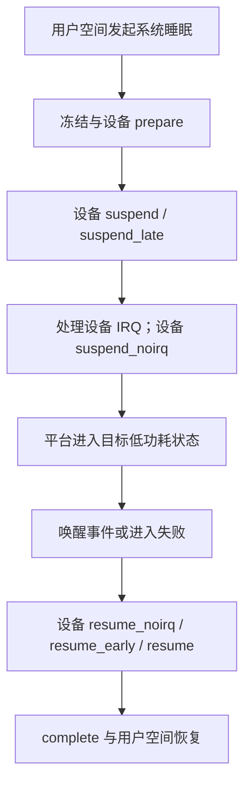

# Linux 系统休眠与中断唤醒

> 系统休眠要求设备停止普通 I/O、平台进入目标低功耗状态，并保留有效的唤醒链路；运行时 IRQ 可用不等于该 IRQ 一定能唤醒系统。

## TL;DR

- system suspend 与 Runtime PM 管理范围不同；设备可能已经 runtime suspended，仍需参与系统睡眠协调。
- 通常先执行设备 suspend / late，再暂停普通设备 IRQ 并执行 noirq 阶段；恢复过程反向推进，具体分支由 PM core 决定。
- `enable_irq_wake()` 配置 IRQ 唤醒能力；`IRQF_NO_SUSPEND` 让 IRQ 在 suspend 周期保持运行，**不保证系统唤醒**。
- 唤醒需设备、GPIO/irqchip、电源域、引脚和平台都支持；排查要观察进入、唤醒、恢复三个阶段。

范围：Linux 6.18.62 LTS 的 system suspend 与设备 IRQ；平台固件和电气约束以实际硬件为准。

## 从应用请求到恢复

图省略平台、CPU、syscore、失败回滚和 `direct_complete` 等分支；并非每个设备一定执行全部驱动回调。父子设备和设备链接约束顺序，异步设备也可能并行处理。`suspend_noirq` 指阶段和设备 IRQ 状态，不等于回调处于硬中断上下文。

`/sys/power/state` 和 `/sys/power/mem_sleep` 显示内核与平台支持的状态；`mem` 对应的具体模式要查看实际选项，不能直接假定所有平台进入相同硬件状态。触发休眠前应确认任务和数据状态。

## 唤醒 IRQ 与普通 IRQ

| 配置 / 机制 | 作用 | 不能推断 |
| --- | --- | --- |
| `enable_irq_wake(irq)` | 请求 irqchip / 平台将 IRQ 配置为系统唤醒源 | 设备、电源域和物理线路一定支持唤醒 |
| `disable_irq_wake(irq)` | 撤销相应唤醒设置 | 普通 IRQ 使用也自动结束 |
| `IRQF_NO_SUSPEND` | suspend 期间保留该 IRQ 的正常处理 | 一定能从睡眠状态唤醒系统 |
| 设备 `power/wakeup` | 用户空间对支持唤醒的设备进行策略控制 | 仅写策略就能使未接线或已断电的硬件工作 |

`IRQF_NO_SUSPEND` 和 IRQ wake 都作用于整条 IRQ；共享线路可能影响其他使用者。对同一个设备，不应把二者叠加作为通用唤醒方案。suspend 进行中发生唤醒事件可能中止休眠，已经睡眠时则触发恢复；设备 IRQ handler 执行的时间应按 PM 阶段和 IRQ 机制判断。

## 设备驱动需要协调什么

1. 按设备协议阻止新 I/O，并等待或终止进行中的 DMA、work、线程和硬件访问。
2. 根据设备是否作为唤醒源，配置中断和硬件低功耗模式；保持必要的供电、时钟、GPIO/pinctrl 与线路。
3. 恢复时按硬件和供应者约束恢复电源、寄存器及运行状态，再开放 I/O；避免回调等待已停用的 IRQ。
4. 失败与回滚路径检查资源和引用是否配对，不能只测试成功睡眠的路径。

与 `dev_pm_ops`、runtime 引用的关系见 [[platform_pm]]、[[Kernel API - pm_runtime]]；irqchip 与 domain 见 [[Linux IRQ Domain 与中断控制器]]。

## 分阶段定位

| 现象 | 优先证据 |
| --- | --- |
| 系统拒绝或立刻退出 suspend | 内核日志、PM tracepoint、活动 wakeup source、设备回调错误 |
| 已睡眠但不能由设备唤醒 | 设备策略、IRQ wake、引脚电平、供电域、控制器及固件配置 |
| 设备触发但系统恢复后无功能 | 设备 IRQ 清除、恢复回调、时钟/复位/电源和寄存器状态 |
| 恢复路径卡住 | 回调等待、锁依赖、DMA/work 状态及是否依赖已暂停的 IRQ |

先记录成功/失败边界和 `/sys/kernel/debug/wakeup_sources` 等可用信息，再用 [[ftrace]] 的 PM、IRQ 和 sched 事件缩小范围。debugfs、事件和权限依系统配置而异；不能以单一计数证明物理唤醒路径正常。

## 参考

- Linux 6.18.62：[Suspend 与中断](https://github.com/gregkh/linux/blob/v6.18.62/Documentation/power/suspend-and-interrupts.rst)、[设备 PM](https://github.com/gregkh/linux/blob/v6.18.62/Documentation/driver-api/pm/devices.rst)、[休眠流程](https://github.com/gregkh/linux/blob/v6.18.62/Documentation/admin-guide/pm/suspend-flows.rst)、[`drivers/base/power/main.c`](https://github.com/gregkh/linux/blob/v6.18.62/drivers/base/power/main.c)。
- 蜗窝科技：[Suspend 与 IRQ](https://www.wowotech.net/pm_subsystem/suspend-irq.html)、[IRQ wakeup](https://www.wowotech.net/pm_subsystem/491.html)。
