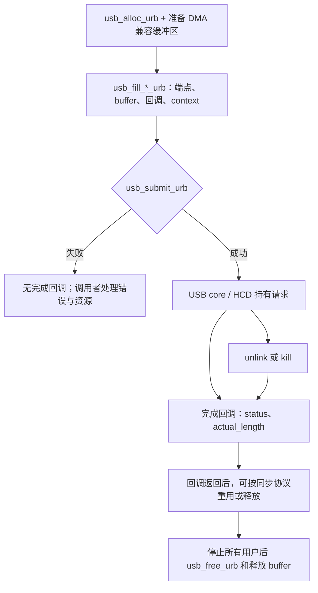

# Linux USB URB 生命周期与断开处理

> URB 是主机驱动提交给 USB 子系统的异步请求；提交成功后，buffer 和上下文必须保持有效到完成回调结束或同步取消完成。

## TL;DR

- `usb_submit_urb()` 成功表示请求已排队，不表示数据传输成功；成功提交后完成回调只执行一次。
- 回调检查 `urb->status` 和 `urb->actual_length`；它不能按可睡眠普通线程编写，重新提交须使用适当 GFP 标志和停止协议。
- `usb_unlink_urb()` 异步取消；`usb_kill_urb()` 等待该 URB 的回调结束，可能睡眠，不能在回调或持有回调所需锁时调用。
- disconnect 先阻止新提交和回调重提交，再同步取消在途请求、停止工作并释放对象；`usb_free_urb()` 不自动停止在途传输。

范围：Linux 6.18.62 LTS，USB host interface driver 的 URB。协议包、事务和传输类型见 [[USB 2.0 设备的传输过程]]。

## 生命周期与所有权



一次成功提交对应一次完成；URB 在完成前，除接口允许的少数场景外，不应由驱动并发修改其字段或复用 buffer。一个 URB 可能由多个 USB 事务和数据包完成；usbmon 的软件请求记录不等于总线抓到的每个包。

## 关键接口

| 接口 | 行为和边界 |
| --- | --- |
| `usb_alloc_urb(iso_packets, gfp)` | 分配 URB；control/bulk/interrupt 的 iso_packets 为 0，失败返回 `NULL` |
| `usb_fill_control_urb()` / `usb_fill_bulk_urb()` / `usb_fill_int_urb()` | 填充请求字段；control 还需有效 setup buffer |
| `usb_submit_urb(urb, gfp)` | 0 表示排队成功，负值表示提交失败且此次没有完成回调 |
| `usb_unlink_urb()` | 请求异步取消；返回后回调可能仍在运行或尚未执行 |
| `usb_kill_urb()` | 同步取消并等待回调结束；过程中阻止该 URB 重提交，调用上下文需允许睡眠 |
| `usb_free_urb()` | 释放持有的 URB 引用；不能替代取消和同步，也不默认释放普通 transfer buffer |
| `usb_anchor_urb()` / `usb_kill_anchored_urbs()` | 管理多个在途 URB；提交失败需处理已 anchor 的请求 |

`urb->status` 和 `urb->actual_length` 在完成回调中检查；出错时也可能已经完成部分数据。isochronous URB 还要检查每个 `iso_frame_desc[]` 的状态和长度，不能仅凭顶层状态判断每帧成功。

## 示例：一次 Bulk IN 请求

前提：调用者已持有有效 `usb_device`，`ep_num` 是从已匹配 interface 的 **Bulk IN 端点描述符**取得的端点号；`start` 与 `stop` 由外层串行化，成功提交后 `ctx`、`udev` 和设备对象保持有效直到 `stop` 返回。示例只提交一次，回调不重提交：

```c
#include <linux/errno.h>
#include <linux/kernel.h>
#include <linux/slab.h>
#include <linux/usb.h>

struct sample_rx {
    struct urb *urb;
    u8 *buffer;
};

static void sample_rx_complete(struct urb *urb)
{
    if (urb->status == 0)
        pr_debug("bulk IN received %u bytes\n", urb->actual_length);
    else
        pr_debug("bulk IN completed: %d\n", urb->status);
}

static int sample_rx_start(struct sample_rx *ctx, struct usb_device *udev,
                           unsigned int ep_num)
{
    int ret;

    ctx->urb = usb_alloc_urb(0, GFP_KERNEL);
    if (!ctx->urb)
        return -ENOMEM;

    ctx->buffer = kmalloc(64, GFP_KERNEL);
    if (!ctx->buffer) {
        usb_free_urb(ctx->urb);
        ctx->urb = NULL;
        return -ENOMEM;
    }

    usb_fill_bulk_urb(ctx->urb, udev, usb_rcvbulkpipe(udev, ep_num),
                      ctx->buffer, 64, sample_rx_complete, ctx);
    ret = usb_submit_urb(ctx->urb, GFP_KERNEL);
    if (ret) {
        kfree(ctx->buffer);
        usb_free_urb(ctx->urb);
        ctx->buffer = NULL;
        ctx->urb = NULL;
        return ret;
    }
    return 0;
}

static void sample_rx_stop(struct sample_rx *ctx)
{
    usb_kill_urb(ctx->urb);
    kfree(ctx->buffer);
    usb_free_urb(ctx->urb);
    ctx->buffer = NULL;
    ctx->urb = NULL;
}
```

仅在 `sample_rx_start()` 成功后调用 `sample_rx_stop()`，并在停止前阻止外部再提交；外层同步也必须处理与 disconnect 的竞争。示例没有业务数据队列、设备引用管理、运行时 PM 或循环收包，不可直接作为完整 USB 驱动。`kmalloc` 分配的 buffer 用于说明常规 DMA 兼容路径；其他 buffer 类型需按 USB/DMA 契约验证。

## 连续收发与 disconnect

实际驱动常在完成回调中重新提交 URB，或者使用多个 URB / anchor 保持吞吐。此时必须先设置同步保护的停止状态，让所有提交路径和完成回调不再启动新 URB，然后取消并等待已提交的 URB，最后清理 buffer、work 和设备引用。

多 URB 场景中先 anchor 再提交；提交失败时撤销该 URB 的 anchor，并按引用约定释放。`usb_kill_anchored_urbs()` 可同步处理 anchor 中的请求，但其他生产者仍可能继续添加新 URB，必须先停止它们。USB 接口绑定与协议见 [[USB 2.0 设备的枚举过程]]。

## 排查

| 现象 | 优先检查 |
| --- | --- |
| `usb_submit_urb()` 立即失败 | pipe 类型、端点、设备状态、内存上下文和返回值；该次不会有完成回调 |
| 提交成功但超时 | 主机/设备协议、端点、固件是否准备数据和 usbmon 完成状态 |
| 回调返回 `-EPIPE` | 对端 STALL / endpoint halt；结合提交阶段 pipe 错误区别分析 |
| disconnect 后崩溃 | 是否仍有 callback/work、重新提交路径、buffer 或 context 被提前释放 |
| 数据长度异常 | `actual_length`、短包与上层协议；不要按请求长度无条件使用未收到的字节 |

USB 传输错误码要结合提交/完成阶段和控制器日志；取消和断开造成的错误不应一律视为硬件协议故障。

## 参考

- Linux 6.18.62：[`urb.c`](https://github.com/gregkh/linux/blob/v6.18.62/drivers/usb/core/urb.c)、[`usb.h`](https://github.com/gregkh/linux/blob/v6.18.62/include/linux/usb.h)、[USB anchors](https://github.com/gregkh/linux/blob/v6.18.62/Documentation/driver-api/usb/anchors.rst)、[USB 错误码](https://github.com/gregkh/linux/blob/v6.18.62/Documentation/driver-api/usb/error-codes.rst)。
- [USB skeleton](https://github.com/gregkh/linux/blob/v6.18.62/drivers/usb/usb-skeleton.c)：参考真实驱动的提交、取消和 disconnect 同步；具体设备仍需自己的协议和生命周期设计。
