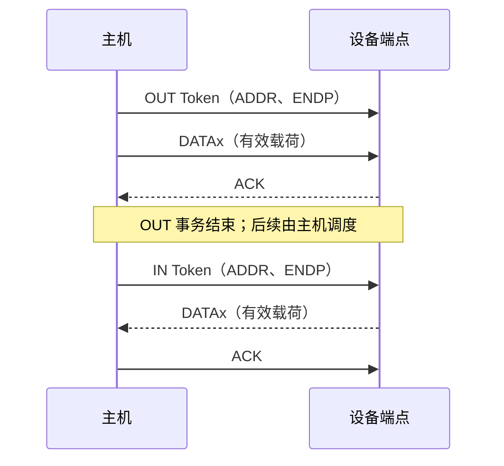
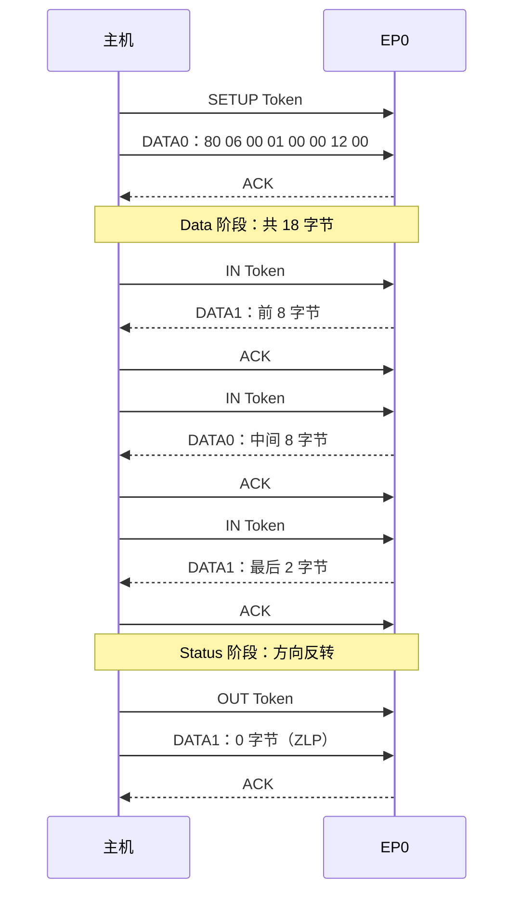

# USB 2.0 设备的传输过程

> USB 2.0 由主机调度端点传输：一次传输可拆成多个事务，一个事务再由 Token、Data 和可选 Handshake 包组成；四种传输类型决定调度、可靠性和时延规则。

## TL;DR

- **IN / OUT 始终以主机为参照**：IN 是设备到主机，OUT 是主机到设备；Interrupt 端点也要等待主机访问。
- **Control 负责请求，Bulk 适合可靠批量数据，Interrupt 提供周期访问机会，Isochronous 优先保证时间与带宽**；等时传输有 CRC 检错，但没有事务握手与总线重传。
- **传输类型、包类型和 PID 是不同层次**：Control 不是一种线上 PID；SETUP Token 后的 DATA0 包才承载 8 字节请求。
- **最大包长不是一次传输的长度**：大缓冲区会拆包；短包和 ZLP 是否用于结束数据，要结合传输类型、请求长度及上层协议判断。
- **usbmon 看到的是 URB 请求与完成**，不能据此还原全部 Token、ACK、NAK、CRC、重试和物理层时序。

范围：USB 2.0 的 Low-Speed（1.5 Mbit/s）、Full-Speed（12 Mbit/s）和 High-Speed（480 Mbit/s）。Linux 软件层以 **6.18.62 LTS** 为参照；不覆盖 SuperSpeed 或 eUSB2 扩展。

导航：[[#从应用请求到总线数据包]] · [[#四种传输类型]] · [[#数据包格式与 PID]] · [[#事务与重试]] · [[#控制传输]] · [[#短包、ZLP 与上层协议]] · [[#抓包与排障]]

## 从应用请求到总线数据包

| 层次 | 含义 | 示例 |
| --- | --- | --- |
| 应用 / 类协议 | 定义数据的业务含义和消息边界 | HID Report、音频样本、MSC BOT 命令与状态、自定义协议 |
| Transfer：传输 | 软件请求的一次数据操作；可能包含多个事务 | 读取一块缓冲区、一次控制请求；Linux 中通常通过 URB 提交 |
| Transaction：事务 | 主机调度的一次总线访问及响应 | `IN → DATA1 → ACK` |
| Packet：包 | 总线上可识别的协议单元 | IN Token、DATA1、ACK |
| 物理信号 | 包的编码和电气传输 | D+/D−、NRZI、位填充、包结束信号 |

USB 是主机调度的总线。设备准备好 IN 数据后放入端点缓冲区，等主机发送 IN Token 才能发送；OUT 数据同样由主机安排。同一 USB 2.0 总线段采用半双工传输，线路速率不等于应用有效吞吐量。设备远程唤醒是电源管理机制，不改变正常数据事务的发起规则。

端点由**设备地址、端点号和方向**定位。`EP1 IN` 与 `EP1 OUT` 是不同方向的端点；控制管道使用一对方向关联的端点，EP0 默认控制管道在枚举期间就可访问。其他端点由活动配置和接口 alternate setting 决定，见 [[USB 2.0 设备的枚举过程]]。

## 四种传输类型

| 类型 | 常见用途 | 调度与可靠性 | 支持速度 |
| --- | --- | --- | --- |
| Control：控制 | 标准、类、自定义请求，配置与状态查询 | 按 Setup / Data / Status 组织；有检错、握手和重试 | LS / FS / HS |
| Bulk：批量 | 存储、文件、串口桥、批量数据 | 利用可用带宽；有检错、握手和重试，不保证带宽或最大时延 | FS / HS |
| Interrupt：中断 | 键鼠、状态通知、小数据 | 周期调度；有检错、握手和重试 | LS / FS / HS |
| Isochronous：等时 | 实时音视频、连续采样 | 周期调度和带宽预留；有 CRC 检错，无事务握手和总线重传 | FS / HS |

“中断传输”不等于设备在任意时刻主动向主机发包。主机在有待处理请求、端点活动且调度条件满足时访问端点；周期访问机会也不等于用户程序或驱动回调获得硬实时保证。

Control / Bulk / Interrupt 的重试用于可靠交付，但仍可能因断连、超时、取消或持续错误而失败。Isochronous 保留按时传输的机会，**不保证每份数据都成功到达**。这四种总线传输类型，与软件 API 采用同步等待还是异步提交是不同维度。

### 单个数据包的有效载荷上限

下表是端点最大包长（MPS）的合法值或上限，不是整个传输或 URB 的长度：

| 类型 | Low-Speed | Full-Speed | High-Speed |
| --- | --- | --- | --- |
| Control | 8 B | 8 / 16 / 32 / 64 B | 64 B |
| Bulk | 不支持 | 8 / 16 / 32 / 64 B | 512 B |
| Interrupt | ≤ 8 B | ≤ 64 B | ≤ 1024 B |
| Isochronous | 不支持 | ≤ 1023 B | ≤ 1024 B |

HS 的 Interrupt / Isochronous 还支持高带宽周期端点：**每微帧最多 3 次事务，每次最多 1024 B，合计最多 3072 B**。这不是一个 3072 B 的数据包，也不是任意端点都能使用该能力。

### 帧、微帧与周期

FS 帧长为 **1 ms**；HS 将 1 ms 分为 8 个 **125 μs 微帧**。主机在 FS 帧或 HS 微帧边界发送 SOF；HS 的 11 位帧号每 1 ms 递增，同一帧内的 8 个 SOF 共享该帧号。LS 不接收 SOF，使用相应的 keep-alive 机制维持总线活动。

周期端点的 `bInterval` 必须结合速度和类型解释：

| 端点 | `bInterval` 的编码 |
| --- | --- |
| LS Interrupt | 规范范围 10～255，按 1 ms 帧表示访问间隔 |
| FS Interrupt | 1～255，按 1 ms 帧表示访问间隔 |
| FS Isochronous | 1～16，间隔为 `2^(bInterval-1) × 1 ms` |
| HS Interrupt / Isochronous | 1～16，间隔为 `2^(bInterval-1) × 125 μs` |

例如 HS `bInterval=4` 对应 **1 ms**，不是 4 ms。实际调度还受主机实现影响；Linux 可能修正非法描述符或规范化请求间隔，驱动应区分描述符编码与软件结构中已换算的间隔。

## 端点描述符决定传输规则

标准端点描述符的基本部分为 7 字节：

| 偏移 / 长度 | 字段 | 含义 |
| --- | --- | --- |
| 0 / 1 B | `bLength` | 标准基本长度为 7；某些类规范可扩展 |
| 1 / 1 B | `bDescriptorType` | Endpoint 为 `0x05` |
| 2 / 1 B | `bEndpointAddress` | bit 7 为方向，低 4 位为端点号 |
| 3 / 1 B | `bmAttributes` | 低 2 位：`00` Control、`01` Isochronous、`10` Bulk、`11` Interrupt；等时端点还含同步与用途信息 |
| 4 / 2 B | `wMaxPacketSize` | 小端；低 11 位为单次事务最大包长 |
| 6 / 1 B | `bInterval` | 周期编码按上表解释；不能统一当成毫秒 |

对于 HS Interrupt / Isochronous，`wMaxPacketSize[12:11]` 编码每微帧的额外事务数：`00/01/10` 分别对应总计 `1/2/3` 次，`11` 保留；其他 USB 2.0 端点不能套用这一乘数。

例如 `07 05 81 03 40 00 04` 表示 `EP1 IN`、Interrupt、MPS 64 B；`bInterval=4` 在 FS 表示 4 ms，在 HS 表示 1 ms。EP0 的包长从设备描述符的 `bMaxPacketSize0` 获得，不靠配置树里的端点描述符建立。

## 数据包格式与 PID

### 线上包的逻辑布局

下面按协议字段顺序表示，位宽不包含 SYNC / EOP；普通 Token 指 IN / OUT / SETUP / PING，SPLIT 另有格式：

```text
普通 Token : SYNC | PID(8) | ADDR(7) | ENDP(4) | CRC5(5) | EOP
SOF        : SYNC | PID(8) | FrameNumber(11)  | CRC5(5) | EOP
Data       : SYNC | PID(8) | Payload(0..MPS 字节) | CRC16(16) | EOP
Handshake  : SYNC | PID(8) | EOP
```

- **SYNC**：LS / FS 为 8 位，HS 发送端为 32 位，经过 Hub 转发可能缩短，用于接收时钟同步。
- **PID**：低 4 位是类型码，高 4 位是其逐位取反，用于检查 PID；不是独立的 CRC，也不是设备 VID/PID。
- **ADDR / ENDP**：分别指定设备地址与端点号；IN / OUT 方向由 Token PID 给出。设备地址 0 用于尚未分配地址的设备。
- **CRC5 / CRC16**：普通 Token 的 CRC5 保护地址与端点字段，SOF 的 CRC5 保护帧号；Data 的 CRC16 保护有效载荷。Handshake 没有载荷和 CRC 字段。
- **EOP**：包结束。LS / FS 以 SE0 后回到 J 表示结束；HS 的 EOP 使用不同编码，不能套用相同电平时序。

数据字节在线上按低位先发送，并经过 NRZI 与位填充处理；普通编码中 NRZI 的 0 产生跳变、1 不跳变，连续 6 个 1 后插入 0。HS EOP 等特殊序列需按规范单独解码，不能把抓包界面的十六进制字节直接当作 D+/D− 电平。

### 常见 PID

以下十六进制值包含类型码及其反码，是解码后的完整 PID 字节：

| 类别 | PID / 字节值 | 用途 |
| --- | --- | --- |
| Token | `OUT / E1`、`IN / 69` | 主机向设备写、向设备读 |
| Token | `SETUP / 2D` | 开始控制传输的 Setup 事务 |
| Token | `SOF / A5` | 帧 / 微帧起点 |
| Data | `DATA0 / C3`、`DATA1 / 4B` | 普通控制、批量、中断数据的序号；FS 等时数据使用 DATA0 |
| Data | `DATA2 / 87`、`MDATA / 0F` | HS 高带宽等时 / 分离事务等规定场景，不是普通 DATA0/1 的随意扩展 |
| Handshake | `ACK / D2` | 已成功接收 |
| Handshake | `NAK / 5A` | 暂时没有 IN 数据，或暂时不能接收 OUT 数据 |
| Handshake | `STALL / 1E` | 端点暂停或控制请求无法完成，须结合传输上下文处理 |
| Handshake | `NYET / 96` | HS OUT 流控、分离事务完成查询等场景，含义取决于上下文 |
| 特殊 | `PING / B4` | HS Control / Bulk OUT 查询接收准备状态，布局与普通 Token 相同 |
| 特殊 | `SPLIT / 78` | HS Hub 的 Transaction Translator（TT）相关分离事务 |
| 特殊 | `PRE / 3C`、`ERR / 3C` | 相同 PID 编码，在不同总线 / 事务上下文中分别表示低速前导或分离事务错误 |

## 事务与重试

### 普通 Bulk / Interrupt 事务

下面表示成功的普通事务，省略调度间隔、错误以及 HS 特殊流控；`DATAx` 为当前应使用的 DATA0 / DATA1：



| 条件 | 总线响应与含义 |
| --- | --- |
| IN 数据未准备好 | 设备以 NAK 代替 Data 包；主机稍后再访问 |
| OUT 暂时无法接收 | 设备在接收数据包后返回 NAK，发送方保留该数据重试 |
| CRC / PID / 位填充错误，或响应丢失 | 通常不发送成功握手；主机按该事务协议重试或报告错误，不存在通用的“CRC 错误包” |
| Bulk / Interrupt 端点 halt | 返回 STALL；通常需要主机清除 halt，并按规范重新同步序号 |

**NAK 是流控，不能直接等同于传输失败；长时间 NAK 仍可能最终造成软件超时。** ACK 表示总线接收成功，不表示设备业务逻辑已经处理完成或数据已经持久化。

### DATA0 / DATA1 为什么能防止重复交付

普通 Bulk / Interrupt 端点按成功交付推进数据序号。未确认的数据重发时保留原 PID；接收方根据预期序号识别重复包，避免 ACK 丢失后将同一数据再次交给上层，并对正确收到的重复包再次 ACK。

初始化 / 重新同步时按规范设置序号，例如成功清除 Bulk / Interrupt 的 endpoint halt 后回到 DATA0。Control 的 Setup、Data 和 Status 使用独立规则，不能把一条控制请求的序号直接接在上一条请求后面。

### Isochronous 事务

```text
等时 OUT：Host → OUT Token → Data；设备不返回 Handshake
等时 IN ：Host → IN Token；Device → Data；主机不返回 Handshake
```

FS 等时数据使用 DATA0，不进行普通的数据翻转。HS 高带宽等时使用规范规定的 DATA0 / DATA1 / DATA2 / MDATA 序列，不能按普通的成功 ACK 翻转逻辑解释。接收方仍会检查 CRC，但错误数据不会通过总线重传补回；应用需要面对缺样、丢帧和时间连续性问题。

### HS 的 PING、NYET 与 Hub 分离事务

HS Control / Bulk OUT 可使用 **PING 协议**探测接收空间，避免设备未就绪时反复发送整个数据包。直接 HS OUT 数据事务中的 NYET 表示**当前数据已接受，但尚未准备接收后续数据**；不能因为看见 NYET 就重复交付当前有效载荷。

FS / LS 设备接在 HS Hub 后面时，上游 HS 链路通过 SPLIT 与 Hub 的 TT 协调下游事务。SPLIT 的字段包含 Hub 地址、端口、Start / Complete 等信息，布局不同于普通设备 Token；Complete-Split 中的 NYET 也不能套用上述“设备已接受 OUT 数据”的含义。分析时先确认采集点位于 Hub 上游还是下游。

## 控制传输

### 三个阶段及方向

控制传输由**必选 Setup、可选 Data、必选 Status** 组成。每个阶段包含相应事务，Status 阶段本身也包含 Token / Data / Handshake；**Status 阶段不等于一个 Handshake 包**。

| 请求类型 | Setup | Data | Status |
| --- | --- | --- | --- |
| Control Read | 主机发送 8 字节请求 | IN，设备到主机 | OUT，主机发送 DATA1 ZLP，设备 ACK |
| Control Write | 主机发送 8 字节请求 | OUT，主机到设备 | IN，设备返回 DATA1 ZLP，主机 ACK |
| No Data | 主机发送 8 字节请求 | 无，`wLength=0` | IN，设备返回 DATA1 ZLP，主机 ACK |

Setup 事务是 `SETUP Token → DATA0（8 B）→ ACK`。**正确收到 Setup 请求时设备必须 ACK，不能以 NAK / STALL 拒收有效 Setup**；不支持的请求可在后续 Data 或 Status 阶段以 STALL 表示。收到新的有效 Setup 会开始新请求并重新同步控制传输状态。

有 Data 阶段时从 DATA1 开始，再按成功事务交替使用 DATA0 / DATA1；Status 总是使用 DATA1 零长度数据包。`GET_DESCRIPTOR` 是读请求，`SET_ADDRESS` 和 `SET_CONFIGURATION` 是无数据请求；设地址的状态阶段仍在旧地址完成，详见 [[USB 2.0 设备的枚举过程]]。

### 8 字节 Setup 请求格式

Setup 请求位于 DATA0 的有效载荷内；下列三个 16 位字段采用**小端**编码：

| 偏移 / 长度 | 字段 | 含义 |
| --- | --- | --- |
| 0 / 1 B | `bmRequestType` | bit 7：Data 方向，1=IN、0=OUT；bits 6:5：`00/01/10/11` 对应 Standard / Class / Vendor / 保留；bits 4:0：接收者 |
| 1 / 1 B | `bRequest` | 请求编号；要结合请求类型解释 |
| 2 / 2 B | `wValue` | 请求参数，例如描述符类型与索引 |
| 4 / 2 B | `wIndex` | 接口号、端点地址、LANGID 等，随请求变化 |
| 6 / 2 B | `wLength` | Data 阶段请求 / 允许的长度；0 表示无 Data 阶段，不含 Setup 与 Status |

接收者通常为 Device（0）、Interface（1）、Endpoint（2）或 Other（3）。`bmRequestType` 的方向位描述 **Data 阶段**，不决定 Setup 的方向；无 Data 阶段时 Status 仍为 IN。

### 示例：读 18 字节设备描述符

Setup 有效载荷为 `80 06 00 01 00 00 12 00`：标准设备 IN 请求，`GET_DESCRIPTOR`，`wValue=0x0100`，`wLength=18`。下面假设 **FS EP0 的 MPS 为 8 B**，省略重试：



若 EP0 MPS 为 64 B，18 字节可放入一个 DATA1 包，不需要凑满 64 B。设备描述符始终为 18 B；这里的 8 B 仅是该示例的端点包长。

## 短包、ZLP 与上层协议

**短包**是有效载荷少于 MPS 的 Data 包；**ZLP** 是有效载荷为 0 的 Data 包，仍含 PID、CRC16 等协议字段，不是“总线没有发包”。

- **Control Read**：达到 `wLength` 或收到短包时结束 Data 阶段。若实际响应少于 `wLength`，且长度恰好是 MPS 的整数倍，设备通常需要再发送一个 ZLP 表明提前结束，然后进入 Status；不能把它与 Status 自带的 ZLP 混为一谈。
- **Bulk IN**：主机按请求长度读取；收到短包可提前结束，ZLP 是其中一种情况。若消息恰好整包且协议依赖短包划界，发送方需要按协议补 ZLP；若双方已知道精确长度则不应一律添加。
- **Bulk OUT**：主机提交长度决定本次发送多少；设备怎样识别上层消息结束，要由类协议或自定义协议约定。Linux 的 `URB_ZERO_PACKET` 是特定情形下请求追加 ZLP 的软件选项，不是所有 OUT 传输的默认要求。
- **Interrupt / Isochronous**：数据长度按端点和类协议解释，不能直接把 Bulk 的短包消息边界规则套上去；等时传输中一个短数据包也不表示整条流结束。

USB 的 Bulk 有效载荷没有统一的业务帧头。MSC BOT 在 Bulk 管道中承载 CBW、数据和 CSW；自定义协议需要自行定义长度、命令和消息边界。**USB 包边界、URB 完成边界和应用消息边界不能默认一一对应。**

## 抓包与排障

先用 `lsusb -t` 确认实际速度，用 `lsusb -v` 查看活动端点的类型、MPS、`bInterval` 和 alternate setting；具体采集命令见 [[USB 2.0 设备的枚举过程#抓取实际请求顺序]]。

| 想确认什么 | 合适的观察层次 |
| --- | --- |
| 请求方向、端点、Setup 内容、URB 长度 / 状态 | usbmon + Wireshark / tshark |
| 逐个 Token / DATA PID、ACK / NAK / NYET、硬件重试、CRC | 对应速度的 USB 硬件协议分析仪，必要时结合控制器跟踪 |
| 复位、chirp、眼图、物理时序与信号完整性 | 适当带宽的示波器、测试夹具及合规测试方法 |

usbmon 通常按 URB 记录提交与完成，数据也可能截断；不能把一次 URB 完成当成一个 USB 数据包。Linux 将请求交给 HCD 后，分包、CRC、握手和许多重试由控制器完成。

| 现象 | 优先核对 |
| --- | --- |
| 持续 NAK，最终超时 | 固件是否准备 IN 数据 / 释放 OUT 缓冲区，主机请求是否仍排队，业务协议是否相互等待 |
| STALL / `-EPIPE` | 是控制请求不受支持，还是 Bulk / Interrupt 端点 halt；按对应语义恢复，避免无条件反复清 halt |
| 短读或等待整包长度时卡住 | 实际长度、MPS、ZLP 约定和主机请求长度，不要对短包补无意义的 0 |
| Interrupt 周期与预期不同 | 实际速度、`bInterval` 编码、主机调度、待处理请求和软件观察延迟 |
| 等时音视频丢帧 | 带宽、alternate setting、队列深度、逐包状态和设备时钟；不要期待总线自动重传 |

Linux 等时 URB 可包含多个包，应检查 `iso_frame_desc[]` 的逐包 `status` / `actual_length`；只看顶层 `urb->status` 不足以证明所有样本有效。

## 相关笔记与参考资料

- [[USB 2.0 设备的枚举过程]]：连接、寻址、配置和接口驱动绑定。
- [[USB 3.0 设备的枚举过程]]：SuperSpeed 的适用边界。
- [[Rust USB control transfer 例子]]：使用 `rusb` 发送自定义控制请求。
- [USB 2.0 Specification](https://www.usb.org/document-library/usb-20-specification)：第 5 章传输模型、第 8 章协议层、第 9 章请求及描述符；规范与适用 ECN 是协议裁定依据。
- Beyond Logic [USB Protocols](https://www.beyondlogic.org/usbnutshell/usb3.shtml)、[Endpoint Types](https://www.beyondlogic.org/usbnutshell/usb4.shtml)：包与事务图解；示例和包长数值应以规范为准。
- Linux 6.18.62 [`ch9.h`](https://github.com/gregkh/linux/blob/v6.18.62/include/uapi/linux/usb/ch9.h)、[`config.c`](https://github.com/gregkh/linux/blob/v6.18.62/drivers/usb/core/config.c)：请求 / 描述符结构、包长与周期处理。
- [`usb.h`](https://github.com/gregkh/linux/blob/v6.18.62/include/linux/usb.h)、[`urb.c`](https://github.com/gregkh/linux/blob/v6.18.62/drivers/usb/core/urb.c)、[usbmon](https://github.com/gregkh/linux/blob/v6.18.62/Documentation/usb/usbmon.rst)：URB、等时逐包结果和软件抓包边界。
