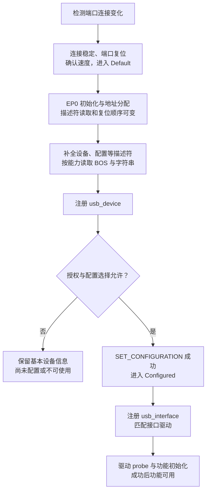

# USB 设备枚举：协议状态、Linux 路径与排障

> 枚举是主机通过 EP0 识别、寻址和配置设备的过程；描述符可读、配置成功、接口驱动可用是三个不同的检查点，不能仅凭一条插入日志判断设备已经正常工作。

## TL;DR

- **先有连接与端口初始化，才有 EP0 请求**；USB 2.0 的主要状态是 `Powered → Default → Address → Configured`。
- **描述符读取与设地址的先后不是固定模板**：Linux 有不同初始化方案，并会因重试和 quirk 插入额外复位或请求。
- **配置是一棵描述符树**：主机读取配置、接口、alternate setting、端点及类描述符，再选择一个配置；EP0 不靠配置中的端点描述符创建。
- **Linux 通常按接口匹配功能驱动**：`lsusb` 能列出设备，不代表 `SET_CONFIGURATION`、驱动 `probe()` 或后续功能初始化都成功。

范围：以 **Linux 6.18.62 LTS 主机侧**为实现参照。主流程按 USB 2.0 描述；USB 3.x 保留设备识别、配置和接口绑定等概念，但链路训练、复位及包级机制不同。

## 从接入到功能可用



图中省略失败重试分支；任一控制请求、资源分配或配置步骤都可能失败。**Default 使用地址 0，Address 使用分配的非零地址；Configured 表示配置生效，不表示功能驱动必然就绪。**

USB 2.0 Low-Speed 通过 D− 上拉表明连接；Full-Speed 设备通过 D+ 上拉，High-Speed 设备也先以相应的 USB 2.0 连接方式出现，再在复位期间通过 chirp 握手确认高速。USB 3.x SuperSpeed 使用独立的高速信号对与链路训练，不能用 D+/D− 的枚举细节解释整条 SuperSpeed 路径。

`bcdUSB` 是协议版本声明，不等于当前链路速率；实际速度以主机日志、`lsusb -t` 等信息为准。

## EP0 上的关键标准请求

以下是常见请求的含义，**不是规定每次都按表格顺序发送**。控制传输的 Setup / Data / Status 阶段及方向见 [[USB Control Transfer]]。

| 请求 | 关键字段 | 作用 |
| --- | --- | --- |
| `GET_DESCRIPTOR(Device)`，`bRequest=0x06` | `wValue=0x0100` | 获取设备描述符，包含 EP0 最大包长、VID/PID、配置数量等 |
| `SET_ADDRESS`，`bRequest=0x05` | `wValue=新地址`，`wLength=0` | 将设备从默认地址移到主机分配的地址 |
| `GET_DESCRIPTOR(Configuration)` | `wValue=(0x02 << 8) \| index` | 按配置描述符索引读取配置树 |
| `GET_DESCRIPTOR(String)` | `wValue=(0x03 << 8) \| index` | 读取字符串；索引 0 返回 LANGID 列表，其他索引配合 `wIndex` 中的 LANGID |
| `GET_DESCRIPTOR(BOS)` | `wValue=0x0f00` | 获取设备能力集合；Linux 对相应协议版本的设备尝试读取 |
| `SET_CONFIGURATION`，`bRequest=0x09` | `wValue=bConfigurationValue`，`wLength=0` | 激活选定配置；协议中的值 0 表示取消配置 |

`SET_ADDRESS` 是无数据阶段的控制请求：**状态阶段仍在旧地址完成，然后设备使用新地址**。固件若在 Setup 阶段立刻切换地址，可能导致主机收不到该请求的状态响应。

读取配置使用的 **descriptor index** 与激活配置使用的 **`bConfigurationValue`** 不是同一个概念：不能因为读取了索引 0，就发送 `SET_CONFIGURATION(0)` 试图选择第一个配置。

### 长度与 EP0 最大包长

- **设备描述符固定为 18 字节**。主机可能先请求 8 字节或请求最多 64 字节，以取得前 8 字节中的 `bMaxPacketSize0`；请求长度不是要求设备凭空补齐的描述符长度。
- **配置描述符头为 9 字节**。Linux 通常先读头部，再按 `wTotalLength` 读取完整配置树；quirk 可能改变第一次读取长度，已读完整时也可能省略第二次请求。
- **`wTotalLength` 包含一个配置的全部相关描述符**，包括接口、各 alternate setting、端点及类相关描述符；不是只有配置头，也不是所有配置长度之和。
- `iManufacturer`、`iProduct`、`iSerialNumber` 等字符串引用字段为 0 表示未提供该字符串；这与请求索引 0 的 String 描述符以取得 LANGID 列表不同。未提供可选字符串不应直接判成整个枚举失败，BOS 也不能被当作所有旧 USB 设备必有的描述符。

| 速度 | EP0 最大包长的规范值 |
| --- | --- |
| Low-Speed | 8 字节 |
| Full-Speed | 8、16、32 或 64 字节 |
| High-Speed | 64 字节 |
| SuperSpeed 及以上 | 512 字节；设备描述符中的 `bMaxPacketSize0=9` 编码为 `2^9` |

最大包长限制的是单个数据包，不是整个控制传输的总长度。固件需要正确处理分包和短包结束；主机请求 64 字节、设备实际返回完整的 18 字节设备描述符，本身并不是长度错误。

## Linux 为什么会出现不同的枚举顺序

Linux 6.18.62 的 `hub_port_init()` 保留两种初始化方案。下面省略重试、辅助请求和控制器准备步骤，仅表示 USB 2.0 的主要差异：

| 方案 | 主要顺序 |
| --- | --- |
| New scheme | 复位 → 地址 0 上请求最多 64 字节设备描述符 → 再次复位 → 设地址 → 读取完整设备描述符 |
| Old scheme | 复位 → 设地址 → 请求设备描述符前 8 字节 → 读取完整设备描述符 |

`old_scheme_first`、`use_both_schemes`、端口 quirk 和重试次数参与方案选择；**SuperSpeed 设备在该版本中不使用 new scheme**。因此重复的复位、描述符读取或地址尝试，不一定是主机实现错误。

这些是主机兼容策略。设备固件应实现符合协议的 EP0 状态机，处理合法的部分读取、重复请求和复位，不能只针对一次抓包中的固定顺序工作。

## Linux 源码路径与驱动绑定

Hub 的状态变化最终交给工作队列中的 `hub_event()` 处理，经 `port_event()`、`hub_port_connect_change()` / `hub_port_connect()` 进入设备初始化；不是在端口中断上下文中同步做完整个枚举。

| 位置 / 入口 | 本阶段负责什么 |
| --- | --- |
| `hub.c`：`hub_port_init()` | 复位、EP0 包长处理、地址分配和设备描述符读取，并尝试适用的 BOS 请求 |
| `hub.c`：`hub_set_address()` | 普通控制请求或 HCD 的 `address_device` 回调，成功后更新 Address 状态 |
| `hub.c`：`usb_new_device()` → `usb_enumerate_device()` | 读取配置和字符串等描述符，再注册 `usb_device` |
| `generic.c`：`usb_generic_driver_probe()` | 在授权等条件满足时，选择配置并调用 `usb_set_configuration()` |
| `message.c`：`usb_set_configuration()` | 发送设置配置请求，成功后设置 Configured 状态，并注册接口设备 |
| `driver.c`：`usb_probe_interface()` | 按 ID 表等规则匹配接口，调用功能驱动的 `probe()` |

这是常见通用设备驱动路径，省略驱动核心回调和特殊设备驱动。Linux 不保证一律选择第一个配置，电源预算、设备类型和策略等也参与选择。

**xHCI 的地址阶段有独立控制器路径**：`hub_set_address()` 可调用 HCD 的 `address_device`，xHCI 通过 Address Device 命令让控制器完成相关操作；它不必表现为 usbcore 提交的普通 `SET_ADDRESS` URB。usbmon 中没有看到这条 URB，不能据此认定线上没有地址分配过程。

普通 USB 功能驱动通常绑定 **`usb_interface`**，匹配可依据 VID/PID、接口 class/subclass/protocol 等。复合设备可以由多个接口驱动提供不同功能，驱动也可能进一步 claim 关联接口。

sysfs 中 `1-2` 表示总线 1 的端口路径 2；`1-2:1.0` 表示该设备配置值 1 下的接口 0，**不是 USB 地址 2、端点 0**。重新枚举时 Bus/Device 编号可能变化，应结合端口路径、VID/PID、序列号和实际拓扑识别设备。

## 按失败阶段排查

在独立终端监视插拔日志：

```sh
sudo dmesg -w
```

查看拓扑和目标设备描述符；下例 `001:004` 应替换为当前 Bus/Device 编号：

```sh
lsusb -t
sudo lsusb -v -s 001:004
```

| 观察结果 | 优先检查 |
| --- | --- |
| 完全没有连接事件，或端口反复断连 | VBUS、电缆、连接器、PHY、角色选择、Hub 和端口供电 |
| `device descriptor read/64`、`read/8` 或 `read/all` 失败 | EP0 响应、最大包长、描述符数据、复位后的固件状态与信号完整性 |
| `device not accepting address` | 地址请求的状态阶段、固件何时切地址、控制器地址命令及电气问题 |
| `can't read configurations`、配置解析错误 | `wTotalLength`、各 `bLength`、描述符排列与接口/端点定义 |
| 设备可见但 `can't set config` 或没有活动配置 | 授权状态、配置值、电源预算、配置请求响应和端点资源 |
| 配置有效但没有功能，或接口 `probe()` 失败 | 接口匹配、驱动是否启用、alternate setting、固件加载和功能初始化 |

常见错误码只能缩小范围，不能单独证明根因：

| 错误码 | 常见含义与边界 |
| --- | --- |
| `-71` / `-EPROTO` | 协议或总线事务异常；控制器未必能区分无响应、断连或具体协议错误 |
| `-110` / `-ETIMEDOUT` | 同步请求在超时前未完成；同时检查设备固件、供电、信号和控制器状态 |
| `-32` / `-EPIPE` | 完成阶段常表示 STALL；可选请求不受支持与关键枚举请求失败的影响不同，提交阶段还可能表示 pipe 类型错误 |
| `-19` / `-ENODEV` | 设备/总线不存在、已移除或路径判定设备不可用，应结合相邻日志分析 |

### 抓取实际请求顺序

启用 `CONFIG_USB_MON` 的系统可使用 usbmon。若它编译为模块，先加载模块，再让支持 usbmon 的 Wireshark/tshark 选择目标总线：

```sh
sudo modprobe usbmon
sudo tshark -D
sudo tshark -i usbmon1 -w usb-enum.pcapng
```

示例接口 `usbmon1` 应按目标总线和 `tshark -D` 的结果替换。**插入设备前开始采集**，完成后用 Ctrl-C 停止；重试可能改变设备编号，不要一开始就只过滤旧地址。分析 Setup 字段、完成状态、实际返回长度以及重试边界。

`lsusb -v` 本身也可能发出控制请求，应与最初插入时的枚举流量区分。usbmon 记录的是软件向 HCD 提交的请求及完成情况，不能精确替代总线分析仪；复位电平、chirp、物理链路训练和所有控制器自主事务，需要结合控制器跟踪或硬件测量。

## 源码与参考资料

- Linux 6.18.62 [`hub.c`](https://github.com/gregkh/linux/blob/v6.18.62/drivers/usb/core/hub.c)：Hub 事件、端口初始化、地址与设备发现。
- [`config.c`](https://github.com/gregkh/linux/blob/v6.18.62/drivers/usb/core/config.c)、[`generic.c`](https://github.com/gregkh/linux/blob/v6.18.62/drivers/usb/core/generic.c)、[`message.c`](https://github.com/gregkh/linux/blob/v6.18.62/drivers/usb/core/message.c)、[`driver.c`](https://github.com/gregkh/linux/blob/v6.18.62/drivers/usb/core/driver.c)：描述符解析、配置选择和接口绑定。
- [`xhci.c`](https://github.com/gregkh/linux/blob/v6.18.62/drivers/usb/host/xhci.c)、[`ch9.h`](https://github.com/gregkh/linux/blob/v6.18.62/include/uapi/linux/usb/ch9.h)：控制器地址路径与标准请求/描述符定义。
- [usbmon](https://github.com/gregkh/linux/blob/v6.18.62/Documentation/usb/usbmon.rst)、[USB 错误码](https://github.com/gregkh/linux/blob/v6.18.62/Documentation/driver-api/usb/error-codes.rst)、[USB 授权](https://github.com/gregkh/linux/blob/v6.18.62/Documentation/usb/authorization.rst)。
