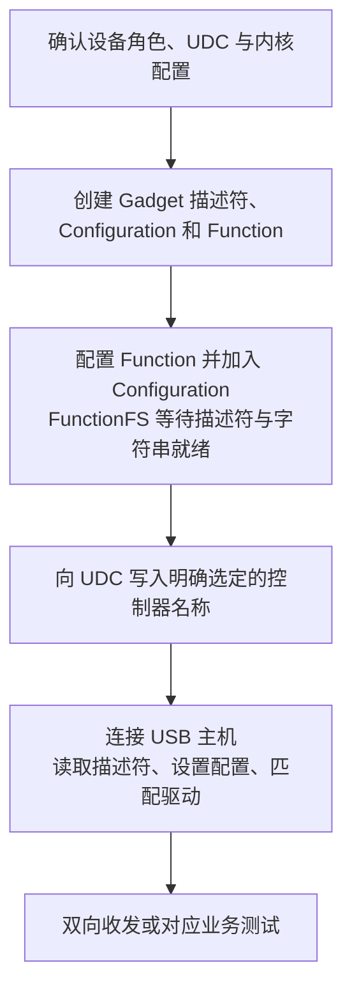

# 通过 Configfs 配置 USB Gadget

> Configfs 用目录和符号链接组合 USB Gadget：先创建描述符、配置与 function，最后绑定 UDC；主机完成枚举和实际收发，才能确认功能可用。

## TL;DR

- **先确认设备角色和 UDC**：`/sys/class/udc` 中必须存在目标控制器；configfs 不能把仅支持 Host 的端口变成设备端口。
- **Function 提供接口、端点和协议实现**，configfs 负责组合；改类代码或创建任意目录不会自动实现 vendor 协议。
- **绑定 `UDC` 是发布配置的最后一步**；FunctionFS 还需用户程序先写入描述符、字符串并保持服务运行。
- **UDC 已绑定、主机已配置、业务可用是不同检查点**；两端都要验证。
- **修改与销毁先解绑**，再删除链接及对象；configfs 属性由内核管理，清理使用 `rm` 删除链接、`rmdir` 删除对象。

范围：以 **Linux 6.18.62 LTS** 的上游 configfs ABI 为参照。示例在设备端创建 USB 2.0 CDC ACM 串口；厂商 BSP 的角色控制、服务和 function 属性可能不同。

导航：[[#对象关系与生效时机]] · [[#前置检查]] · [[#最小示例：CDC ACM 串口]] · [[#验证与故障定位]] · [[#组合其他 Function]] · [[#FunctionFS 与自定义协议]] · [[#修改、解绑与清理]]

## 对象关系与生效时机

```text
/sys/kernel/config/usb_gadget/acm_demo/
├── idVendor、idProduct、bcdUSB、UDC 等属性
├── strings/0x409/                 设备字符串，0x409 为英语 LANGID
├── functions/
│   └── acm.usb0/                  ACM function 实例
└── configs/
    └── c.1/                      配置值 1
        ├── strings/0x409/        配置字符串
        ├── bmAttributes、MaxPower
        └── acm.usb0 -> ../../functions/acm.usb0
```

`functions/<类型>.<实例>` 中，`acm` 是内核注册的类型，`usb0` 是实例名，不是网络接口名。Function 不一定只对应一个 USB 接口：ACM 包含控制、数据两个接口，以及通知 IN、Bulk IN、Bulk OUT 端点。

将 function 链接到 `configs/c.1/` 才将其纳入该配置。**多个 function 链接到同一个 configuration，主机才可在这一个活动配置中同时使用它们**；创建多个 configuration 供主机选择，不代表它们会同时活动。



## 前置检查

1. **硬件与角色**：端口实际连接到支持 peripheral / OTG 的控制器，当前为 device 角色，线缆可传输数据。固定 `dr_mode="host"`、Type-C 策略、PHY 或 VBUS 检测问题需要在平台层解决；不要在配置脚本里盲目切换角色。
2. **内核功能**：需 `CONFIG_USB_GADGET`、平台 UDC 驱动、`CONFIG_USB_CONFIGFS`，以及选用的 `CONFIG_USB_CONFIGFS_ACM` 等选项。`USB_CONFIGFS` 选择 `USB_LIBCOMPOSITE`，后者选择 `CONFIGFS_FS`；串口还依赖 TTY 支持。
3. **控制器归属**：同一 UDC 通常只能绑定一个 gadget driver。先查明 `g_serial`、`g_ether`、`g_mass_storage` 或系统 gadget 服务是否已占用；不要同时让 legacy gadget 和 configfs 管理同一 UDC。

在**设备端**查看：

```sh
ls -l /sys/class/udc
findmnt -t configfs
ls /sys/kernel/config/usb_gadget
```

尚未加载或挂载时，最后两项可能没有结果。`/sys/class/udc` 为空则应先查控制器驱动、设备树和角色，加载 `libcomposite` 本身不会创建硬件 UDC。

## 最小示例：CDC ACM 串口

将以下内容保存为 `create-gadget-acm.sh`。以 root 执行，并通过环境变量提供 `USB_VID`、`USB_PID`、`USB_SERIAL`、`UDC_NAME`；VID/PID 使用 `0x` 前缀的实际值，UDC 名称从设备端列表明确选择。VID/PID 必须有权使用，序列号应稳定且能区分设备。

示例假设 USB 总线供电、配置后最大取电 **100 mA**，实际产品需按供电设计调整。若改为自供电，应相应设置 `bmAttributes` 和从 VBUS 获取的电流声明。

```bash
#!/usr/bin/env bash
set -euo pipefail

if (( EUID != 0 )); then
    printf '请以 root 运行此脚本\n' >&2
    exit 1
fi
: "${USB_VID:?设置有权使用的 USB VID}"
: "${USB_PID:?设置有权使用的 USB PID}"
: "${USB_SERIAL:?设置设备的稳定序列号}"
: "${UDC_NAME:?从 /sys/class/udc 中指定控制器名称}"

if [[ ! -e "/sys/class/udc/$UDC_NAME" ]]; then
    printf '找不到 UDC：%s\n' "$UDC_NAME" >&2
    exit 1
fi

modprobe libcomposite
if ! mountpoint -q /sys/kernel/config; then
    mount -t configfs none /sys/kernel/config
fi
if [[ ! -d /sys/kernel/config/usb_gadget ]]; then
    printf 'usb_gadget 不存在，请检查 configfs 挂载和内核配置\n' >&2
    exit 1
fi

G=/sys/kernel/config/usb_gadget/acm_demo
mkdir "$G"                       # 已存在则停止，避免覆盖其他配置
cd "$G"
printf '%s\n' "$USB_VID" > idVendor
printf '%s\n' "$USB_PID" > idProduct
printf '0x0100\n' > bcdDevice
printf '0x0200\n' > bcdUSB
printf 'high-speed\n' > max_speed
printf '0xef\n' > bDeviceClass
printf '0x02\n' > bDeviceSubClass
printf '0x01\n' > bDeviceProtocol

mkdir strings/0x409
printf '%s\n' "$USB_SERIAL" > strings/0x409/serialnumber
printf 'Example Manufacturer\n' > strings/0x409/manufacturer
printf 'Configfs ACM Demo\n' > strings/0x409/product

mkdir configs/c.1
mkdir configs/c.1/strings/0x409
printf 'CDC ACM\n' > configs/c.1/strings/0x409/configuration
printf '0x80\n' > configs/c.1/bmAttributes
printf '100\n' > configs/c.1/MaxPower

mkdir functions/acm.usb0
ln -s "$G/functions/acm.usb0" "$G/configs/c.1/acm.usb0"
printf '%s\n' "$UDC_NAME" > UDC
```

脚本可通过 `sudo env USB_VID="$USB_VID" USB_PID="$USB_PID" USB_SERIAL="$USB_SERIAL" UDC_NAME="$UDC_NAME" bash ./create-gadget-acm.sh` 执行；调用前先在当前 shell 定义这些变量。内建功能且没有相应模块文件的系统，可省去 `modprobe`；模块化系统需安装匹配当前内核的模块。

关键字段与行为：

| 设置 | 含义与边界 |
| --- | --- |
| `bcdDevice=0x0100` | 设备发布版本 1.00，不是 USB 速度 |
| `bcdUSB=0x0200` | USB 协议版本声明；不单独限制实际速度 |
| `max_speed=high-speed` | 将本示例的速度上限限制为 HS，实际可因控制器或连接条件运行于 FS；ACM 所需 Bulk 不适用于 LS |
| `EF / 02 / 01` | 此示例的设备级 IAD 复合设备标识；ACM 自己生成接口及 IAD 描述符，不是任意 gadget 的通用模板 |
| `bmAttributes=0x80` | 总线供电，未声明远程唤醒；必须按真实供电与能力填写 |
| `MaxPower=100` | configfs 的单位为 **mA**；内核编码成 USB 2.0 描述符的 `bMaxPower=50`，不是让用户自己先除以 2 |
| `mkdir functions/acm.usb0` | 实例化 ACM；可通过 `request_module()` 自动请求对应模块 `usb_f_acm` |
| 写入 `UDC` | 注册并绑定 gadget driver，使主机有机会枚举；不代表主机已完成配置 |

`MaxPower` 是配置描述符中的功耗声明，不是 Type-C / USB PD 协商，也不会替硬件实现限流。不要直接复用 Linux Foundation 的 VID 作为自己的产品标识。

## 验证与故障定位

在设备端，以实际绑定的控制器名称检查：

```sh
G=/sys/kernel/config/usb_gadget/acm_demo
cat "$G/UDC"
cat "$G/functions/acm.usb0/port_num"
cat "/sys/class/udc/$UDC_NAME/state"
cat "/sys/class/udc/$UDC_NAME/current_speed"
```

`port_num` 决定本机 `/dev/ttyGS<n>` 的编号，不能仅凭实例名 `usb0` 认定一定是 `ttyGS0`。创建该字符设备也不意味着主机已经连接；`state` 与 `current_speed` 用于结合主机状态判断。

在**另一台 Linux USB 主机**上执行：

```sh
sudo dmesg -w
```

另开终端查看 `lsusb -t`，再以 `lsusb -v -s BUS:DEV` 检查新设备的实际描述符。ACM 通常由主机 `cdc_acm` 驱动绑定并出现 `/dev/ttyACM<n>`，应按新日志或 `/dev/serial/by-id/` 确认设备，不硬编码主机编号。

验证至少包含三个检查点：

| 检查点 | 成功判据 |
| --- | --- |
| 设备侧绑定 | `UDC` 内容为选定控制器，无相关绑定错误 |
| 主机配置 | 普通枚举流程后设备端 UDC `state` 为 `configured`，主机接口驱动绑定成功 |
| 功能收发 | 两端打开对应串口，用 raw / 关闭回显的设置双向发送已知内容并核对结果；ACM 应用还需考虑主机 DTR 状态 |

如果要提供登录终端，在确认串口编号后启动对应 getty，见 [[g_serial - systemd getty@ttyGS0]]。使用 configfs 时复用已建的 ACM function，不再加载 `g_serial`。

| 现象 | 优先检查 |
| --- | --- |
| `/sys/class/udc` 为空 | peripheral 驱动、PHY、设备树 `dr_mode`、Type-C / role-switch 策略 |
| `usb_gadget` 目录不存在 | configfs 是否正确挂载、`CONFIG_USB_CONFIGFS` 与 `libcomposite` |
| 创建 function 失败 | 类型拼写、对应 `CONFIG_USB_CONFIGFS_*`、模块是否存在及 `dmesg` 错误；实例名不能代替类型实现 |
| 写 `UDC` 失败 / busy | 其他 gadget driver 或系统服务占用、重复绑定、控制器名称错误 |
| 绑定时找不到端点或资源不足 | 组合功能所需端点的数量、方向、传输类型及 UDC 能力；“模块可加载”不等于组合一定能绑定 |
| 已绑定但主机无连接或枚举失败 | 实际设备端口、数据线、VBUS / 角色、描述符与设备日志；不能仅凭本机树结构判断成功 |
| 已配置但应用无数据 | 主机驱动、实际设备节点、TTY 设置 / DTR、占用该端口的程序、协议及缓冲区 |

## 组合其他 Function

新增 function 时先解绑，配置其属性并创建到目标 configuration 的链接，再重新绑定并让主机重新枚举。更换组合后检查实际端点和接口布局，接口编号可能变化。

| 实例示例 | 内核配置 | 还需要做什么 |
| --- | --- | --- |
| `acm.usb0` | `CONFIG_USB_CONFIGFS_ACM` | 串口应用或 getty；多个 ACM 要创建不同实例并确认端点资源 |
| `ncm.usb0` / `ecm.usb0` | `CONFIG_USB_CONFIGFS_NCM` / `ECM` | 两端网络驱动、MAC 与 IP / 路由配置；创建网卡不等于已配置网络 |
| `mass_storage.0` | `CONFIG_USB_CONFIGFS_MASS_STORAGE` | 配置 LUN backing file / block device；主机访问期间不能让设备端同时挂载同一可写文件系统 |
| `hid.usb0` | `CONFIG_USB_CONFIGFS_F_HID` | 有效的 Report Descriptor、报告长度及应用；只改类代码不能生成键鼠功能 |
| `ffs.vendor` | `CONFIG_USB_CONFIGFS_F_FS` | FunctionFS 用户程序提供描述符、控制请求处理和端点 I/O |

这些类型只在目标内核启用对应实现时有效。主机兼容性由功能描述符与驱动决定；Windows 的网络类、OS 描述符和驱动策略需要单独验证，不能认为任意组合都会自动绑定。

## FunctionFS 与自定义协议

FunctionFS 是用户空间实现 USB function 的接口；configfs 中的 `ffs.vendor` 只创建实例，**不会自动生成 vendor 接口、Bulk 端点或业务协议**。

推荐顺序：

1. 创建 `functions/ffs.vendor`；以实例名 `vendor` 挂载 FunctionFS，例如 `mount -t functionfs vendor /dev/ffs-vendor`，挂载点需预先创建。
2. 启动用户程序，打开该挂载点的 `ep0`，写入 FunctionFS 格式的描述符和字符串；为要支持的速度提供适用描述符。
3. 确认 `functions/ffs.vendor/ready` 为 `1`，将 function 纳入 configuration，最后绑定 UDC。程序继续处理 `ep0` 事件、适用的 Setup 请求和 `ep*` 数据 I/O。
4. 退出时先协调主机 I/O、解绑，再停止进程、关闭文件、卸载 FunctionFS，并删除链接和实例；进程提前关闭文件可能使 function 失效并造成断连。

FunctionFS 的端点文件名是逻辑映射，例如 `ep1` 不保证最终就是 USB 地址中的 EP1；接口、端点及字符串编号可由框架重映射。写 `bDeviceClass=0xff` 只影响设备级类声明，`bInterfaceClass` 需要由实际 function 描述符提供，二者都不能代替协议实现。

## 修改、解绑与清理

任何重配都按“停止业务 I/O → 解绑 → 修改 → 重新绑定 → 主机重新验证”处理。解绑会让主机看到断开，应用需要重新打开设备；不要依赖内核在删除链接时隐式解绑。

下面仅清理**上面完整创建的 `acm_demo`**，以 root Bash 执行；若创建中途失败，先查看实际存在的对象，按同一依赖顺序清理已创建的部分：

```bash
#!/usr/bin/env bash
set -euo pipefail

G=/sys/kernel/config/usb_gadget/acm_demo
cd "$G"
if [[ -n "$(< UDC)" ]]; then
    printf '\n' > UDC
fi
rm configs/c.1/acm.usb0
rmdir configs/c.1/strings/0x409
rmdir configs/c.1
rmdir functions/acm.usb0
rmdir strings/0x409
cd /
rmdir "$G"
```

解绑要**实际写入一个换行**，让内核收到去掉换行后的空字符串；`: > UDC` 或 `printf '' > UDC` 的零字节写入不能替代解绑操作。已解绑时再写空值在该版本可能返回 `ENODEV`，所以示例先读出当前绑定状态。

不要删除内核自动生成的属性文件或默认子目录，也不要对 configfs 使用 `rm -rf`；对象内即使显示属性文件，也应通过 `rmdir` 销毁。存在额外语言、配置、链接或 function 时，需要先清掉对应依赖。清理 gadget 不要求卸载所有模块或卸载共享 configfs。

Configfs 树不随重启持久化。开机恢复应由单一服务负责创建和销毁；FunctionFS 用实际 `ready` 与进程生命周期建立依赖，避免只靠固定延时启动。服务停止路径也要执行相应解绑和清理。

## 相关笔记与参考资料

- [[USB 2.0 设备的枚举过程]]、[[USB 2.0 设备的传输过程]]：主机如何识别配置、端点与传输。
- [[g_serial - systemd getty@ttyGS0]]：串口登录及与内核 console 的区别。
- Linux 6.18.62 [Gadget Configfs](https://github.com/gregkh/linux/blob/v6.18.62/Documentation/usb/gadget_configfs.rst)、[FunctionFS](https://github.com/gregkh/linux/blob/v6.18.62/Documentation/usb/functionfs.rst)、[FunctionFS 描述符](https://github.com/gregkh/linux/blob/v6.18.62/Documentation/usb/functionfs-desc.rst)：对象关系、绑定和用户空间 function。
- [`configfs.c`](https://github.com/gregkh/linux/blob/v6.18.62/drivers/usb/gadget/configfs.c)、[`composite.c`](https://github.com/gregkh/linux/blob/v6.18.62/drivers/usb/gadget/composite.c)：UDC / `max_speed` 属性与 `MaxPower` 编码。
- [`Kconfig`](https://github.com/gregkh/linux/blob/v6.18.62/drivers/usb/gadget/Kconfig)、[`f_acm.c`](https://github.com/gregkh/linux/blob/v6.18.62/drivers/usb/gadget/function/f_acm.c)：配置依赖、ACM 描述符与 `port_num`。
- [ACM ABI](https://github.com/gregkh/linux/blob/v6.18.62/Documentation/ABI/testing/configfs-usb-gadget-acm)、[FunctionFS ABI](https://github.com/gregkh/linux/blob/v6.18.62/Documentation/ABI/testing/configfs-usb-gadget-ffs)：属性的准确语义；[在线 Configfs 文档](https://docs.kernel.org/usb/gadget_configfs.html) 便于浏览，版本差异以固定源码为准。
