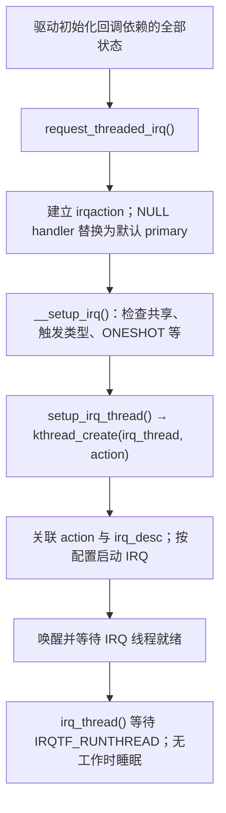
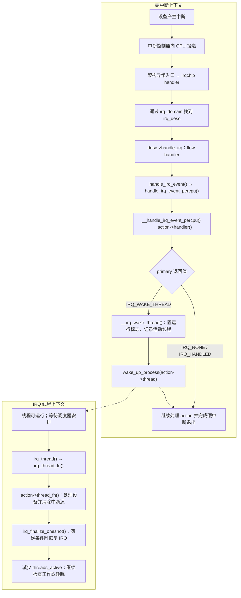

# Linux 线程化中断：threaded IRQ 的实现与用法

> threaded IRQ 把设备处理分成不可睡眠的 primary handler 和可睡眠的 `thread_fn`；硬中断返回 `IRQ_WAKE_THREAD` 后，内核唤醒预先创建的 IRQ 线程，由调度器安排执行。

## TL;DR

- 使用 `request_threaded_irq()` 或 `devm_request_threaded_irq()` 注册；慢速 I²C/SPI 访问、mutex 等放进 `thread_fn`。
- 独占 IRQ 常用 `handler = NULL` 加 `IRQF_ONESHOT`；仍有默认硬中断 handler，负责返回 `IRQ_WAKE_THREAD`。
- `IRQF_ONESHOT` 让 IRQ 在线程处理完成前保持屏蔽；驱动仍须按硬件协议消除设备中断源。
- 线程唤醒可能合并，不能把回调次数当作硬件事件数；按状态寄存器、FIFO 或硬件计数器处理实际工作。

**适用范围：Linux 6.18 LTS，源码核对版本为 6.18.62。** 主路径采用非 PREEMPT_RT、未开启 `threadirqs` 的普通设备 IRQ；ARM64/GICv3 用于解释架构入口，嵌套 IRQ 另有边界。

导航：[接口](#接口与执行上下文) · [实现](#注册与线程实现) · [触发路径](#中断触发后的路径) · [ONESHOT](#irqf_oneshot-如何收尾) · [示例](#接口用法示例) · [排查](#验证与排查)

## 接口与执行上下文

```c
int request_threaded_irq(unsigned int irq,
                         irq_handler_t handler,
                         irq_handler_t thread_fn,
                         unsigned long flags,
                         const char *name, void *dev_id);
```

`irq` 是 Linux IRQ 号，通常来自 `platform_get_irq()`、`client->irq` 或 PCI IRQ 分配接口，不能直接填设备树中断描述里的裸硬件号。`dev_id` 是传给两个回调的私有状态指针；共享 IRQ 必须使用非空且能区分各注册者的值。注册成功返回 `0`，失败返回负错误码。[^manage][^irqdesc]

| 项目 | primary：`handler` | 线程回调：`thread_fn` |
| --- | --- | --- |
| 上下文 | 硬中断上下文，必须短小、不可睡眠 | IRQ 内核线程上下文，可被调度、可睡眠 |
| 适合操作 | 安全的 MMIO 状态检查、归属判断、必要的设备侧屏蔽 | 同步 I²C/SPI 访问、mutex、较长的设备处理 |
| 不能做的事 | mutex、睡眠式总线访问、等待线程完成 | 持有自旋锁或关闭中断时睡眠；无界忙循环 |
| 常见返回值 | `IRQ_NONE`、`IRQ_HANDLED`、`IRQ_WAKE_THREAD` | 通常为 `IRQ_HANDLED` |

primary 返回 `IRQ_NONE` 表示不属于本设备；返回 `IRQ_HANDLED` 表示已处理，不会因此唤醒线程；返回 `IRQ_WAKE_THREAD` 才请求执行已注册的 `thread_fn`。普通显式线程回调不要用 `IRQ_WAKE_THREAD` 表达“再执行一次”：内核对线程返回该值的处理用于强制线程化的 secondary action，不能替代设备状态循环。[^handle][^manage]

| 标志或形式 | 用法与边界 |
| --- | --- |
| `IRQF_ONESHOT` | 在线程处理期间保持该 IRQ 屏蔽；不表示“一生只触发一次” |
| `handler = NULL` | 安装 `irq_default_primary_handler()`，其返回值为 `IRQ_WAKE_THREAD`；一般必须配 `IRQF_ONESHOT`，`IRQCHIP_ONESHOT_SAFE` 控制器例外 |
| `IRQF_SHARED` | 接线及各注册者必须允许共享，触发类型和 ONESHOT 配置须兼容；有 `IRQF_COND_ONESHOT` 协商规则 |
| `IRQF_TRIGGER_*` | 描述实际边沿、电平及极性；通常沿用固件/设备树配置，不能用改标志掩盖接线错误 |
| `IRQF_NO_AUTOEN` | 注册后不自动启用，初始化完成再 `enable_irq()`；不能与 `IRQF_SHARED` 组合 |
| `devm_request_threaded_irq()` | 多一个首参数 `struct device *dev`，在驱动解绑时自动释放 IRQ；设备停机和资源顺序仍由驱动保证 |

以上检查在注册阶段完成。共享 IRQ 的 primary 应在硬中断中安全判断归属，非本设备返回 `IRQ_NONE`；默认 primary 不做归属判断，不宜作为共享设备的通用模板。[^manage][^devres]

## 注册与线程实现

`irq_desc` 描述一条 Linux IRQ，包括 irqchip、flow handler、action 链表和线程同步状态；每次驱动注册建立一个 `irqaction`，保存 `handler`、`thread_fn`、`dev_id` 与 `thread`。共享一条 IRQ 的多个 action 可以各自拥有线程，通常并非“一条 IRQ 永远只有一个线程”。[^manage][^interrupt]



图中概括成功注册路径；实际校验分布在创建线程前后，失败会回收已创建的资源。**线程在注册阶段创建并反复复用**，通常名为 `irq/<IRQ号>-<name>`；不是触发一次就创建一次。注册期间 handler 就可能运行，不能在注册成功后才初始化它要访问的状态。[^manage]

`irq_thread()` 设置 FIFO 调度策略，并在循环中通过 `irq_wait_for_interrupt()` 等待工作。收到运行标志后，普通显式线程化路径执行 `irq_thread_fn()` → `action->thread_fn()`；回调结束后完成 ONESHOT 收尾并减少 `threads_active`。可调度不等于立即运行，实际延迟取决于 CPU、优先级、亲和性和锁竞争。[^manage]

## 中断触发后的路径

以下画的是一次正常投递，不展开共享 action 的遍历、异常中断和控制器专用分支。虚线表示唤醒关系，**不是在 primary 的调用栈上直接调用 `thread_fn`**。[^handle][^manage]



线程可能在另一 CPU 上先于原硬中断退出运行，因此不能假设“primary 返回之后，硬中断路径的全部收尾一定已经结束”。ONESHOT 收尾会检查硬中断仍在进行等竞争条件。[^manage]

### ARM64 + GICv3 的具体入口

以 CPU 在 EL1 内核运行时收到普通 GICv3 外设 IRQ 为例，6.18.62 的主要调用链为：[^arm64][^gic][^irqdesc]

```text
异常向量 → el1h_64_irq_handler()
  → el1_interrupt() → __el1_irq() → do_interrupt_handler()
  → handle_arch_irq 指向的 gic_handle_irq()
  → __gic_handle_irq_from_irqson() → 读取 IAR → __gic_handle_irq()
  → generic_handle_domain_irq() → irq_resolve_mapping()
  → handle_irq_desc() → generic_handle_irq_desc()
  → desc->handle_irq，普通 GIC 外设 IRQ 常为 handle_fasteoi_irq()
  → handle_irq_event() → ... → primary → __irq_wake_thread()
```

用户态被打断时采用 EL0 入口；GPIO 级联控制器、其他架构和中断类型也有自己的入口及 flow handler，不能把所有 IRQ 都写成 `handle_level_irq()`。GIC 的中断确认、优先级下降和 deactivate/EOI 时机依赖工作模式；它们与设备寄存器里的清中断操作属于不同层次。[^arm64][^gic][^chip]

## IRQF_ONESHOT 如何收尾

以常见 `handle_fasteoi_irq()` 为例，它在运行 action 前对 ONESHOT IRQ 执行屏蔽；唤醒线程后，不会在 primary 返回时立即按普通 IRQ 路径恢复。线程收尾逻辑决定何时恢复。`IRQCHIP_ONESHOT_SAFE` 等控制器可采用不同实现，不能机械套用同一组 mask/EOI 寄存器操作。[^chip][^manage]

| 内部状态 | 用途 |
| --- | --- |
| `action->thread_flags` 中的 `IRQTF_RUNTHREAD` | 表示该 action 有一次待执行工作；已经置位的再次唤醒可合并 |
| `action->thread_mask`、`desc->threads_oneshot` | 用位图记录哪些 ONESHOT action 尚未完成，协调共享 IRQ 的恢复 |
| `desc->threads_active` | 记录已唤醒且尚未完成的线程工作，供 `synchronize_irq()` 等等待；不是设备事件计数 |

`__irq_wake_thread()` 置运行位、更新相关状态并唤醒线程。线程开始一轮处理前清运行位；处理期间若又置位，后续再跑一轮，但多个请求仍可能折叠。`irq_finalize_oneshot()` 检查硬中断是否仍在进行、该线程是否还有待执行工作；完成后清除对应 ONESHOT 位。只有相关位全部清空、IRQ 未被禁用且处于屏蔽状态，才恢复中断。[^handle][^manage]

这保证同一个普通 action 的 `thread_fn` 串行执行，**不保证**它与其他 action、其他 IRQ 或进程代码互斥。需要跨路径保护的数据仍应使用与实际执行上下文匹配的锁。[^manage]

设备侧必须按手册完成“读状态、取数据、清原因或解除电平”的协议。ONESHOT 不会自动清设备状态；若电平中断源在线程返回后仍有效，恢复 IRQ 后可马上再次触发。屏蔽期间的新事件是否保留、边沿是否丢失、FIFO 是否溢出，取决于设备和 irqchip，不能靠 ONESHOT 承诺不丢事件。[^chip]

## 接口用法示例

以下是驱动集成片段，省略资源映射、总线绑定和数据上报。寄存器语义是明确的示例假设，迁移时必须替换为目标设备手册中的协议。

### MMIO：primary 判断归属，线程清状态

假设 `0x00` 是可在硬中断安全读取的状态寄存器，bit 0 锁存事件，向该位写 `1` 清除（W1C），中断为电平型。示例只展示状态处理；实际设备如有 FIFO，应先按协议提取数据，不能用清状态代替消费数据。

```c
#include <linux/bitops.h>
#include <linux/device.h>
#include <linux/interrupt.h>
#include <linux/io.h>

#define DEMO_IRQ_STATUS  0x00
#define DEMO_IRQ_EVENT   BIT(0)

struct demo_mmio {
    void __iomem *base;
    int irq;
};

static irqreturn_t demo_primary(int irq, void *dev_id)
{
    struct demo_mmio *demo = dev_id;

    if (!(readl(demo->base + DEMO_IRQ_STATUS) & DEMO_IRQ_EVENT))
        return IRQ_NONE;

    return IRQ_WAKE_THREAD;
}

static irqreturn_t demo_thread(int irq, void *dev_id)
{
    struct demo_mmio *demo = dev_id;
    u32 pending = readl(demo->base + DEMO_IRQ_STATUS) & DEMO_IRQ_EVENT;

    if (pending)
        writel(pending, demo->base + DEMO_IRQ_STATUS);

    return IRQ_HANDLED;
}

static int demo_request_irq(struct device *dev, struct demo_mmio *demo)
{
    return devm_request_threaded_irq(dev, demo->irq,
                                     demo_primary, demo_thread,
                                     IRQF_ONESHOT, dev_name(dev), demo);
}
```

注册前完成 `base`、`irq` 和设备初始化，设备中断源先保持关闭，注册成功再开启。若确实共享线路，增加 `IRQF_SHARED` 并检查其他注册者配置；上面的 primary 过滤才有归属判断意义。`readl()` 本身不代表任意地址都安全，掉电状态、读清副作用和 MMIO 写入完成要求也由设备规范决定。

### I²C：默认 primary，线程执行可睡眠访问

假设设备有**独占的电平 IRQ**，SMBus `0x01` 状态寄存器成功读取后会清除已锁存原因并解除中断电平。该假设不适用于要求显式 ACK 或排空 FIFO 的器件；SPI 同步传输可采用同样的上下文划分。

```c
#include <linux/i2c.h>
#include <linux/interrupt.h>
#include <linux/mutex.h>

#define SENSOR_IRQ_STATUS  0x01

struct demo_sensor {
    struct i2c_client *client;
    struct mutex io_lock;
};

static irqreturn_t sensor_thread(int irq, void *dev_id)
{
    struct demo_sensor *sensor = dev_id;
    int status;

    mutex_lock(&sensor->io_lock);
    status = i2c_smbus_read_byte_data(sensor->client, SENSOR_IRQ_STATUS);
    mutex_unlock(&sensor->io_lock);

    if (status < 0) {
        /* 读取失败时电平可能仍有效，先停止本独占 IRQ，等待恢复。 */
        disable_irq_nosync(irq);
        dev_err_ratelimited(&sensor->client->dev,
                            "IRQ status read failed: %d\n", status);
    }

    return IRQ_HANDLED;
}

static int sensor_request_irq(struct demo_sensor *sensor)
{
    struct i2c_client *client = sensor->client;

    mutex_init(&sensor->io_lock);
    return devm_request_threaded_irq(&client->dev, client->irq,
                                     NULL, sensor_thread, IRQF_ONESHOT,
                                     dev_name(&client->dev), sensor);
}
```

调用前须确认适配器支持 `I2C_FUNC_SMBUS_BYTE_DATA`，设置 `sensor->client`，完成设备初始化，并让其他访问该设备的路径遵守同一锁规则。成功读取后的状态解码及数据上报按设备实现；错误路径停止 IRQ 后，驱动需有恢复或报错停机策略，确认总线恢复且中断源已消除后才能配对 `enable_irq()`。线程内不能用会等待自身结束的 `disable_irq()`。

上游真实案例可读 `drivers/input/touchscreen/ar1021_i2c.c`：线程内执行 `i2c_master_recv()`，注册时使用默认 primary、ONESHOT 和 `IRQF_NO_AUTOEN`，在输入设备打开时启用 IRQ。不要将它的设备协议套到其他传感器。[^ar1021]

## 生命周期与适用边界

- **注册：**先准备回调可访问的状态，再注册 IRQ，最后开启设备中断源；如需更晚启用独占 IRQ，可用 `IRQF_NO_AUTOEN`。注册失败必须传播错误，不能继续假设 IRQ 可用。
- **卸载：**先阻止本设备产生新中断，并协调停止其他设备访问，再 `free_irq(irq, dev_id)` 或 `devm_free_irq(dev, irq, dev_id)`；回调依赖的寄存器映射、供电和私有内存必须保持有效，直到释放完成。自动 devres 释放同样需要正确的顺序。
- **同步：**`synchronize_irq()` 等待硬中断与线程处理，但本身不禁止新 IRQ；要先停源或禁用。`synchronize_hardirq()` 不等待完整线程处理，不能据此销毁线程依赖资源。`disable_irq()` 会等待，`disable_irq_nosync()` 不等待。
- **锁：**等待或释放 IRQ 时不能持有其 handler/thread_fn 要获取的锁，否则会死锁。共享线路不要为停掉本设备而随意禁用整条 IRQ，应控制本设备中断源。

这些约束来自 generic IRQ 的注册、同步与释放实现；6.18.62 的释放路径还通过 `irq_stop_thread()` 等待线程及退出清理完成。[^manage][^devres]

**与其他机制的区别：**普通非 RT 情况下，`request_irq()` 的 handler 仍在硬中断上下文；tasklet/softirq 的回调不能仅因属于“下半部”就睡眠。threaded IRQ 是 IRQ 子系统管理的专用处理线程，workqueue 则通过工作项与 worker 调度，不具有相同的 ONESHOT 协调语义。参见 [tasklet](../kernel-api/Kernel%20API%20-%20tasklet.md) 和 [workqueue](../kernel-api/Kernel%20API%20-%20workqueue.md)。[^interrupt][^manage]

**PREEMPT_RT / `threadirqs`：**会强制线程化可转换的 IRQ；`IRQF_NO_THREAD`、`IRQF_PERCPU`、`IRQF_ONESHOT` 等会跳过这项转换。显式 ONESHOT 注册中自己提供的 primary 仍须不可睡眠；不要因为运行在 RT 内核就给它加 mutex。未带 ONESHOT 且同时有 primary/thread_fn 的注册，在强制线程化时还可能创建 secondary action。[^rt][^manage]

**嵌套线程 IRQ：**部分慢总线中断控制器在父 IRQ 线程中处理子 IRQ。generic IRQ 对 nested action 不创建上述独立线程，不能把普通非嵌套路径直接套给这类 GPIO 扩展器。[^manage]

## 验证与排查

```bash
# 确认 Linux IRQ、计数变化以及 IRQ 线程是否存在。
cat /proc/interrupts
ps -eLo pid,tid,cls,rtprio,psr,comm | grep 'irq/'

# 短时记录 primary 与线程调度关系；需要 trace-cmd 和相应 tracing 配置。
sudo trace-cmd record -e irq:irq_handler_entry -e irq:irq_handler_exit \
    -e sched:sched_wakeup -e sched:sched_switch sleep 5
sudo trace-cmd report
```

`irq_handler_entry/exit` 包围的是 action 的 primary，**不直接测量 `thread_fn` 耗时**。线程执行时间需结合可追踪函数的 function graph 或驱动自定义 tracepoint；`sched_wakeup/sched_switch` 用于辨认唤醒到运行之间的调度等待，已在运行/等待执行的线程不一定每次都产生新的唤醒事件。`/proc/interrupts` 也不是设备业务事件计数器。[^handle][^trace]

| 现象 | 优先检查 |
| --- | --- |
| primary 运行但线程没有工作 | 是否返回 `IRQ_WAKE_THREAD`、`thread_fn` 是否注册、运行标志是否已合并 |
| 线程返回后立刻再次触发 | 电平原因是否解除、ACK/W1C 顺序是否正确、触发极性是否一致 |
| IRQ 长期未恢复或卸载卡住 | 线程是否阻塞、是否存在等待者持锁的死锁、IRQ 是否被额外 disable |
| 事件丢失或处理延迟大 | FIFO 深度与排空策略、屏蔽时间、线程调度和亲和性、总线及锁等待 |

验收时分别证明：设备状态被消费、线程能完成、IRQ 能再次响应、错误路径可恢复或安全停机、解绑后没有回调访问已释放资源。以上示例仅说明 API 和上下文，实际设备的时序与事件完整性需要硬件验证。

相关：[spin_lock_irqsave 与执行上下文](../kernel-api/Kernel%20API%20-%20spin_lock_irqsave.md) · [ftrace](../debug/ftrace.md)

## 源码与参考

下列源码链接固定到 **v6.18.62**；定位时搜索所列函数，避免将其他版本的行号和内部调用直接套用。

[^manage]: [kernel/irq/manage.c](https://git.kernel.org/pub/scm/linux/kernel/git/stable/linux.git/tree/kernel/irq/manage.c?h=v6.18.62)：`request_threaded_irq()`、`__setup_irq()`、`setup_irq_thread()`、`irq_thread()`、`irq_finalize_oneshot()`、`irq_setup_forced_threading()`、`__free_irq()`。
[^handle]: [kernel/irq/handle.c](https://git.kernel.org/pub/scm/linux/kernel/git/stable/linux.git/tree/kernel/irq/handle.c?h=v6.18.62)：`handle_irq_event()`、`__handle_irq_event_percpu()`、`__irq_wake_thread()`。
[^chip]: [kernel/irq/chip.c](https://git.kernel.org/pub/scm/linux/kernel/git/stable/linux.git/tree/kernel/irq/chip.c?h=v6.18.62)：`handle_fasteoi_irq()`、`handle_level_irq()`、`cond_unmask_eoi_irq()`。
[^irqdesc]: [kernel/irq/irqdesc.c](https://git.kernel.org/pub/scm/linux/kernel/git/stable/linux.git/tree/kernel/irq/irqdesc.c?h=v6.18.62) 与 [include/linux/irqdesc.h](https://git.kernel.org/pub/scm/linux/kernel/git/stable/linux.git/tree/include/linux/irqdesc.h?h=v6.18.62)：domain 映射和 flow handler 分派。
[^interrupt]: [include/linux/interrupt.h](https://git.kernel.org/pub/scm/linux/kernel/git/stable/linux.git/tree/include/linux/interrupt.h?h=v6.18.62)：`irqaction`、IRQ flags 和公开接口。
[^devres]: [kernel/irq/devres.c](https://git.kernel.org/pub/scm/linux/kernel/git/stable/linux.git/tree/kernel/irq/devres.c?h=v6.18.62)：managed IRQ 的注册与释放。
[^arm64]: [arch/arm64/kernel/entry-common.c](https://git.kernel.org/pub/scm/linux/kernel/git/stable/linux.git/tree/arch/arm64/kernel/entry-common.c?h=v6.18.62) 与 [entry.S](https://git.kernel.org/pub/scm/linux/kernel/git/stable/linux.git/tree/arch/arm64/kernel/entry.S?h=v6.18.62)：ARM64 IRQ 异常入口。
[^gic]: [drivers/irqchip/irq-gic-v3.c](https://git.kernel.org/pub/scm/linux/kernel/git/stable/linux.git/tree/drivers/irqchip/irq-gic-v3.c?h=v6.18.62)：`gic_handle_irq()`、domain 分派及 GIC flow handler 设置。
[^rt]: [PREEMPT_RT execution context differences](https://git.kernel.org/pub/scm/linux/kernel/git/stable/linux.git/tree/Documentation/core-api/real-time/differences.rst?h=v6.18.62)：显式与强制线程化的执行上下文。
[^ar1021]: [drivers/input/touchscreen/ar1021_i2c.c](https://git.kernel.org/pub/scm/linux/kernel/git/stable/linux.git/tree/drivers/input/touchscreen/ar1021_i2c.c?h=v6.18.62)：可睡眠 I²C IRQ 线程的实际驱动。
[^trace]: [include/trace/events/irq.h](https://git.kernel.org/pub/scm/linux/kernel/git/stable/linux.git/tree/include/trace/events/irq.h?h=v6.18.62)：IRQ action handler tracepoint 的定义与测量范围。
