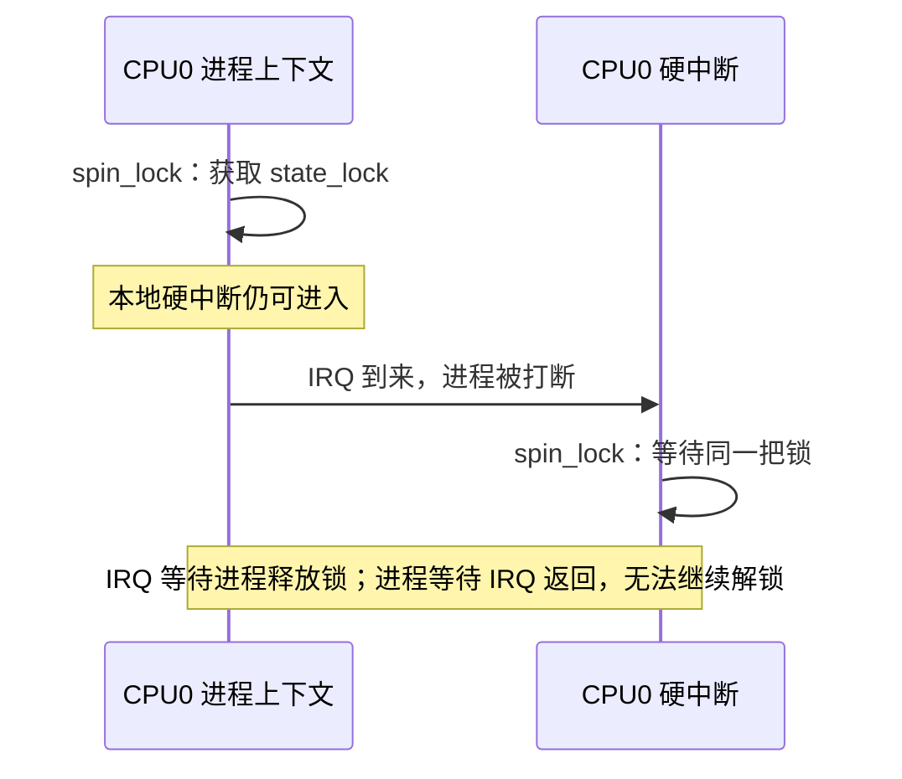

# Linux `spin_lock_irqsave()`：自旋锁与本地中断屏蔽

> 在非 PREEMPT_RT 内核中，`spin_lock_irqsave()` 先保存并屏蔽本地硬中断，再获取自旋锁：锁负责跨 CPU 互斥，中断屏蔽避免同 CPU 的硬中断打断持锁者后再次获取同一锁。

## TL;DR

- 同一数据被进程上下文和硬中断共享时，非 RT 内核常用 `spin_lock_irqsave()` / `spin_unlock_irqrestore()`，所有访问路径遵守同一锁规则。
- `flags` 使用局部 `unsigned long`，传变量本身；恢复的是进入前的状态，不能用无条件开中断替代。
- 临界区只做短小、不可睡眠的操作；拷贝快照后解锁，再做用户空间拷贝、总线传输或等待。
- PREEMPT_RT 的普通 `spinlock_t` 不再通过 `_irqsave` 屏蔽硬中断；真正硬中断共享的数据需评估 `raw_spinlock_t` 或调整处理上下文。

**源码基准：Linux 6.18 LTS，核对版本 6.18.62。** 以下机制与示例默认非 PREEMPT_RT；RT 的差异见[专节](#preempt_rt-下的关键差异)。

导航：[基本用法](#基本用法与-flags) · [死锁原因](#为什么仅用-spin_lock-会死锁) · [源码路径](#实现路径与执行顺序) · [接口选择](#根据共享上下文选择接口) · [示例](#示例硬中断更新进程读取快照) · [排查](#验证与排查)

## 基本用法与 flags

```c
#include <linux/spinlock.h>

static DEFINE_SPINLOCK(state_lock);

/* 以下语句位于调用函数内部。 */
unsigned long flags;

spin_lock_irqsave(&state_lock, flags);
/* 只访问受 state_lock 保护的共享状态。 */
spin_unlock_irqrestore(&state_lock, flags);
```

动态对象可使用 `spinlock_t lock` 成员，在对象发布或注册 IRQ 前调用 `spin_lock_init(&obj->lock)`。锁对象必须是各访问者共享的同一个对象，不能在每次调用中创建一把新的局部锁，也不能重新初始化正在使用的锁。[^spinlocks]

`spin_lock_irqsave()` 是会写入 `flags` 的宏，不返回一份供调用者接收的标志。`flags` 保存的是架构相关的本地中断状态，不是布尔值、设备中断号或锁的属性，不应自行解释或修改。[^spinlock][^irqflags]

| 进入前本地 IRQ 状态 | 临界区内 | `spin_unlock_irqrestore()` 后 |
| --- | --- | --- |
| 已启用 | 屏蔽 | 恢复启用 |
| 已屏蔽 | 仍屏蔽 | 仍屏蔽 |

因此同一 helper 可以用于普通进程路径和已经关中断的路径。每次获取的 `flags` 必须与对应解锁配对，在同一执行上下文使用；不能放在所有 CPU 共用的全局变量中。嵌套获取**不同锁**时分别保存 `flags_a`、`flags_b`，按反向顺序释放，且各路径的锁顺序必须一致。自旋锁不可递归，换一份 `flags` 也不能再次获取已经持有的同一锁。[^locking]

## 为什么仅用 spin_lock 会死锁

在非 RT 内核中，`spin_lock()` 禁止持锁任务被调度抢占，但**不屏蔽硬中断**。假设进程和本地 IRQ handler 都要获取 `state_lock`，仅在进程中使用普通 `spin_lock()` 会形成以下自死锁：[^locking]



`spin_lock_irqsave()` 使本地 IRQ 在获取锁之前就被屏蔽，避免这条重入路径。不能先 `spin_lock()` 再关中断，中间的窗口已经足以触发死锁。[^smp]

| 机制 | 解决的问题 | 不能单独解决的问题 |
| --- | --- | --- |
| 自旋锁 | 同一锁的访问者之间互斥，包括其他 CPU | 同 CPU 硬中断打断持锁者后再次取锁 |
| 本地 IRQ 屏蔽 | 阻止可屏蔽硬中断在本 CPU 重入 | 其他 CPU 同时访问共享数据 |
| 非 RT 持锁期间禁止抢占 | 避免持锁任务被普通任务调度出去 | 屏蔽硬中断、阻止其他 CPU 运行 |

屏蔽只作用于当前 CPU 的可屏蔽 IRQ，不会关闭其他 CPU 的中断，也不是只关闭某个设备的 IRQ。另一 CPU 仍可进入其 handler，并通过同一锁参与互斥；没有使用该锁的访问不会因此得到保护。NMI 等不受该屏蔽约束，不能假设同一把锁可安全用于 NMI。[^irqflags][^locking]

## 实现路径与执行顺序

6.18.62 非 RT 的普通 SMP 路径可概括为：[^spinlock][^smp]

```text
spin_lock_irqsave(&lock, flags)
  → raw_spin_lock_irqsave(spinlock_check(&lock), flags)
  → _raw_spin_lock_irqsave() / __raw_spin_lock_irqsave()
      local_irq_save(flags)      保存并屏蔽本地 IRQ
      preempt_disable()          禁止调度抢占
      lockdep 记录与底层取锁       竞争时等待锁可用
  → 访问共享状态
spin_unlock_irqrestore(&lock, flags)
  → raw_spin_unlock_irqrestore() / __raw_spin_unlock_irqrestore()
      lockdep 释放记录与底层解锁
      local_irq_restore(flags)   恢复进入前的 IRQ 状态
      preempt_enable()           撤销本层抢占禁止
```

这不是所有构建的逐行展开：内联、锁调试、单核配置及 `CONFIG_GENERIC_LOCKBREAK` 会改变路径，lockbreak 等待阶段还可临时恢复 IRQ 和抢占。不能仅凭调用了这个 API 就断言整个等待阶段始终关中断；**成功持锁后的非 RT 临界区才具有上述屏蔽与互斥保证**。[^smp][^spinimpl]

底层实现取决于架构。例如 ARM64 使用 queued spinlock 接口，通用 qspinlock 的快路径尝试原子获取，竞争时进入 slowpath。API 不承诺固定自旋次数、固定等待时间或所有平台使用同一条原子指令。单核配置也可能省去部分跨 CPU 取锁动作，驱动仍应使用完整接口。[^qspin][^locking]

锁提供共享内存访问所需的 acquire/release 顺序。它不意味着任意设备写入已经到达硬件，也不替代 MMIO 访问器、DMA 同步或设备手册要求的写回读；共享状态的正确同步与设备协议要分别保证。[^spinlocks]

## 根据共享上下文选择接口

先列出数据会被哪些上下文访问，再确定锁和屏蔽范围。下表默认非 RT，且不存在未列出的更高上下文访问者。[^locking]

| 访问关系 | 常见选择 | 条件 |
| --- | --- | --- |
| 仅进程/内核线程之间，需要睡眠 | `mutex` | 无硬中断或 softirq 获取该锁 |
| 仅任务之间，短小不可睡眠临界区 | `spin_lock()` / `spin_unlock()` | 不会被本地中断上下文重入 |
| 任务与 softirq/tasklet 共享 | 任务侧 `spin_lock_bh()`；softirq 侧普通自旋锁 | 没有硬中断访问；`_bh` 不屏蔽硬中断 |
| 任务或 softirq 与硬中断共享 | 任务/softirq 侧 `spin_lock_irqsave()` / `spin_unlock_irqrestore()` | IRQ 侧也获取同一锁；已知本地 IRQ 关闭时可用普通自旋锁，否则保存恢复 |
| 明确进入时 IRQ 已开启、退出时要开启 | `spin_lock_irq()` / `spin_unlock_irq()` | `_irq` 不保存之前状态，不适用于状态不确定的通用 helper |
| 真正硬中断与任务共享，且需支持 RT | 短小的 `raw_spin_lock_irqsave()` 临界区，或将共享处理移至线程 | 必须重新检查所有访问者和调用链 |

“IRQ 侧使用普通锁”依赖实际 IRQ 状态和嵌套条件；通用 helper 两侧都使用保存恢复形式，可以减少调用者必须满足的前置条件。不同后缀最终仍须操作同一把锁；仅把某一条进程路径改成 `_irqsave`，无法修复其他仍允许本地重入的路径。[^locking]

## 示例：硬中断更新，进程读取快照

这个示例仅演示**非 RT 内核**中的共享状态保护。设备 handler 已先确认中断属于本设备，并完成必要的设备操作，再调用 `irq_stats_record()`；它记录的是驱动调用次数，不等价于硬件事件总数。

```c
#include <linux/spinlock.h>
#include <linux/types.h>

struct irq_stats {
    spinlock_t lock;
    u64 count;
};

static void irq_stats_init(struct irq_stats *stats)
{
    spin_lock_init(&stats->lock);
    stats->count = 0;
}

static void irq_stats_record(struct irq_stats *stats)
{
    unsigned long flags;

    spin_lock_irqsave(&stats->lock, flags);
    stats->count++;
    spin_unlock_irqrestore(&stats->lock, flags);
}

static u64 irq_stats_snapshot(struct irq_stats *stats)
{
    unsigned long flags;
    u64 count;

    spin_lock_irqsave(&stats->lock, flags);
    count = stats->count;
    spin_unlock_irqrestore(&stats->lock, flags);

    return count;
}
```

在注册 IRQ 或向其他任务发布对象前初始化。若需要 `copy_to_user()`、格式化输出或同步总线访问，先调用 `irq_stats_snapshot()` 得到值，再于锁外处理；快照之后计数继续变化是允许的，快照不表示整个设备状态被永久冻结。

如果需要在 PREEMPT_RT 的真正硬中断中使用这类短小计数临界区，应把该对象及**全部访问路径**一致改为 `raw_spinlock_t` / `raw_spin_lock_init()` / `raw_spin_lock_irqsave()` / `raw_spin_unlock_irqrestore()`，或把更新移到可使用普通锁的上下文。不要只替换某一次取锁。

## 临界区与常见错误

- **持锁睡眠：**不能在普通非 RT 自旋锁或 raw 自旋锁内使用 mutex、`msleep()`、等待 completion、可能缺页的用户空间拷贝、睡眠式 I²C/SPI 传输或 `GFP_KERNEL` 分配；需要的资源尽量预先准备。`GFP_ATOMIC` 也不代表任意调用链在 RT 的 raw 临界区都安全。
- **错误配对：**`irqsave` 要与对应 `irqrestore` 配对；不能用 `spin_unlock_irq()` 无条件启用本来已关闭的中断。每个提前返回和错误分支都要解锁并恢复。
- **等待依赖当前锁的工作：**持锁调用 `synchronize_irq()`、`disable_irq()` 或同步取消工作，而对方也要获取该锁，可能形成死锁；应在锁外等待并另行协调对象生命周期。
- **递归与锁顺序：**同一锁不能重复获取，多把锁必须统一顺序；`irqsave` 无法解决跨 CPU 的 ABBA 死锁。
- **无锁读取：**写侧加锁而读侧直接读取，不能得到同等保护；`volatile` 和单独的 `READ_ONCE()` 不会自动建立多字段一致性或互斥。
- **扩大屏蔽范围：**只在锁内更新共享状态，把慢操作移出。关中断和取锁竞争都会增加延迟，硬件可能合并事件或发生 FIFO 溢出，不能承诺所有中断都会完整保存并立即响应。

这些约束同时涉及上下文、资源生命周期和锁依赖，应按实际调用链检查。[^locking][^locktypes]

## PREEMPT_RT 下的关键差异

| 语义 | 非 RT `spinlock_t` | RT `spinlock_t` | `raw_spinlock_t`（含 RT） |
| --- | --- | --- | --- |
| 锁竞争 | 自旋等待，具体策略依配置 | 基于 RT-mutex，可阻塞并支持优先级继承 | 保留严格自旋语义 |
| 持锁时抢占 | 禁止调度抢占 | 仍可抢占，持锁任务不迁移 | 禁止调度抢占 |
| `_irqsave` 屏蔽硬中断 | 是 | **否** | 是 |
| 真正硬中断中使用 | 可按上下文规则使用 | 不能按普通硬中断自旋锁使用 | 用于确需原子性的短小底层路径 |

6.18.62 的 `spinlock_rt.h` 中，`spin_lock_irqsave()` 将 `flags` 置为 `0` 并调用普通 `spin_lock()`，对应解锁调用 `rt_spin_unlock()`，不会修改 CPU 的 IRQ 屏蔽状态。`flags` 在这里用于接口兼容，不能拿它判断进入前 IRQ 是否开启。[^rtimpl]

**锁获取机制可阻塞，不表示临界区可以任意睡眠。**保持可同时适用于非 RT 的 spinlock 规则；需要主动等待、慢速 I/O 的任务路径应明确选择 mutex 等睡眠锁。也不要手工 `local_irq_disable()` 后获取 RT 的普通 `spinlock_t`，这会把可能阻塞的取锁放进真正原子上下文。[^locktypes]

[threaded IRQ](../irq/threaded-irq.md) 的 `thread_fn` 处于线程上下文：如果某份数据只由 IRQ 线程和其他任务访问，可按需求选 mutex 或普通自旋锁；若 primary 或其他真正硬中断仍访问它，就仍有硬中断同步约束。`IRQF_ONESHOT` 协调 IRQ 的屏蔽恢复，不会代替数据锁，也不会与其他 CPU 的普通任务互斥。

## 验证与排查

调试内核可启用 `CONFIG_PROVE_LOCKING` 检查锁依赖和 IRQ 上下文使用，配合 `CONFIG_DEBUG_ATOMIC_SLEEP` 发现原子上下文中的睡眠。多核、可抢占构建更容易暴露并发错误；配置启用和测试未告警都不能独立证明所有路径正确。[^locking]

| 现象 | 优先检查 |
| --- | --- |
| CPU 卡在取锁，持锁者似乎也在本 CPU | 任务是否仅用普通锁而被同锁 IRQ 打断，是否递归取锁 |
| `sleeping function called from invalid context` | 是否在自旋锁、关 IRQ 或禁止抢占的区域调用了可能睡眠的函数 |
| `inconsistent lock state` / 锁依赖告警 | 同一锁是否同时作为 IRQ-safe 与 IRQ-unsafe 使用，是否存在逆序获取 |
| 延迟尖峰、设备 FIFO 溢出 | 临界区是否过长、跨 CPU 竞争是否严重；结合目标内核支持的 `irqsoff` tracer 或锁统计定位 |
| 换成 RT 后仍有重入或上下文告警 | 是否错误依赖普通 `spinlock_t` 的 `_irqsave` 屏蔽硬中断 |

把锁的保护范围写成明确约束：保护哪些字段、谁能访问、能否被 IRQ 打断、退出时 IRQ 状态是否恢复。辅助函数可使用 [lockdep_assert_held()](Kernel%20API%20-%20lockdep_assert_held.md) 表达必须持锁的前提；断言不负责加锁。trace 工具用法见 [ftrace](../debug/ftrace.md)。

## 源码与参考

源码链接固定到 **v6.18.62**，按函数或宏名定位。

[^spinlocks]: [Documentation/locking/spinlocks.rst](https://github.com/gregkh/linux/blob/v6.18.62/Documentation/locking/spinlocks.rst)：基本用法、互斥与内存序。
[^locking]: [Documentation/kernel-hacking/locking.rst](https://github.com/gregkh/linux/blob/v6.18.62/Documentation/kernel-hacking/locking.rst)：各上下文的锁选择、死锁和不可睡眠约束。
[^locktypes]: [Linux 锁类型与 PREEMPT_RT 约束](https://docs.kernel.org/locking/locktypes.html)；[6.18.62 固定版本](https://github.com/gregkh/linux/blob/v6.18.62/Documentation/locking/locktypes.rst)。
[^spinlock]: [include/linux/spinlock.h](https://github.com/gregkh/linux/blob/v6.18.62/include/linux/spinlock.h)：`spin_lock_irqsave()` 与 raw 接口映射。
[^smp]: [include/linux/spinlock_api_smp.h](https://github.com/gregkh/linux/blob/v6.18.62/include/linux/spinlock_api_smp.h)：`__raw_spin_lock_irqsave()`、`__raw_spin_unlock_irqrestore()`。
[^spinimpl]: [kernel/locking/spinlock.c](https://github.com/gregkh/linux/blob/v6.18.62/kernel/locking/spinlock.c)：配置分支与 lockbreak 路径。
[^irqflags]: [include/linux/irqflags.h](https://github.com/gregkh/linux/blob/v6.18.62/include/linux/irqflags.h) 与 [ARM64 irqflags.h](https://github.com/gregkh/linux/blob/v6.18.62/arch/arm64/include/asm/irqflags.h)：保存和恢复本地 IRQ 状态。
[^qspin]: [ARM64 spinlock.h](https://github.com/gregkh/linux/blob/v6.18.62/arch/arm64/include/asm/spinlock.h) 与 [通用 qspinlock.h](https://github.com/gregkh/linux/blob/v6.18.62/include/asm-generic/qspinlock.h)：架构取锁接口与原子快路径。
[^rtimpl]: [include/linux/spinlock_rt.h](https://github.com/gregkh/linux/blob/v6.18.62/include/linux/spinlock_rt.h) 与 [kernel/locking/spinlock_rt.c](https://github.com/gregkh/linux/blob/v6.18.62/kernel/locking/spinlock_rt.c)：RT 普通自旋锁实现。
