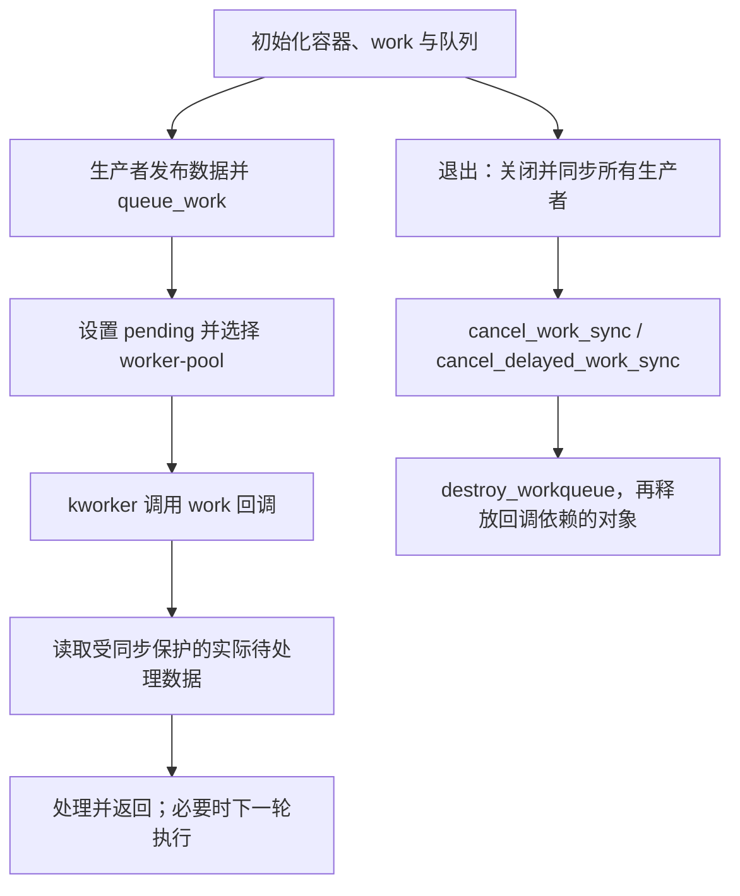

# Linux Workqueue：异步工作、并发与清理

> Workqueue 将工作项交给执行池；普通 threaded workqueue 的回调可睡眠，但 `WQ_BH` 在 softirq 上下文执行。安全卸载需要先停止生产者，再同步取消工作，最后释放对象和队列。

## TL;DR

- `INIT_WORK()` 初始化普通工作，`queue_work()` 提交；同一 work 重复提交可能合并，不能代替业务数据队列。
- 普通 workqueue 由 kworker 执行，可睡眠；不同 work 通常可并发，串行顺序需求用 `alloc_ordered_workqueue()`。
- `cancel_work_sync()` 等待普通 work，delayed work 必须用 `cancel_delayed_work_sync()`。
- `_sync` 返回不禁止未来入队；必须先关闭并同步 IRQ、定时器和其他生产者，保持对象活到最后一次访问结束。

源码基准：Linux 6.18 LTS / 6.18.62。本文主路径为普通 threaded workqueue。

## 对象关系与执行路径

`work_struct` 表示一次可重复使用的工作项；`workqueue_struct` 定义执行属性、并发和 flush 范围。后台 worker-pool 可由多个 workqueue 共享，因此创建专用 workqueue 不等于获得一条独占内核线程。



`queue_work()` 返回 true 表示成功排入；已 pending 或被禁用等情况下可返回 false。回调执行期间仍可能被再次排入后续一轮；不能把 false 当作分配失败，也不能把 true 当作已经完成。成功入队对之前写入有发布顺序保证，但并发更新、重复入队失败和多个生产者仍需自己的锁或原子协议。

同一 work 在回调函数不变、始终使用同一 workqueue 且未重新初始化时具有不重入保证；它不会自动保护其他 work、IRQ 或任务对同一设备的访问。

## 接口与选型

| 需求 | 接口或属性 | 边界 |
| --- | --- | --- |
| 短异步任务，无特殊队列属性 | `schedule_work()` | 使用系统队列；只同步自己的 work，不 flush 整个系统队列 |
| 自定义队列属性或独立 flush 范围 | `alloc_workqueue()` | 检查返回 NULL，并设计并发上限及依赖 |
| 全队列按入队顺序逐项执行 | `alloc_ordered_workqueue()` | 不用 `WQ_UNBOUND + max_active=1` 假定严格全局顺序 |
| 延迟入队 | `INIT_DELAYED_WORK()`、`queue_delayed_work()` | 延迟单位 jiffies，不是准确执行时刻 |
| 调整延迟或确保有下一次执行 | `mod_delayed_work()` | 与普通 queue 的返回语义不同，按接口说明处理 |
| 内存回收路径依赖的工作 | `WQ_MEM_RECLAIM` | 提供回收所需执行保障，不是任意依赖图的免死锁开关 |
| 系统冻结期间应暂停执行 | `WQ_FREEZABLE` | 仍需驱动自己的设备挂起/恢复协调 |
| softirq 上下文工作 | `WQ_BH` | 不可睡眠，使用该类型允许的属性组合 |

6.18.62 中 `schedule_work()` 使用 `system_percpu_wq`。每 CPU 和 unbound 队列的 `max_active` 含义与 NUMA 分配有区别，不能只凭名称假定全系统最多一个回调。

## 示例：合并通知并由普通 worker 处理

示例将多次通知合并为批次计数，数据层面不承诺逐事件保存。实际驱动应在回调中排空受保护的设备/软件队列。

```c
#include <linux/atomic.h>
#include <linux/container_of.h>
#include <linux/errno.h>
#include <linux/workqueue.h>

struct deferred_device {
    struct workqueue_struct *wq;
    struct work_struct work;
    atomic_t notifications;
    unsigned long batches;
};

static void deferred_fn(struct work_struct *work)
{
    struct deferred_device *ctx;

    ctx = container_of_const(work, struct deferred_device, work);
    if (atomic_xchg(&ctx->notifications, 0))
        ctx->batches++;
}

static int deferred_init(struct deferred_device *ctx)
{
    atomic_set(&ctx->notifications, 0);
    ctx->batches = 0;
    INIT_WORK(&ctx->work, deferred_fn);
    ctx->wq = alloc_ordered_workqueue("demo-deferred", 0);
    if (!ctx->wq)
        return -ENOMEM;
    return 0;
}

static void deferred_notify(struct deferred_device *ctx)
{
    atomic_set(&ctx->notifications, 1);
    queue_work(ctx->wq, &ctx->work);
}

static void deferred_destroy(struct deferred_device *ctx)
{
    cancel_work_sync(&ctx->work);
    destroy_workqueue(ctx->wq);
}
```

只在 init 成功后开启通知源，destroy 前先停止并同步所有通知者，且回调不自重排。`batches` 只能在工作已同步停止后无额外锁读取。与回调并发的设备访问仍需单独保护，不能仅因使用 ordered queue 就省略进程路径的锁。

## 取消、flush 与销毁

| 接口 | 保证及限制 |
| --- | --- |
| `cancel_work()` | 尝试取消 pending 工作，不等待正在执行的回调 |
| `cancel_work_sync()` | 取消并等待执行结束；不排除与其竞争的新入队 |
| `cancel_delayed_work_sync()` | 同时处理 delayed work 的定时器和 work，不能改用 `cancel_work_sync(&dwork.work)` |
| `flush_work()` | 等待所覆盖的工作执行完成，不表示取消，也不阻止未来入队 |
| `disable_work_sync()` / `enable_work()` | 禁用计数阻止入队并同步等待，恢复要正确配对；仍不允许生产者访问已释放对象 |
| `destroy_workqueue()` | 销毁自有队列并等待已排入工作；必须事先取消仍在 timer 侧的 delayed work |

普通 work 的同步取消要求可睡眠上下文，不能在回调中同步取消自己，也不能持有回调需要的锁等待它结束。先禁用/停止生产者与同步回调是不同步骤；即使 disabled work 拒绝入队，尝试访问已经释放 work 的生产者仍会发生 UAF。

若回调会自行重排、还会触发另一个 work 或 timer，需要将这些通路一起纳入停止协议。不要释放硬件映射、私有内存或模块代码后才等待取消。不能销毁系统提供的共享 workqueue。

## 验证与排查

- 对照 `queue_work()` 返回值、业务待处理状态和回调执行次数，区分正常合并与真正遗漏；不要要求三者一一相等。
- 使用 workqueue tracepoint 和调度记录区分等待 worker、等待锁与回调本身耗时，避免在高频回调中大量打印。
- 卡在 flush/cancel 时检查回调栈、锁依赖、同队列互相等待和不断自重排。
- 解绑后仍访问对象时，先找没有停止的生产者、timer 侧 delayed work 和在 cancel 后重新入队的路径。

相关：[container_of](Kernel%20API%20-%20container_of.md)、[kthread_run](Kernel%20API%20-%20kthread_run.md)、[tasklet](Kernel%20API%20-%20tasklet.md)、[threaded IRQ](../irq/threaded-irq.md)。

## 源码与参考

- [6.18.62 Workqueue 文档](https://github.com/gregkh/linux/blob/v6.18.62/Documentation/core-api/workqueue.rst)：worker-pool、属性、顺序与不重入条件。
- [workqueue.h](https://github.com/gregkh/linux/blob/v6.18.62/include/linux/workqueue.h)、[workqueue.c](https://github.com/gregkh/linux/blob/v6.18.62/kernel/workqueue.c)：入队、内存序、取消和销毁。
