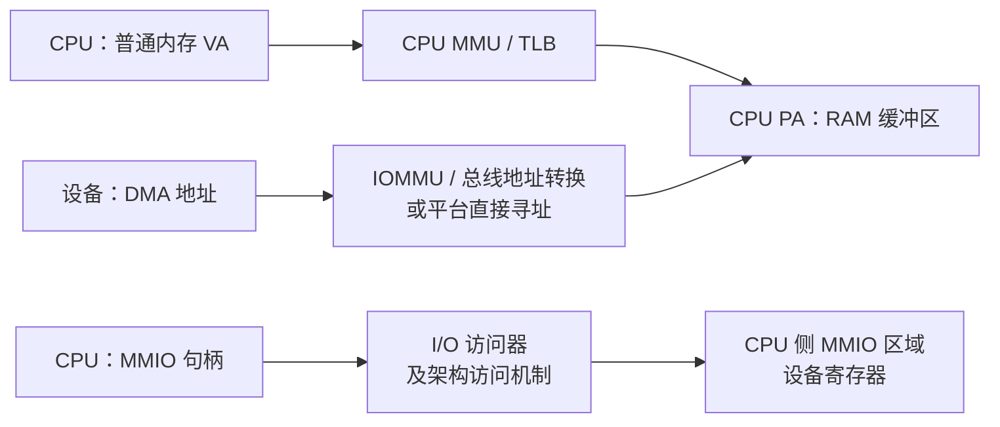

# Linux 内核地址：虚拟地址、物理地址、MMIO 与 DMA

> 先确认地址由谁使用：CPU 通过虚拟地址访问普通内存，通过 I/O 访问器访问设备寄存器；设备执行 DMA 时使用 DMA API 提供的设备地址。

## TL;DR

- **物理地址不是可直接解引用的内核指针**：强制类型转换只改变 C 类型，不会建立映射，也不会完成地址翻译。
- **CPU 物理地址空间同时包含 RAM 和 MMIO 区域**；“有一个物理地址”不等于“它是普通内存”。
- **MMIO 先取得资源，再映射和访问**：使用 `void __iomem *` 与 `readl()` / `writel()` 等，映射成功不保证设备已上电。
- **CPU PA 与 DMA 地址不保证相等**：即使没有 IOMMU，也应使用 DMA API，不能用 `virt_to_phys()` 代替。

范围：启用 MMU 的常见 Linux 系统，以 **Linux 6.18.62 LTS** 的文档和接口为基准。无 MMU 系统、恒等映射及早期启动阶段须按具体架构分析。

## 五类地址与正确的数据类型

| 地址 / 句柄 | 常用类型 | 谁使用、如何访问 |
| --- | --- | --- |
| 内核普通内存虚拟地址 | `void *`、具体对象指针 | CPU 使用；如 `kmalloc()`、`vmalloc()` 返回值 |
| 用户虚拟地址 | `void __user *` 等 | 属于特定进程地址空间；内核通过 uaccess 等适用接口访问 |
| CPU 物理地址（PA） | `phys_addr_t`；MMIO 资源常用 `resource_size_t` | 描述 CPU 物理地址空间中的位置，不是普通 C 指针 |
| MMIO 访问句柄 | `void __iomem *` | 由映射接口取得，交给 `readl()`、`ioread32()` 等 I/O 访问器 |
| 设备 DMA 地址 | `dma_addr_t` | 交给设备执行 DMA；CPU 不能把它当普通指针解引用 |

`__user` 和 `__iomem` 是用于静态检查的地址空间标记，不会自行完成权限验证或建立映射。大多数架构上的 MMIO 句柄表现为内核虚拟地址，部分架构则把它实现为特殊 token；可移植代码始终通过 I/O 接口使用它。

同样的数值可能出现在不同地址空间中，但意义不同。类型选对之后仍要核对地址来源；不要为了打印或写寄存器就把地址截断成 `u32`，也不要假定 CPU 字长等于物理地址宽度。

## CPU 访问与设备 DMA 是两条路径



图中为常规 DMA API 路径，假设设备访问同一 RAM 缓冲区；实际平台也可能通过 bounce buffer 中转。**MMIO 是 CPU 访问设备寄存器，DMA 是设备访问内存**。DMA 不经过 CPU 的 MMU/TLB，设备侧地址转换遵守总线或 IOMMU 配置。

PCI BAR 或设备树 `reg` 中的原始地址可能仍属于总线地址空间。驱动应让相应总线和资源接口完成翻译，使用已解析的资源或专用映射接口，不把原始字段直接假定为 CPU PA。

## 普通 RAM：指针、线性映射与物理页

- **线性映射（direct / linear map）**是内核虚拟地址空间中的特定区域，与对应 RAM 存在架构规定的偏移关系；Linux 文档也常把这类地址称为 kernel logical address。
- `virt_to_phys()` 只适用于满足其架构前提的地址；`phys_to_virt()` 也只求对应线性映射地址，**不会为任意 PA 创建映射**，更不能拿来映射设备寄存器。
- `kmalloc()` 在成功分配范围内提供虚拟、物理连续的内存；`vmalloc()` 只保证虚拟连续，`kvmalloc()` 的结果不能直接假定来自线性映射。
- `struct page *` 是描述物理页的内核元数据指针，PFN 是物理页框号；二者都不是缓冲区的数据指针，MMIO 区域也不能一概当成普通 RAM 页面处理。

因此，不能看到一个内核指针就统一套用 `virt_to_phys()`，也不能用一个固定偏移转换用户地址。具体页表翻译、块映射和 `vmalloc_to_page()` 的边界见 [[virt to phy]]；分配接口见 [[Kernel API - kmalloc]]。

## MMIO：先持有资源，再映射与访问

正常驱动先从总线获取并申请设备资源，再建立具有合适属性的 I/O 映射。`ioremap()` 本身不代替资源申请，也不负责设备时钟、复位或 runtime PM。

| 接口 | 失败与释放方式 |
| --- | --- |
| `ioremap(cpu_phys, size)` | 失败为 `NULL`；成功后配对 `iounmap()`，资源申请和释放另行管理 |
| `devm_ioremap_resource(dev, res)` | 校验并申请 MMIO 资源、建立托管映射；失败为错误指针，用 `IS_ERR()` / `PTR_ERR()` |
| `devm_platform_ioremap_resource(pdev, index)` | 获取指定 Platform MMIO 资源并托管映射；同样检查错误指针 |

### 示例：一次性读取设备 ID

前提：调用者已持有对应 MMIO 资源，`cpu_phys` 是解析后的 CPU 物理地址且按 4 字节对齐，`size >= sizeof(u32)`；偏移 0 是允许安全读取的 32 位小端 ID 寄存器，设备已可访问，`id` 是有效输出指针。

```c
#include <linux/errno.h>
#include <linux/io.h>

static int read_device_id(phys_addr_t cpu_phys, size_t size, u32 *id)
{
    void __iomem *regs;

    regs = ioremap(cpu_phys, size);
    if (!regs)
        return -ENOMEM;

    *id = ioread32(regs);
    iounmap(regs);
    return 0;
}
```

此示例展示低层映射的生命周期；它不负责申请或释放设备资源。长期运行的驱动通常在初始化时映射并复用句柄，Platform 驱动优先选上述资源托管接口，而非每次访问都重新映射。

- **宽度、字节序和副作用由设备手册决定**：8/16/32 位访问不可随意替换；大端寄存器按需选 `ioread32be()` 等接口。
- **读出后原值写回不一定安全**：W1C（写 1 清除）、读清和 FIFO 寄存器都有特殊语义，不能当普通变量做读改写。
- **`volatile` 指针不能替代 I/O 访问器**；复制 I/O 区域按用途选择 `memcpy_toio()` / `memcpy_fromio()`，不能直接套普通 `memcpy()`。
- **访问顺序不等于写入已经到达设备**：posted write 的完成确认须按总线和设备要求处理，不能只依赖普通内存屏障。

`ioremap()` 也不是映射任意 RAM 的通用工具：普通 RAM 与设备寄存器的属性和别名约束不同，ARM64 实现会拒绝将普通线性映射 RAM 作为设备区域重映射。

寄存器访问、轮询和资源清理细节见 [[Kernel API - ioremap]]；电源访问条件见 [[Kernel API - pm_runtime]]。

## DMA：CPU 指针与设备地址成对管理

DMA API 根据设备与平台建立映射，并处理必要的 IOMMU、寻址范围或缓存维护。IOVA 是启用相应 IOMMU 翻译时设备所见的一类地址，不是 CPU 可解引用的 VA。

| 使用方式 | CPU 使用什么 | 设备使用什么 |
| --- | --- | --- |
| `dma_alloc_coherent()` | 函数返回的 CPU 指针 | 输出参数中的 DMA 地址 |
| `dma_map_single()` | 原有合法缓冲区指针，访问须遵守所有权协议 | 映射函数返回的 DMA 地址 |

不能把 `dma_addr_t` 传给 `phys_to_virt()` 当作 CPU 指针，也不能将任意 `vmalloc()` 地址直接传给 `dma_map_single()`。DMA mask、映射错误检查、方向、缓存所有权和配对释放都属于同一使用契约。

撤销映射或释放缓冲区之前，必须确认设备已经停止访问；仅有“等待超时”不能证明这一点。完整示例见 [[Kernel API - dma_map_single]]。

## 调试时如何判断手里的地址

| 信息来源 | 能说明什么 | 不能据此推断什么 |
| --- | --- | --- |
| `/proc/iomem` | 内核登记的 CPU 物理资源范围；可见内容受权限和配置限制 | 某范围可以直接解引用，或设备当前已上电 |
| `/proc/<pid>/maps` | 用户 VA 区间、权限和映射来源 | 对应物理页已经分配、连续或适合 DMA |
| `phys_addr_t` 配合 `%pa`、`dma_addr_t` 配合 `%pad` | 按相应地址类型打印，参数传变量地址 | 两种地址打印成相同数值就可以混用 |

排查顺序是 **地址来源 → 谁使用它 → 映射与属性 → 对象和设备生命周期**。页表正确只能解释 CPU 地址翻译，不能替代资源管理、DMA 协议或硬件访问条件。

## 源码与参考资料

- [Linux 6.18.62 DMA API HOWTO](https://github.com/gregkh/linux/blob/v6.18.62/Documentation/core-api/dma-api-howto.rst)：CPU VA、CPU PA、总线地址与 DMA 地址。
- [Device I/O 文档](https://github.com/gregkh/linux/blob/v6.18.62/Documentation/driver-api/device-io.rst)：`__iomem`、访问器、映射属性和 posted write。
- [`lib/devres.c`](https://github.com/gregkh/linux/blob/v6.18.62/lib/devres.c)、[`drivers/base/platform.c`](https://github.com/gregkh/linux/blob/v6.18.62/drivers/base/platform.c)：资源请求、托管映射和错误返回。
- [ARM64 `memory.h`](https://github.com/gregkh/linux/blob/v6.18.62/arch/arm64/include/asm/memory.h)、[`ioremap.c`](https://github.com/gregkh/linux/blob/v6.18.62/arch/arm64/mm/ioremap.c)：线性映射换算与 I/O 映射限制。
- [内核地址打印格式](https://github.com/gregkh/linux/blob/v6.18.62/Documentation/core-api/printk-formats.rst)：`%pa` / `%pad` 的参数约定。
