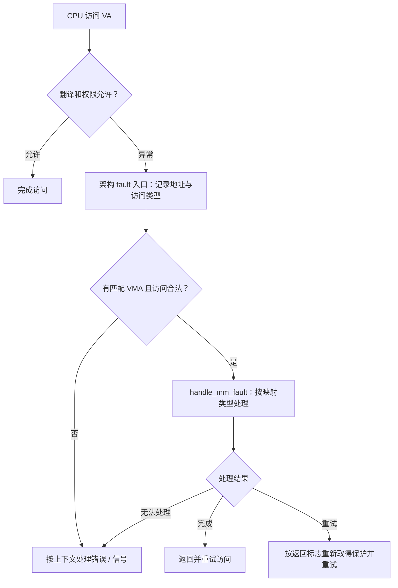

# Linux 缺页处理与写时复制

> 缺页是 CPU 访问无法按当前页表和权限直接完成时产生的异常；内核可能建立映射并重试，也可能向用户任务报告访问错误。

## TL;DR

- TLB miss 不等于 page fault；页表有效时硬件可完成遍历并继续访问。
- VMA 合法不等于页面已经驻留：匿名分配、文件映射、swap 和 COW 都可能在访问时触发 fault。
- `MAP_PRIVATE` 的写入通常通过写时复制保持私有语义；`MAP_SHARED` 的共享语义不能套用相同结论。
- 排查先区分用户 / 内核访问、地址和访问类型，再看 VMA、页表、fault 结果和后备对象。

范围：Linux 6.18.62 LTS，常见 MMU 系统；ARM64 路径用于说明架构入口。

## 从异常到结果

真实实现还包含 VMA 锁或 `mmap_lock`、页表锁、竞争和其他特殊映射；图是决策关系，不是唯一的函数调用链。

## 常见原因

| 场景 | 可能发生什么 |
| --- | --- |
| 匿名内存首次访问 | 按访问类型和内核策略建立页表或分配页面；读访问可能使用共享零页等优化 |
| 文件映射缺页 | 查找或读取 page cache，并按映射建立页表；底层文件状态和 I/O 可能导致失败 |
| 页被换出 | 通过 swap 等机制恢复内容，具体 I/O 和内存压力影响延迟 |
| 私有映射写入 | 写保护 fault 触发 COW 或适用的页面复用，保证私有语义 |
| 地址不在有效 VMA 或权限不允许 | 用户态可能收到 `SIGSEGV`；文件后备等问题在适用情况下也可能是 `SIGBUS` |

minor / major fault 是统计分类，不应单凭一次计数认定硬件错误；文件映射和回收造成的 I/O 还需结合实际工作负载与日志分析。

## COW 需要满足什么

普通 `fork()` 创建独立地址空间时，适用的私有映射可以在初期共享物理页并对写入使用保护。任一进程写入时，内核根据引用和映射状态创建或复用合适的页面，再更新对应映射；另一进程的私有内容不应被该写入改变。

共享映射、设备映射、固定用户页和特殊 VMA 有自己的规则；不能把“fork 后每一页立即完整复制”或“所有写入都会重新分配”当作通用事实。

## Linux 6.18 源码入口

| 位置 | 入口 | 观察 |
| --- | --- | --- |
| `arch/arm64/mm/fault.c` | `do_page_fault()` | 解析 ARM64 fault 并尝试取得合适的 VMA 保护 |
| `mm/memory.c` | `handle_mm_fault()` / `__handle_mm_fault()` | 根据 fault 标志和页表状态处理 |
| `mm/memory.c` | `do_anonymous_page()`、`do_wp_page()` | 匿名页和写保护相关路径 |
| `mm/filemap.c` | `filemap_fault()` | 常见文件映射缺页与 page cache |

这些函数包含并发重试和错误分支；处理过程中可能释放锁，不能在返回后无条件假设原 VMA 仍受保护。查找 VMA 的锁和返回边界见 [[VMA]]，用户指针复制见 [[Kernel API - copy_user]]。

## 诊断

1. 用户任务：结合 fault 地址、访问方向、`/proc/<pid>/maps` 和具体信号，确定是否在预期映射区间。
2. 性能问题：用 `perf stat` 或进程统计观察 minor / major faults 的变化，并结合 I/O 和工作集；首次加载的 fault 不必然是故障。
3. 驱动：检查用户内存访问接口、进程上下文和对象生命周期；不能在不可睡眠上下文用普通 uaccess 等待缺页。
4. 需要让设备长期访问用户页时，应选择适用的 page pinning、DMA 映射和解除固定流程，不把虚拟地址直接交给设备。

## 参考

- Linux 6.18.62：[页表与缺页](https://github.com/gregkh/linux/blob/v6.18.62/Documentation/mm/page_tables.rst)、[进程地址空间](https://github.com/gregkh/linux/blob/v6.18.62/Documentation/mm/process_addrs.rst)、[pin_user_pages](https://github.com/gregkh/linux/blob/v6.18.62/Documentation/core-api/pin_user_pages.rst)。
- [`arch/arm64/mm/fault.c`](https://github.com/gregkh/linux/blob/v6.18.62/arch/arm64/mm/fault.c)、[`mm/memory.c`](https://github.com/gregkh/linux/blob/v6.18.62/mm/memory.c)、[`mm/filemap.c`](https://github.com/gregkh/linux/blob/v6.18.62/mm/filemap.c)。
- 蜗窝科技：[逆向映射](https://www.wowotech.net/memory_management/reverse_mapping.html)、[用户地址复制](https://www.wowotech.net/memory_management/454.html)。
