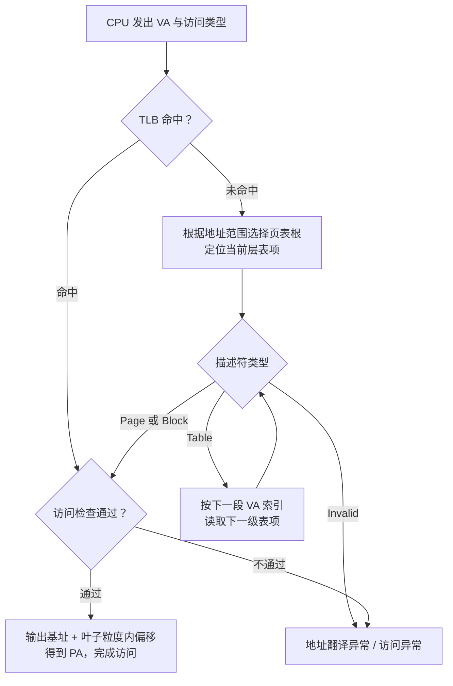

# ARM64 虚拟地址到物理地址：MMU、页表与接口边界

> CPU 用当前地址空间的页表和 TLB 完成地址翻译；软件只有先确定地址来源、页表根及叶子映射粒度，才能正确解释一个虚拟地址对应的物理地址。

## TL;DR

- **同一个 VA 可以对应不同 PA**：转换结果取决于地址空间、页表内容和查询时刻；VMA 存在不代表物理页已分配。
- **4 KiB 页、48 位 VA、四级配置**下，索引为 `9 + 9 + 9 + 9` 位，页内偏移为 12 位；Linux 的 P4D 在该配置中折叠。
- **页表遍历不一定走到 PTE**：L1 的 1 GiB Block 或 L2 的 2 MiB Block 可提前结束；偏移位数随叶子粒度改变。
- **`virt_to_phys()` 不是通用页表查询器**：用户地址、`vmalloc`、MMIO 与 DMA 地址分别有不同接口和生命周期要求。

范围：以 Linux **6.18.62 LTS / AArch64** 为实现参照，主要说明 EL0/EL1 的 **Stage-1** 翻译。位段和数值示例限定为 **4 KiB 页、48 位 VA、四级页表**，不展开 LPA2、地址标签和其他页大小；其他配置不能直接套用此表。

## 先确定使用哪个地址空间

| 对象 | Linux 中的常见作用 |
| --- | --- |
| `mm_struct->pgd` | 该用户地址空间的顶级页表指针，是内核可访问的虚拟指针 |
| `TTBR0_EL1` | 通常用于用户地址范围的页表根 |
| `TTBR1_EL1` | 通常用于内核地址范围的页表根 |
| `TCR_EL1` | 配置相应地址范围的宽度、翻译粒度等 |
| ASID | 区分地址空间的翻译缓存上下文；不是物理页号 |

页表根的选择与 **VA 所属地址范围及控制寄存器配置**有关，不能简化成“EL0 必定选 TTBR0，EL1 必定选 TTBR1”。例如内核按规则访问用户内存时，目标仍是用户地址范围。

`mm->pgd` 不能直接作为普通虚拟指针写进 TTBR。ARM64 的 `cpu_switch_mm()` 先将页表指针转换成物理地址，再由切换路径设置相关寄存器和 ASID。PAN、KPTI 等机制还可能暂时禁用或替换部分映射。

多个线程可以共享一个 `mm_struct`；不同进程也可以把同一段 VA 映射到不同物理页。地址空间关系见 [[mm_struct]]，区域属性见 [[VMA]]。

## CPU 访问内存时的翻译路径



这是逻辑流程；实现还可能有多级 TLB 和页表遍历缓存，图中省略了缓存填充及维护操作。**TLB 未命中本身不是缺页异常**，有效映射可由硬件遍历页表取得。

描述符除了输出地址，还包含类型、权限和内存属性。读写权限、执行权限、Access Flag 等检查，以及上层表项的限制，都可能影响访问；“算出了 PA”不等于当前访问合法。

按需分配、换入或写时复制也会触发异常。Linux 能处理时会建立或调整映射后重试；无法处理时才按上下文报错、发送信号或进入内核异常处理。缺页不一定是程序错误。

## 4 KiB、48 位 VA 的四级页表

一张页表占 4 KiB，每个描述符占 8 字节，因此每表有 **512 项**，每层消耗 **9 位**索引。

| VA 位段 | 硬件层级 | 本配置的 Linux 层级 | 一个表项覆盖的范围 / 合法叶子 |
| --- | --- | --- | --- |
| `[47:39]` | L0 | PGD | 覆盖 512 GiB，继续指向下级表 |
| `[38:30]` | L1 | PUD | 覆盖 1 GiB，可为 Table 或 1 GiB Block |
| `[29:21]` | L2 | PMD | 覆盖 2 MiB，可为 Table 或 2 MiB Block |
| `[20:12]` | L3 | PTE | 4 KiB Page |
| `[11:0]` | 页内偏移 | — | 4 KiB 页内的字节偏移 |

Linux 通用代码按 `PGD → P4D → PUD → PMD → PTE` 描述五层。在本例四级配置中，**P4D 折叠进 PGD，不增加一次硬件访存或一张独立页表**。不要把五个软件层级名直接理解为五级硬件页表。

对于有效的 Table 描述符，下一层表项的位置在概念上是：

```text
index    = (VA >> 本层对应的 shift) & 0x1ff
entry_PA = 当前页表的物理基址 + index × 8
```

从该表项解码出下一张表的物理基址后，再处理下一段 VA 位。页表中的地址字段是**物理地址编码**，并不是可直接解引用的 C 指针。

如果当前层得到 Page / Block 叶子，就停止向下遍历。最终地址由**解码后的输出基址**加上对应粒度内的 VA 偏移组成：

| 叶子类型 | 物理基址对齐 | VA 偏移 | 计算方式 |
| --- | --- | --- | --- |
| L3 Page | 4 KiB | `[11:0]` | `PA = page_base + (VA & 0xfff)` |
| L2 Block | 2 MiB | `[20:0]` | `PA = block_base + (VA & 0x1fffff)` |
| L1 Block | 1 GiB | `[29:0]` | `PA = block_base + (VA & 0x3fffffff)` |

不能把整个描述符当作基址，也不能对所有配置机械地套用 `PTE & ~0xfff`：描述符含有属性位，输出地址编码还受架构特性和物理地址宽度影响。

### 一个可手算的例子

假设 VA 为 `0x0000123456789abc`，且它属于当前有效地址空间：

| 字段 | 值 |
| --- | --- |
| L0 索引 | `0x024` |
| L1 索引 | `0x0d1` |
| L2 索引 | `0x0b3` |
| L3 索引 | `0x189` |
| 4 KiB 页内偏移 | `0xabc` |

- 若最终 L3 页基址为 `0x87654000`，则 **PA = `0x87654abc`**。
- 若在 L2 就遇到基址为 `0x80000000` 的 2 MiB Block，则偏移应取 `0x189abc`，所以 **PA = `0x80189abc`**，不再读取 L3 表。

这两种是不同的假设映射。仅凭 VA 数值和索引，无法推导出实际 PA，必须读取对应地址空间的有效叶子描述符。

## 软件求地址：先判断指针来自哪里

ARM64 线性映射中的地址满足对应偏移关系：

```text
PA = VA - PAGE_OFFSET + PHYS_OFFSET
```

这是 `virt_to_phys()` 在线性映射路径中的换算思路，**不是现场遍历页表**。ARM64 实现另有内核镜像偏移路径；已知内建内核符号应使用适用的 `__pa_symbol()` 等接口，不能把这个实现分支理解成任意指针都能转换。

CPU 实际读写线性映射指针时，仍然使用 MMU/TLB 和相应权限检查；软件能按偏移算出 PA，不代表硬件访问绕过了地址翻译。

| 地址来源 / 目标 | 应采用的方式 | 边界 |
| --- | --- | --- |
| 有效的线性映射 RAM，如常见 `kmalloc()` 地址 | 需要 CPU 物理地址时才考虑 `virt_to_phys()` | 对象须存活；转换不建立映射或持有页面 |
| 普通 RAM 支撑的 `vmalloc()` / `vmap()` 地址 | `vmalloc_to_page()` 后取 `page_to_phys()`，再加页内偏移 | 检查返回值，保证映射存活；逐页处理，不能假设物理连续 |
| 用户指针 | 复制数据用 `copy_from_user()` 等；I/O 确需持有页面时使用适用的 `pin_user_pages*()` | 处理权限、部分成功及配对 unpin；固定页不代表用户 VA 永远不被解除或重映射 |
| `ioremap()` 得到的 `__iomem` 指针 | 通过设备资源记录地址，使用 `readl()` / `writel()` 等访问 | 不用 `virt_to_phys()` 反推 MMIO 地址 |
| 设备需要的 DMA 地址 | 使用 DMA API 返回的 `dma_addr_t` | CPU PA、总线地址和 IOVA 不保证数值相等 |

用户页固定与 DMA 映射是不同步骤；拿到页并不意味着已经取得设备可用地址。设备写入的页还要遵守脏页处理等要求；具体接口见内核文档和相应子系统约定。

I/O 映射见 [[Kernel Address - Virtual and Physical]]；分配差异见 [[Kernel API - kmalloc]]；DMA 生命周期见 [[Kernel API - dma_map_single]]。

## 软件遍历页表的同步与生命周期

`pgd_offset()`、`p4d_offset()`、`pud_offset()`、`pmd_offset()`、`pte_offset_*()` 只是遍历所需的部分接口。实际实现还必须处理：

- **地址空间与并发**：持有正确的 `mm`，遵守 VMA、页表锁和 RCU 等生命周期规则；仅持有 `mmap_read_lock()` 并不能替代所有页表层面的同步。
- **不同表项状态**：检查空项、无效项、PUD/PMD 叶子，以及交换、迁移等软件编码；不能假设所有映射都以普通 PTE 结束。
- **结果的有效期**：一次读出的 PFN 只是该时刻的映射快照，不能作为异步 I/O 的长期地址凭据；持有页面和建立设备映射仍需对应 API。
- **映射修改**：修改页表还涉及架构规定的更新顺序、屏障与 TLB 维护，不能直接改一个表项后假设 CPU 立即采用新映射。

调试或内核子系统确需遍历时，优先研究目标版本的 `mm/pagewalk.c` 及现有调用者，再按目标映射类型实现。

另外，虚拟机中的 Stage-1 输出通常是 **IPA（来宾物理地址）**，随后由 Stage-2 转为宿主 PA。不能把来宾页表中的输出地址直接当作宿主物理地址；这与设备 IOMMU 的 DMA 地址转换也不是同一条路径。

## 源码定位与参考资料

| Linux 6.18.62 位置 | 可核对的内容 |
| --- | --- |
| `arch/arm64/include/asm/pgtable-hwdef.h` | 表项大小、层级移位、Page / Block 描述符定义 |
| `include/asm-generic/pgtable-nop4d.h` | P4D 折叠，`p4d_offset()` 复用 PGD 项 |
| `arch/arm64/include/asm/mmu_context.h` | `cpu_switch_mm()` 与页表根地址转换 |
| `arch/arm64/include/asm/memory.h`、`arch/arm64/mm/physaddr.c` | 线性映射与内核镜像换算、`CONFIG_DEBUG_VIRTUAL` 检查 |
| `mm/vmalloc.c`、`mm/pagewalk.c` | vmap 地址查页与通用页表遍历实现 |

- [Linux 6.18.62 页表文档](https://github.com/gregkh/linux/blob/v6.18.62/Documentation/mm/page_tables.rst)：层级折叠、TLB、缺页与大页。
- [ARM64 页表硬件定义](https://github.com/gregkh/linux/blob/v6.18.62/arch/arm64/include/asm/pgtable-hwdef.h)、[`memory.h`](https://github.com/gregkh/linux/blob/v6.18.62/arch/arm64/include/asm/memory.h)、[`mmu_context.h`](https://github.com/gregkh/linux/blob/v6.18.62/arch/arm64/include/asm/mmu_context.h)。
- [`vmalloc_to_page()` 实现](https://github.com/gregkh/linux/blob/v6.18.62/mm/vmalloc.c)、[页固定 API 文档](https://github.com/gregkh/linux/blob/v6.18.62/Documentation/core-api/pin_user_pages.rst)。
- [DMA API HOWTO](https://github.com/gregkh/linux/blob/v6.18.62/Documentation/core-api/dma-api-howto.rst)：CPU VA、CPU PA 与设备地址的区别。
