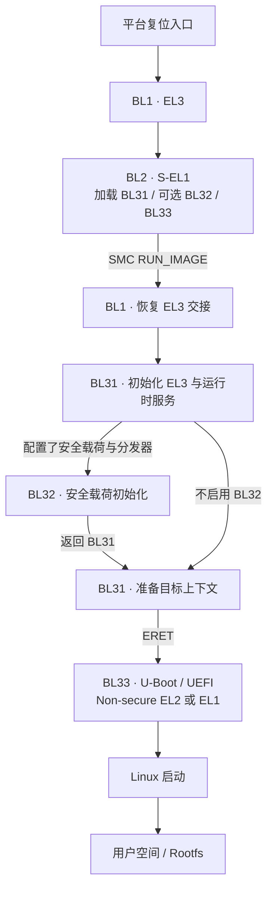
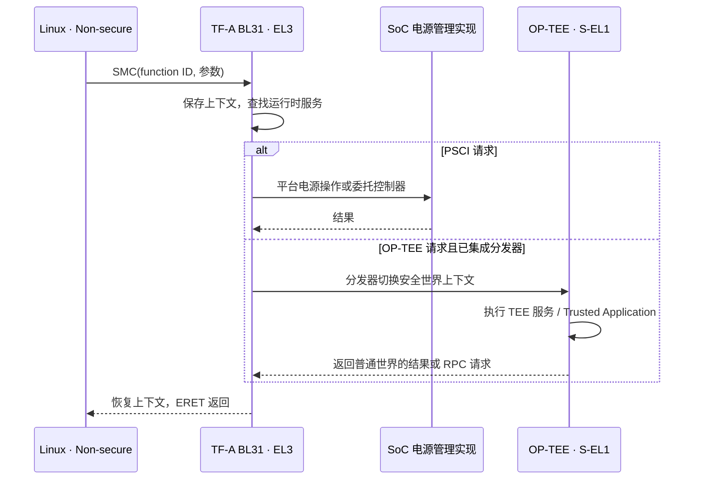

# ARM Trusted Firmware-A：启动阶段与运行时服务

> TF-A 是 Arm A-profile 平台可信启动与安全运行时固件的开源参考实现；在典型 AArch64 系统中，BL31 驻留安全内存，以 EL3 固件身份处理 PSCI、世界切换及其他已注册服务。

## TL;DR

- **先区分架构**：本文主线是 AArch64 的传统 TrustZone 模型；AArch32 和启用 RME 的系统不能直接套用同一张启动图。
- **区分阶段与组件**：BL1/BL2 负责早期启动和加载，BL31 提供 EL3 运行时服务，BL32 是可选安全载荷，BL33 是普通世界固件。
- **区分加载与执行**：加载了 BL32 不代表它与 BL31 并行启动；典型流程由 BL31 先初始化 BL32，返回后再进入 BL33。
- **区分打包与信任**：FIP 是容器；是否验签、从哪里取得可信根、是否继续验证 Linux，取决于整条启动链的配置。

核对基准：**TF-A v2.15.0**；Linux PSCI 调用路径对照 **6.18.62**。旧称 ATF / ARM Trusted Firmware，当前项目名为 Trusted Firmware-A。平台 SDK 的分支和二进制实现可能不同。

## 启动阶段：谁加载谁，谁继续驻留

| 映像 | AArch64 典型执行位置 | 职责 | Linux 启动后 |
| --- | --- | --- | --- |
| BL1 | EL3，通常来自可信 ROM | 复位处理、基础初始化、加载 BL2，并响应 BL2 的交接请求 | 不是普通运行时服务入口 |
| BL2 | S-EL1；特定配置可在 EL3 | 按平台策略加载及认证 BL31、BL32、BL33 和配置数据 | 通常完成使命，可否回收依平台布局 |
| BL31 | EL3 | Secure Monitor、上下文管理、PSCI 与运行时服务分发 | 代码/数据驻留，按异常或调用进入执行 |
| BL32 | 通常为 S-EL1 | 可选 Secure Payload，如 OP-TEE；不一定来自 TF-A 仓库 | 启用时通常驻留安全世界 |
| BL33 | NS-EL2 或 NS-EL1 | U-Boot、EDK2/UEFI 等普通世界固件，继续启动 OS | 是否保留部分运行时能力由实现决定 |

BL1 本身可以是平台 ROM 中的可信代码，不能假定所有 SoC 都存在“厂商 BootROM 后再运行 TF-A BL1”的串行关系。厂商 ROM、SPL 或 miniloader 可以替代 TF-A 的部分前期阶段，但必须满足下一阶段的入口约定。

DRAM、时钟、安全内存隔离由平台启动代码分工完成，**不保证由 BL2 单独完成**。例如 DDR 训练可能已经由厂商 DDR 固件或 U-Boot TPL 完成。

### 参考冷启动流程

下面表示**包含 TF-A BL1、BL2 运行于 S-EL1**的控制权转移；BL2 加载映像与后续执行不是一回事。



TF-A v2.15.0 的 `RESET_TO_BL2=1` 路径让 BL2 在 EL3 接管复位入口，可省去上述 BL1 路径；BL2 直接交接下一映像。另有直接以 BL31 为入口的配置，不能用单一流程覆盖所有平台。

冷启动以外，CPU_ON、CPU 休眠恢复等通常沿专门的 warm-boot 路径恢复上下文，**不会重新执行整条 BL2 加载链**。

### BL31 如何交接 BL33

交接需要的不只是一个函数地址：

| 信息 | 用途 |
| --- | --- |
| 映像入口 `pc` | 下一阶段开始执行的位置 |
| `spsr` | 目标异常级、执行状态及中断屏蔽等初始状态 |
| 安全属性 | 区分 Secure / Non-secure 等目标上下文 |
| 参数寄存器及平台数据 | 传递下一阶段约定的启动信息 |

通用框架通过 `entry_point_info_t` 描述入口，平台代码取得下一映像信息；`bl31_prepare_next_image_entry()` 初始化上下文，再由 EL3 退出路径恢复相关状态并执行 `ERET`。因此不能把跨安全状态交接当作普通 C 函数调用。

加载地址、入口、参数结构版本、缓存一致性或目标 EL 不匹配，都可能表现为“打印完 BL31 日志后没有输出”。

## Exception Level 与 Security State

异常级决定特权层次，安全状态决定访问域，二者是不同维度。以下是传统 AArch64 TrustZone 的常见安排：

| 异常级 | Non-secure 世界 | Secure 世界 |
| --- | --- | --- |
| EL0 | Linux 用户程序、OP-TEE Client | Trusted Application，具体取决于安全 OS |
| EL1 | 普通 OS 内核，如 Linux | Trusted OS，如 OP-TEE |
| EL2 | Hypervisor；VHE 宿主内核也可在此运行 | 仅支持相应扩展和软件栈时使用 S-EL2 |
| EL3 | 不属于普通世界的一个独立 OS 层 | Secure Monitor / TF-A BL31，管理下层上下文 |

- “BL31 常驻”指映像和状态持续保留，**不是 CPU 始终在 EL3 执行**。运行 Linux 时 CPU 通常执行普通世界代码。
- 世界切换由 EL3 上下文管理和返回状态配合完成；安全内存、外设访问还依赖 TZC、防火墙、互连等硬件配置，不能只靠软件修改一个标志。
- 支持 RME 的系统增加 Root/Realm 状态；SPMD、SPMC、RMM 等架构也有不同分工，需另查相应设计，不能把它们全部等同于传统 BL32/OP-TEE。

### AArch32 不能照搬 BL31 图

Armv7-A 使用处理器模式和 Monitor 等机制，不能直接套用 AArch64 的 EL0～EL3 执行模型。TF-A 的 AArch32 参考流程没有独立 BL31，BL32 承担相应运行时固件角色，可使用 SP_MIN 等实现；具体安全 OS 如何集成仍取决于平台。

**RK3506 是 Cortex-A7 / Armv7-A 平台；RK3588 是 AArch64 平台。** 前者的安全固件职责、映像命名及启动链需要独立核对，不能因为两者都出现 `tee.bin` 就套用相同的 BL31 → BL32 流程。

## Linux 如何调用 TF-A

### SMC、SMCCC 与服务分发

`SMC` 是触发 Secure Monitor Call 的指令；**SMCCC 是调用约定**，规定 function ID、参数和返回值。function ID 区分调用类型、32/64 位约定和服务归属（OEN），并非所有 SMC 都进入 OP-TEE。

没有匹配的运行时服务时，TF-A 会返回 `SMC_UNK`；这与“没有进入 BL31”是不同问题。

下面是裸机、SMC 未被 EL2 截获时的简化路径：



EL2 可以截获部分 SMC。虚拟机也可能通过 `HVC` 请求由 Hypervisor 提供的 PSCI 服务，**不是每次 Linux PSCI 调用都必然进入物理机 BL31**。Linux 根据设备树 `method = "smc"` / `"hvc"` 或 ACPI 信息选择 conduit。

### PSCI：标准电源接口

| 调用 | 用途 |
| --- | --- |
| `CPU_ON` | 请求启动目标 CPU，并提供入口地址 |
| `CPU_OFF` | 关闭调用 CPU |
| `CPU_SUSPEND` | CPU/电源域进入受支持的低功耗状态 |
| `SYSTEM_OFF` / `SYSTEM_RESET` | 系统关机 / 复位 |
| `SYSTEM_SUSPEND` / `PSCI_FEATURES` | 系统挂起 / 查询可选能力，须核对版本与固件支持 |

Linux 6.18.62 中的典型 CPU_ON 软件路径为：

```text
psci_ops.cpu_on → psci_0_2_cpu_on → __psci_cpu_on
→ invoke_psci_fn → arm_smccc_smc 或 arm_smccc_hvc
```

SMC conduit 下，TF-A 的标准服务处理器继续分发到 `psci_smc_handler()`，再调用平台电源管理实现。该实现可能操作 SoC 寄存器，也可能委托独立电源控制器；无需 OP-TEE 参与。

### OP-TEE：安全 OS 与分发器

传统集成中，`SPD=opteed` 把 OP-TEE Dispatcher 编入 BL31，OP-TEE OS 作为 BL32 提供。**只打包 BL32 不足以完成集成**，还需要正确的分发器、加载布局、内存隔离和 Linux 侧配置；使用 FF-A/SPMD 的方案另有调用路径。

典型客户端请求经过：

```text
普通应用 → libteec → /dev/tee* → Linux OP-TEE 驱动
→ SMC → BL31/opteed → OP-TEE OS → Trusted Application
```

OP-TEE 可提供密钥、加密、安全存储等服务；需要普通世界文件系统等协助时，还可能通过 RPC 和 `tee-supplicant` 往返多次。共享内存中的地址、长度和内容仍须校验，进入 Secure World 不会自动让输入可信。

## FIP 与安全启动的边界

| 概念 | 解决的问题 | 不能据此推断 |
| --- | --- | --- |
| FIP | 用 ToC、UUID 和数据区组织多个固件及配置条目 | 容器中的条目已验签 |
| Trusted Board Boot（TBB） | 根据 Chain of Trust 认证后续固件 | 已自动覆盖 Linux 与 Rootfs |
| TrustZone | 区分安全状态与硬件访问权限 | 当前启动映像来自可信签名者 |
| OP-TEE | 隔离执行安全应用和服务 | 它必然负责所有启动阶段验签 |

FIP 可包含 BL2、BL31、BL32、BL33、配置 DTB 及证书等；具体条目取决于平台。已有工具时，可用只读命令查看包内容：

```sh
./tools/fiptool/fiptool info /path/to/fip.bin
```

安全启动需分别确认：

1. **可信根**：由不可随意替换的启动代码和可信公钥/公钥哈希等建立，不能只相信可修改存储中的自签名证书。
2. **认证开关与材料**：`TRUSTED_BOARD_BOOT` 控制认证支持；`GENERATE_COT` 用于生成并打包相应证书。包里有证书不代表启动时执行了认证。
3. **信任链终点**：TF-A 的 TBB 通常覆盖到 BL33；若要覆盖 OS，还需由 U-Boot/UEFI 继续验证内核、设备树、initramfs，Rootfs 完整性再按设计使用 dm-verity 等机制。

平台还需按产品要求处理回滚防护、恢复入口和密钥生命周期。TF-A、FIP 和 OP-TEE 都不能单独证明完整安全启动已启用。

## Rockchip 平台如何对应

对 RK3588 等 AArch64 Rockchip 平台，常见分工是：BootROM 启动前期 loader，DDR 固件/TPL 与 SPL/miniloader 完成必要初始化和加载，再进入 BL31，最终交给 U-Boot proper（BL33）。是否启用 BL32，以及用哪种容器，取决于 SDK 和打包配置。

| 文件或组件 | 常见用途 | 核对重点 |
| --- | --- | --- |
| DDR binary / TPL | DDR 训练和早期内存初始化 | SoC、DRAM 类型、版本与入口约定 |
| `idbloader.img` | BootROM 可识别的前期 loader 组合 | 可能组合 DDR/TPL 与 SPL，不是 BL1 的固定别名 |
| `u-boot-spl.bin` / miniloader | 加载后续映像、准备交接 | 可承担类似 BL2 的职责，但不等同于 TF-A BL2 源码 |
| `bl31.elf` / `bl31.bin` | AArch64 EL3 固件 | 地址、入口、平台 ABI，不能跨 SoC 混用 |
| `tee.bin` 等 | 可能是 TEE/安全固件 | 先核对架构与包格式，不能仅凭文件名认定具体角色 |
| `u-boot.itb` | FIT 容器 | 可同时装 U-Boot、BL31、可选 TEE 等，不只装 BL33 |
| `trust.img` | 部分 Rockchip loader/SDK 的可信固件包 | 与 FIP、FIT 不是同一种格式，也不是所有方案都需要 |

部分 SoC 的 TF-A 平台代码未完全上游开源，U-Boot 官方文档允许使用 Rockchip `rkbin` 提供的 BL31 二进制。不能仅根据“U-Boot 是开源的”推断整条固件链均可从主线源码构建。

## 源码阅读与定位

先从正在分析的 SoC 平台目录、实际构建选项和打包输入确定路径，再读公共框架。以下目录基于 TF-A v2.15.0：

| 源码位置 | 主要观察点 |
| --- | --- |
| `plat/<vendor>/<soc>/` | 平台入口、内存布局、映像信息、电源管理回调 |
| `bl1/`、`bl2/` | 早期初始化、加载、认证及下一阶段交接 |
| `bl31/bl31_main.c` | `runtime_svc_init()`、BL32 初始化、`bl31_prepare_next_image_entry()` |
| `bl31/aarch64/runtime_exceptions.S`、`common/runtime_svc.c` | 低 EL 异常入口、上下文保存与运行时服务查找 |
| `services/std_svc/std_svc_setup.c`、`lib/psci/` | 标准服务入口与 PSCI 实现 |
| `services/spd/opteed/` | OP-TEE 初始化和安全载荷上下文切换 |
| `tools/fiptool/`、`tools/cert_create/` | 固件容器与证书生成，职责不同 |

排查时根据控制权停留位置缩小范围：

| 现象 | 优先检查 |
| --- | --- |
| 看不到 BL31 日志 | 前级是否加载并进入 BL31、串口地址/时钟、日志构建选项；无日志本身不证明未执行 |
| BL31 后进入不了 BL33 | BL33 是否存在、入口/SPSR/安全状态、交接参数和内存覆盖 |
| 启用 TEE 后卡住 | 分发器与 BL32 格式是否匹配、安全内存范围、初始化返回路径 |
| Linux 次级 CPU 启动失败 | PSCI conduit、固件能力、CPU MPIDR、入口与平台电源回调 |
| 挂起后无法恢复 | warm-boot 入口、保存状态、DDR 保持及 GIC/平台恢复顺序 |

## 官方资料与源码

- [TF-A v2.15.0 Firmware Design](https://trustedfirmware-a.readthedocs.io/en/v2.15.0/design/firmware-design.html)：AArch64/AArch32 冷启动、运行时及交接要求。
- [构建选项](https://trustedfirmware-a.readthedocs.io/en/v2.15.0/getting_started/build-options.html)、[Trusted Board Boot](https://trustedfirmware-a.readthedocs.io/en/v2.15.0/design/trusted-board-boot.html)：复位入口变体、认证开关和信任链。
- [BL31 实现](https://github.com/ARM-software/arm-trusted-firmware/blob/v2.15.0/bl31/bl31_main.c)、[PSCI 实现](https://github.com/ARM-software/arm-trusted-firmware/blob/v2.15.0/lib/psci/psci_main.c)、[OP-TEE Dispatcher](https://trustedfirmware-a.readthedocs.io/en/v2.15.0/components/spd/optee-dispatcher.html)。
- [Linux 6.18.62 PSCI](https://github.com/gregkh/linux/blob/v6.18.62/drivers/firmware/psci/psci.c)：SMC/HVC 选择和 CPU_ON 调用路径。
- [U-Boot Rockchip 文档](https://docs.u-boot.org/en/latest/board/rockchip/rockchip.html)、[v2026.10 SPL/TF-A 交接](https://github.com/u-boot/u-boot/blob/v2026.10/common/spl/spl_atf.c)：DDR、SPL、BL31 与打包方式。
- Rockchip 官方内核设备树：[RK3506 引入 RK3502 公共定义](https://github.com/rockchip-linux/kernel/blob/develop-6.1/arch/arm/boot/dts/rk3506.dtsi)、[Cortex-A7 CPU 定义](https://github.com/rockchip-linux/kernel/blob/develop-6.1/arch/arm/boot/dts/rk3502.dtsi)。
