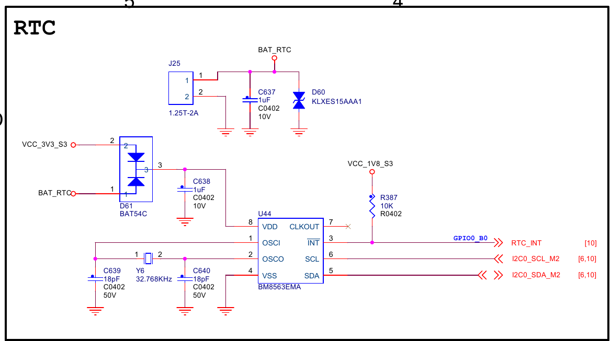

# RTC 电池（hym8563 / CR1220）：受控断电验证与寿命

> RTC 备电须通过保留 RTC 电池、断开整板主供电的冷启动验证；用内核首次读取的 RTC 时间判断保持能力。
> 开机后的系统时间可能已被 fake-hwclock / NTP 修正，芯片耗电规格也不能直接保证整板电池寿命。

## TL;DR

- `poweroff` 后适配器仍连接，或 USB 等连接仍反向供电，都不能证明 RTC 电池在供电。
- `rtc information is valid` 只说明驱动未读到 VL 低电压标志；还要核对时间是否随实际经过时间推进。
- `setting system clock to …` 消息正文保留首次 RTC 读数；后续校时不改该正文。
- 软件写入旧日期只能验证恢复逻辑，不能代替真实断电或制造 VL 事件。
- 2026-10-22 在 V2、BSP 6.1.172 上验证短时保持正常，确认主供电断开至少约 14 分钟；不据此推算长期精度或电池寿命。
- 同日读到 CLKOUT 已开启；CR1220 35～40 mAh 应参考开启档估算，关闭与驱动清理均[尚未实施](rtc-hym8563-clkout.md)。

## 受控断电方法

适用于当前 LubanCat-5 V2、Rockchip 6.1 BSP。测试前确认没有采集、构建、安装或写盘任务。
本实验不需要禁用 chrony 或 fake-hwclock；用开机内核消息区分 RTC 与后续软件校时。

1. 联网执行 `sudo lsp-time-sync status --json`，确认 `ntp.ready_to_save=true`。
   再执行 `sudo hwclock --systohc --utc`，记录 `date -u`、RTC 的 sysfs 日期/时间和 boot ID，保存到板外。
2. 执行 `sudo systemctl poweroff`，等待正常关机完成。
3. 保留 RTC 电池，断开适配器、主电池及可能反供的 USB 等连接。由操作者确认整板主供电已断，记录起点。
   SSH 离线仅说明网络不可达，不能替代物理断电确认。
4. 等待约 5～10 分钟作短时保持检查，记录实际断电时长，再恢复主供电。该时长不是电池寿命验收标准。
5. 冷启动后读取本次 boot ID、内核 RTC 消息及时间诊断；若计算偏差，等待 NTP 收敛后再采样。

```bash
cat /proc/sys/kernel/random/boot_id
sudo dmesg --color=never | grep -E 'rtc-hym8563|setting system clock'
sudo lsp-time-sync status --json
```

| 观察 | 可支持的结论 |
| --- | --- |
| 已确认物理断电，日志为 valid，RTC 读数随实际经过时间推进并接近独立时间基准 | 本次条件下短时保持正常 |
| 日志为 invalid，或首次读数回到 `2021-01-01T12:00:00` | RTC 信息失效；检查电池、连接与供电路径，不能直接归因于电池耗尽 |
| valid，但时间停滞或明显偏离基准 | 继续检查走时与初始校准，不能仅凭 valid 判通过 |
| 缺开机消息、物理断电未确认或参考时间未校准 | 相关结论证据不足 |

驱动在 VL 置位或日期无效时将 RTC 初始化为上述 2021 年日期。因此开机后再读芯片 VL，
可能已不是驱动初始化前的状态；常规测试无需强制绕过驱动访问 I²C 寄存器。

### 估算首次读取时的偏差

记内核消息中的 RTC epoch 为 `R`、该消息的开机单调时间为 `M`；
在 NTP 收敛后尽量成对采样当前 UTC epoch `T` 和 `/proc/uptime` 第一列 `U`：

```text
参考读取时刻 ≈ T − (U − M)
RTC 偏差 ≈ R − [T − (U − M)]
```

测试期间不得挂起系统，以免 uptime 与日志时间基准的差异影响回推。
RTC 只有整秒，读数与日志打印有间隔，采样也有延迟；结果需注明这些量化限制，不能直接换算 ppm。
`rtc_hctosys()` 给系统时钟加 0.5 秒，但消息中的 epoch 仍是 RTC 原始整数秒。
NTP 的剩余校正量门限不是绝对 UTC 精度保证。
基准读数到冷启动读数的差值包含关机、断电和启动过程，不能直接称为纯断电时长。

## V2 供电路径

来源：V2R2 原理图（镜像源码：`hardware-docs/lubancat-5-v2/lubancat_5_v2_EBF410149V2R2_SCH_20250908.pdf`） PDF 第 41 页 RTC 区域。



`J25:1` 接 `BAT_RTC`、`J25:2` 接地。`D61 = BAT54C` 是共阴极双二极管：
`D61:2` 接 `VCC_3V3_S3`，`D61:1` 接 `BAT_RTC`，`D61:3` 共阴极接 `U44:8`（VDD）与 `C638`。
`U44 = BM8563EMA` 由 Y6 的 32.768 kHz 晶振走时；其 CLKOUT 引脚未外接负载。
该电路允许两路电源择高供电，不能仅因系统关机就认定电池已接管，也不能把隔离二极管漏电视为零。
图中没有 RTC 电池充电路径，备电按接口设计使用一次性 CR 系列；该接口不为可充电电池补电。

## 实测范围（2026-10-22）

LubanCat-5 V2、Rockchip BSP 6.1.172，根分区 `/dev/mmcblk0p2`。
操作者确认主供电及反供连接全断、保留 RTC 电池；确认断电与提示允许复电的本机记录间隔约 846 秒，
因此仅报告断电至少约 **14 分钟**。实际复电时刻未单独计时。

| 观测 | 结果 |
| --- | --- |
| 断电前 RTC 基准（北京时间） | `2026-10-22 10:57:10`，已在 NTP 收敛后回写 |
| 冷启动 RTC 消息 | `rtc information is valid`；`setting system clock to 2026-10-22T03:16:47 UTC (1792639007)` |
| RTC 消息开机单调时间 | `2.033068` 秒 |
| 两次 RTC 读数推进 | 1177 秒，即 19 分 37 秒，包含关机、断电与启动过程 |
| NTP 回推的读取时刻（北京时间） | `2026-10-22 11:16:48.710`；参考经过时间 1178.706 秒 |
| RTC 相对回推参考的偏差 | 约慢 1.7 秒；采样区间约 1.3 ms，仍有整秒量化与参考授时误差 |

本次短时保持正常。联网后 `lsp-time-save.service` 在北京时间 `11:17:01` 自动完成首次保存，
结果 `success`；三个采集服务仍为 disabled / inactive。未测整板备电电流或长期漂移。

## 既有实测记录（2026-09-21）

旧记录为开发板断电 11 分 42 秒；本文保留的数值如下，未包含重新计算偏差所需的 RTC 消息单调时间：

```text
断电前基准             2026-09-21T12:08:00+08:00，epoch 1789963680（system 与 rtc 差 0 秒，VL=0）
恢复供电后内核 RTC     2026-09-21T04:19:42Z，epoch 1789964382（12:19:42 CST）
旧算法回推开机时刻     1789964381（12:19:41 CST；date +%s − uptime，chrony 已同步）
旧算法报告偏差         1 秒
两次 RTC 基准差值      702 秒（11 分 42 秒）
芯片 0x02 读数         0x20（VL=0）；内核：rtc information is valid
```

该记录支持当次断电期间 RTC 未丢时的观察。旧算法未计入驱动读取发生在启动之后的延迟，
“偏差 1 秒”不再作为精度结论；702 秒也不能直接分离关机与启动所占时间。
人工写入 2021 年再重启只覆盖软件恢复路径，不是无电池断电实验。

## 耗电规格与寿命边界

参考 HYM8563T 手册（镜像源码：`hardware-docs/modules/HYM8563T.PDF`） 第 3 页直流规格；
板上 U44 标为 BM8563EMA，引用这些同类器件数据作估算，不替代实际物料规格与整板测量。

| 手册条件 | 数值 |
| --- | --- |
| `IDD2`：CLKOUT 禁止、3.0 V、25 ℃ | 250 nA 典型 / 500 nA 最大；−40～85 ℃ 为 400 / 650 nA |
| `IDD3`：CLKOUT=32.768 kHz、3.0 V、25 ℃ | 550 nA 典型 / 1000 nA 最大；−40～85 ℃ 为 650 / 1100 nA |
| `VLOW`：VL 检测阈值 | 0.9 V 典型 / 1.0 V 最大 |

上述静态耗电条件为 fSCL=0，手册脚注要求定时器源为 1/60 Hz、SCL/SDA 为 VDD；
BSP 初始化代码配置的是使能 1 Hz 定时器，与该条件不同，真实备电状态和总电流尚未测量。
按用户给定 CR1220 容量 35～40 mAh，
用 `容量(mAh) / 电流(mA) / (24 × 365.25)` 得到理论连续备电年数：

| 芯片状态 | 典型电流估算 | 最大电流估算 |
| --- | --- | --- |
| CLKOUT 关闭、25 ℃ | 16.0～18.3 年（250 nA） | 8.0～9.1 年（500 nA） |
| CLKOUT 关闭、−40～85 ℃ | 10.0～11.4 年（400 nA） | 6.1～7.0 年（650 nA） |
| CLKOUT=32.768 kHz、25 ℃ | 7.3～8.3 年（550 nA） | 4.0～4.6 年（1000 nA） |

这些只表示芯片规格下的容量商。实际还受电池自放电、温度、二极管及保护器件漏电、板面漏电和截止条件影响。
未测整板备电电流、未核对具体电池厂商规格，不能据此承诺使用年限或制定固定更换周期。

当前驱动定义 CLKOUT 寄存器为 `0x0d`，`0x01` 是控制寄存器 2；
旧记录 `reg 0x01 = 0x00` 不能证明 CLKOUT 关闭，引脚悬空也不能证明其内部振荡输出已禁止。
2026-10-22 实际读取 `0x0d=0x80`，FE=1、FD=00，应参考开启档；
常开调用流程、内建 / 模块边界与未做事项见 [RTC CLKOUT](rtc-hym8563-clkout.md)。

## 依据与相关

- `kernel-6.1/drivers/rtc/rtc-hym8563.c`：`hym8563_probe()` 的 VL 检查与默认日期、寄存器定义。
- `kernel-6.1/drivers/rtc/class.c`：`rtc_hctosys()` 的 RTC 读取、0.5 秒补偿及消息格式。
- [系统时间恢复与校准](../system/tuning/time-sync.md)、[电量计](battery-gauge-bq40z50.md)。
