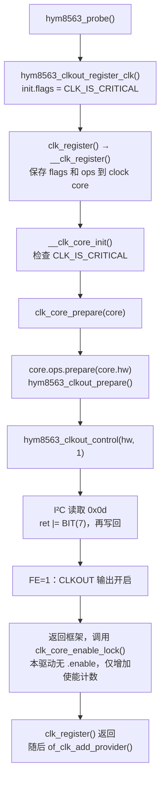

# RTC CLKOUT：常开路径与模块解绑边界

> LubanCat-5 V2 的 RTC CLKOUT 引脚虽为 NC，当前 BSP 仍在注册时钟时主动开启输出。
> 已完成源码分析和状态读取；关闭输出、修复解绑清理及相应板测均未实施。

## TL;DR

- 2026-10-22，V2 / 运行内核 6.1.172：寄存器 `0x0d=0x80`，即 FE=1、FD=00，配置为开启 32.768 kHz 输出。
- 驱动设置 `CLK_IS_CRITICAL`，时钟框架在注册期间调用 `.prepare()`，由该回调通过 I²C 写入 FE。
- 当前 `CONFIG_RTC_DRV_HYM8563=y`，但驱动支持 `m` 构建；缺少 `.remove()` 不阻止模块编译。
- 当前解绑清理不完整，不能直接执行 `unbind → insmod 同名修改版`；资源注销也不等于关闭 CLKOUT。
- 未完成项见[实施与验证状态](#实施与验证状态)；备电供电图与续航估算见 [RTC 电池](rtc-hym8563-battery.md)。

## 核对方法与已读取状态

适用范围为 LubanCat-5 V2、当前工程 Rockchip BSP 6.1.172；以下运行状态是 2026-10-22 的开发板读数，
不代替以后操作前的实时核对。本次仅观察，未写寄存器、解绑或替换驱动。

| 对象 | 依据与结果 |
| --- | --- |
| 硬件接线 | V2R2 原理图 PDF 第 41 页：`U44:7 CLKOUT` 未外接；NC 不会使芯片自动清除输出使能位 |
| 时钟消费者 | 已核对 V2 设备树实际 include 链，未发现 `&hym8563` 时钟消费者；RTC 节点仍注册为 provider |
| 运行配置 | `/proc/config.gz`：`CONFIG_RTC_DRV_HYM8563=y`、`CONFIG_COMMON_CLK=y` |
| 内建清单 | `modules.builtin`：`kernel/drivers/rtc/rtc-hym8563.ko`；此处 `.ko` 名称不代表可卸载 |
| 驱动绑定 | I²C `0-0051` 绑定 `rtc-hym8563` |
| 时钟状态 | debugfs 名称 `hym8563`，prepare / enable 计数均为 1，rate 为 32768，flags 含 `CLK_IS_CRITICAL` |
| 硬件控制位 | 已核对读取副作用后，单次只读 `0x0d` 得到 `0x80`；FE=1、FD=00，未测引脚波形 |

`clk_summary` 的 `Y` 不能单独证明 FE=1：该驱动实现 `.prepare/.is_prepared`，没有 `.enable/.is_enabled`，
时钟框架对这一组合可直接显示 `Y`。本次以控制寄存器读数确认配置。
`0x01` 是控制寄存器 2，读取它为零不能证明 CLKOUT 关闭。

## 常开的原因与调用路径

`hym8563_clkout_register_clk()` 无条件设置 `init.flags = CLK_IS_CRITICAL`。
以下为成功注册路径，省略错误处理；真正改变硬件的是 `.prepare()` 回调中的 I²C 读改写：

写入保留 FD 频率选择位；当前 FD=00，因此输出配置为 32.768 kHz。
开启发生在 provider 发布之前，不需要先有消费者调用 `clk_prepare_enable()`。
`CLK_IS_CRITICAL` 还阻止普通 disable / unprepare 将最后一个使能 / 准备计数降至零。
当前 suspend / resume 只处理唤醒 IRQ 等状态，没有关闭 CLKOUT；也没有 shutdown 回调关闭它。

本地历史中该 flag 已存在于最初导入，尚未定位其原始上游补丁和设置理由。
其他分支保留相同设置不能证明 V2 的 NC 接线需要该输出，也不能仅凭 NC 判断通用驱动的历史动机。

## 模块构建与解绑为何不同

Kconfig 为 `tristate`，并明确支持名为 `rtc-hym8563` 的模块；源码使用 `module_i2c_driver()`。
缺少 `.remove()` 不妨碍 `m` 构建，I²C 框架仍会释放 `devm_*` 资源。
当前运行配置选择 `y`，其代码不能用 `rmmod` 卸载。

直接 `unbind → insmod 同名修改版` 有两项独立限制；以下为源码分析，未通过解绑实验复现：

1. `unbind` 只解除设备绑定，内建 I²C driver 的注册记录仍在。
   同名新驱动在 `driver_register()` 查重时返回 `-EBUSY`，不会替换已有代码。
2. 当前驱动用普通 `clk_register()`、`of_clk_add_provider()` 注册资源，却没有配套清理。
   `clkout_hw` 嵌在 `devm_kzalloc()` 分配的私有结构内；解绑释放该结构后，残留时钟仍引用它，
   存在访问已释放内存的风险。重新绑定还可能遇到重复时钟名；仅改模块或驱动名不足以解决。

安全交接设备给另一测试驱动，要求旧驱动能完整解绑，测试驱动名称独立并控制绑定对象。
当前实现不满足这一前提，未执行该实验。

## 清理位置与修复方案边界

若保留手动注册，应在正常解绑的 `.remove()` 和 probe 失败回退路径配对注销，
并在私有结构释放前完成。先阻止新的 provider 查询，再注销 clock：

| 注册 | 注销 |
| --- | --- |
| `of_clk_add_provider(node, ...)` | `of_clk_del_provider(node)` |
| `clk_register(dev, hw)` | `clk_unregister(clk)` |

- provider 注册失败：仅回退已成功的 clock。
- 后续 RTC 注册失败或正常解绑：先撤销 provider，再注销 clock。
- probe 失败不会自动调用 `.remove()`；当前代码还忽略了 provider 和时钟注册错误，修复须同步检查返回值。

当前 BSP 也提供 `devm_clk_hw_register()` 和 `devm_of_clk_add_hw_provider()`。
先注册 clock、再发布 provider，框架可在失败或解绑时逆序释放，省去这两项专用的 `.remove()` 清理；
仍须检查返回值，并保证时钟资源先于私有结构释放。

**注销软件对象不等于关闭硬件输出。** 当前 `clk_unregister()` 替换回调并移除时钟对象，
不会自动调用 `.unprepare()`；注销 prepared 时钟会打印警告。普通 disable / unprepare 又受 critical 限制，
因此只补两条注销调用或改为 devm，并不是当前常开时钟的完整无警告卸载方案。

关闭策略也不能仅以“删除 `CLK_IS_CRITICAL`”验收：启动晚期的未使用时钟清理受计数、
`clk_ignore_unused` 和注册时机影响，晚加载模块还可能错过该阶段。
应明确默认输出策略，以 `0x0d` 的 FE 读回确认，再验证走时和唤醒；不关闭 RTC 内部走时振荡器。

## 实施与验证状态

截至 2026-10-22，本专题仅完成上述源码分析、接线核对和当前开启状态读取；以下均**未做**：

- [ ] 实现板级 CLKOUT 关闭策略；未修改 critical 标志或写入 FE=0。
- [ ] 补齐 clock / provider 生命周期与注册错误处理；未新增 `.remove()` 或迁移 devm 注册。
- [ ] 构建、安装或启动包含上述变更的内核；未将当前 `y` 改为 `m`。
- [ ] 进行 unbind / bind、模块加载 / 卸载 / 重载验证。
- [ ] 验证关闭后的 FE 状态、RTC 走时、闹钟唤醒及真实断电保持。
- [ ] 测量关闭前后的整板备电电流；芯片手册数值不代表已测得节电效果。

[既有短时断电保持验证](rtc-hym8563-battery.md#实测范围2026-10-22)不属于关闭 CLKOUT 后的回归，
不能用于勾选上述待办。后续可直接验证修改后的内建测试内核；
若需反复 `.ko` 调试，应先修复生命周期，再启动配置为 `m` 的测试内核，并匹配其配置、版本和符号。

## 依据与相关

- rtc-hym8563.c（镜像源码：`kernel-6.1/drivers/rtc/rtc-hym8563.c`）：`hym8563_probe()`、`hym8563_clkout_register_clk()`、时钟回调及驱动注册。
- RTC Kconfig（镜像源码：`kernel-6.1/drivers/rtc/Kconfig`）：`RTC_DRV_HYM8563` 的 tristate 与模块说明。
- clk.c（镜像源码：`kernel-6.1/drivers/clk/clk.c`）：`__clk_register()`、`__clk_core_init()`、`clk_core_prepare()`、critical 限制、unused 清理及注销 / devm API。
- driver.c（镜像源码：`kernel-6.1/drivers/base/driver.c`）：`driver_register()` 同名查重；dd.c（镜像源码：`kernel-6.1/drivers/base/dd.c`）：解绑与 devres 释放。
- i2c-core-base.c（镜像源码：`kernel-6.1/drivers/i2c/i2c-core-base.c`）：`i2c_device_remove()`。
- V2R2 原理图（镜像源码：`hardware-docs/lubancat-5-v2/lubancat_5_v2_EBF410149V2R2_SCH_20250908.pdf`）：PDF 第 41 页 RTC 区域。
- HYM8563T 手册（镜像源码：`hardware-docs/modules/HYM8563T.PDF`）：第 11 页，CLKOUT 控制寄存器表 19 / 20；板上物料为 BM8563EMA，规格估算边界见 [RTC 电池](rtc-hym8563-battery.md)。
