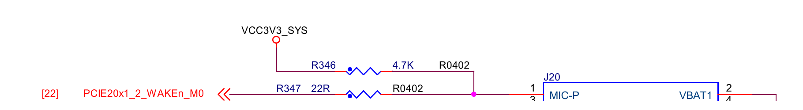

# RTL8822CE 深睡唤醒：GPIO3_D0 接线与软件条件

## 结论

> LubanCat-5 V2 的 Mini-PCIe WAKE# 已接到 GPIO3_D0，但当前软件配置尚不足以证明 RTL8822CE 能从 deep 唤醒主机。

- 硬件已核对：J20 pin 1 经 R347 接 `GPIO3_D0 / PCIE20X1_2_WAKEN_M0`。
- 软件存在缺口：板级 DT 未配置该引脚的唤醒 IRQ / pinctrl；Wi-Fi WoWLAN 源码开关为关，设备 wakeup 策略也未启用。
- 待验证：GPIO3_D0 的 PMU 路径、卡在挂起时的工作条件，以及 Wi-Fi / 蓝牙各自的实际唤醒事件。

以太网、Wi-Fi、蓝牙远程唤醒仍是功能要求；[UART2 早醒的 GPIO-only 规避](rk3588-cpu0-immediate-wake.md)
不能代替这些功能的验证。本文只解释当前 Mini-PCIe 组合卡的唤醒条件。

## 方法

1. 先用 PCI / USB 枚举核对卡、驱动及设备路径。当前 Wi-Fi 走 PCIe，蓝牙走 USB，须分别检查。
2. 对照原理图确认 WAKE# 的实际引脚，再核对运行 DT、pinmux、GPIO IRQ consumer 与 wake 策略；
   PCIe platform 的 `power/wakeup=enabled` 不能代替卡和 WAKE# 输入的配置。
3. 检查驱动的 WoWLAN 编译条件、固件 / 触发策略，以及 PCIe 挂起时的保电、PERST、PHY / 时钟处理。
4. 完成配置后，使用 RTC 兜底做真实 Wi-Fi / 蓝牙刺激，以实际返回、IRQ 与唤醒原因判定；
   仅有硬件接线、设备枚举或 `wakeup=enabled` 都不足以证明功能可用。

## 原因

### WAKE# 的硬件通道

V2 原理图（镜像源码：`hardware-docs/lubancat-5-v2/lubancat_5_v2_EBF410149V2R2_SCH_20250908.pdf`）
第 38 页为 MINI PCIE，第 22 页为 SoC VCCIO5 引脚。




```text
J20 pin 1 / WAKE# → R347 22 Ω → PCIE20x1_2_WAKEn_M0 → AH24 / GPIO3_D0
```

卡侧由 R346 4.7 kΩ 上拉至 VCC3V3_SYS。GPIO3_D0 可复用为 PCIe WAKE 功能，
接线本身不证明驱动正在使用它，也不证明蓝牙事件会驱动同一根 WAKE#。

### 主机与卡都需要配置

板级 `pcie2x1l2` 只配置 reset GPIO3_D1、disable GPIO3_C1；未配置 GPIO3_D0 唤醒 IRQ / wake pinctrl。
`pcie-dw-rockchip.c` 的 `device_init_wakeup()` 只声明设备唤醒能力，没有注册 WAKE# GPIO IRQ。
PCIe 挂起还会停止链路、PHY / 时钟并按保电策略处理 PERST / 电源，需确认卡仍能检测目标无线事件。

实际使用的厂商驱动为 `rtl88x2ce` / 模块 `8822ce`。
其 Makefile 默认 `CONFIG_WOWLAN=n`、`CONFIG_GPIO_WAKEUP=n`；`rtw_pci_suspend()` 中 PCI wake 的配置受前者控制。
无线芯片侧 GPIO 选项不能代替主机 GPIO3_D0 的 IRQ 配置。

GPIO3 的 Linux 父中断是 GIC SPI280 / 285；`gpio-rockchip.c` 的 `irq_gc_set_wake` 与挂起回调管理中断掩码。
它能否在当前 deep 策略下绕过 CPU0 类入口，尚缺 PMU / 固件依据及真实刺激验证，不能套用 GPIO0 的板测结论。

## 证据

2026-10-21 已有只读核验，环境为 LubanCat-5 V2 / Linux `6.1.172 #13`；未执行无线唤醒测试。

| 对象 | 观察 | 能说明什么 |
| --- | --- | --- |
| Wi-Fi | PCI `0004:41:00.0`，`10ec:c822`，驱动 `rtl88x2ce` | 实际卡与驱动身份 |
| Wi-Fi / 上游 PCI bridge | `power/wakeup=disabled` | 当次设备策略未启用唤醒 |
| PCIe platform `fe190000.pcie` | `power/wakeup=enabled` | 控制器声明不能代替端点和 WAKE# 配置 |
| 蓝牙 | USB `4-1.1`，`0bda:c822`，USB 设备 `power/wakeup=disabled` | 蓝牙另走 USB，需独立配置和验证 |
| 有效 DT | 无 GPIO3_D0 唤醒 IRQ / wake pinctrl | 硬件 WAKE# 尚未接成当前 GPIO 唤醒 consumer |

原始输出位于开发板工程 `build/kernel13-sleep-20261021-7k25ol6_/network-wake-readonly.txt`。
这些是带版本的观察，不代表所有 RTL8822CE 模块或后续镜像的默认能力。

## 参考

- Mini-PCIe 板级配置（镜像源码：`kernel-6.1/arch/arm64/boot/dts/rockchip/rk3588-lubancat-5.dts`）、GPIO3 父中断（镜像源码：`kernel-6.1/arch/arm64/boot/dts/rockchip/rk3588s.dtsi`）。
- PCIe WAKE 引脚复用（镜像源码：`kernel-6.1/arch/arm64/boot/dts/rockchip/rk3588s-pinctrl.dtsi`）、GPIO wake 掩码实现（镜像源码：`kernel-6.1/drivers/gpio/gpio-rockchip.c`）。
- PCIe 控制器挂起实现（镜像源码：`kernel-6.1/drivers/pci/controller/dwc/pcie-dw-rockchip.c`）的 `rockchip_dw_pcie_suspend()`、`rk_pcie_hardware_io_unconfig()`。
- RTL8822CE 构建开关（镜像源码：`kernel-6.1/drivers/net/wireless/rtl8822ce/Makefile`）、PCI suspend 实现（镜像源码：`kernel-6.1/drivers/net/wireless/rtl8822ce/os_dep/linux/pci_intf.c`）。
