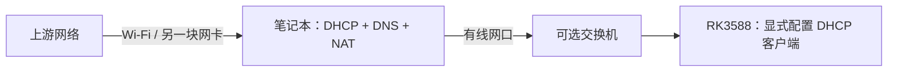

# 笔记本通过有线网口向 RK3588 共享上网

> 笔记本用 NetworkManager `ipv4.method=shared` 提供 DHCP、DNS 和 NAT；RK3588 须先显式切为 DHCP 客户端，才能接入这个共享网络或其下游交换机。

## TL;DR

- 共享侧由笔记本提供 DHCP；板子的产品默认是 DHCP 服务端，接线前必须切换角色。
- 开发板客户端无限重试，不自动回退为服务端；上游暂时离线不会启动另一份 DHCP。
- 示例下游网段为 `<HOST_15>/24`，与板子产品直连网段 `<HOST_12>/24` 分开。
- 已有笔记本共享连接可以直接复用，无需修改本机配置；仅需本地访问时使用[产品直连模式](ethernet-direct.md)。

## 接线和地址流向



NetworkManager 将下游流量 NAT 到笔记本当前默认网络。板子获得上游分配的地址、网关和 DNS，
笔记本自身默认路由仍走 Wi-Fi 等上游。VPN、代理或企业网络策略可能限制共享上网，取得租约不等于外网可达。

## 开发板切为 DHCP 客户端

在板子串口或独立 Wi-Fi 会话操作，先不要接共享交换机；禁止切换当前 SSH 承载口。
先核对接口与硬件路径，再从[profile 对照表](ethernet-direct.md#配置与安装契约)选择对应客户端 UUID：

```bash
nmcli -f DEVICE,TYPE,STATE,CONNECTION device status
udevadm info --query=property --path='/sys/class/net/<待核对接口>'
```

下面变量替换为已核对的接口及对应 UUID。先持久禁用直连自动连接，停用活动直连与 DHCP 服务，
再启用所需客户端并激活；有线连接需要 carrier，最后一步前连接上游网线。

```bash
iface='<已核对接口>'
client_uuid='<该 GMAC 的客户端 UUID>'
direct_uuid='00000000-0000-4000-8000-000000000001'
sudo nmcli connection modify uuid "$direct_uuid" connection.autoconnect no
if nmcli -g UUID connection show --active | grep -Fxq "$direct_uuid"; then
    sudo nmcli connection down uuid "$direct_uuid"
fi
sudo systemctl stop 'lsp-ethernet-direct@*.service'
sudo nmcli connection modify uuid "$client_uuid" connection.autoconnect yes connection.autoconnect-retries 0
sudo nmcli --wait 20 connection up uuid "$client_uuid" ifname "$iface"
```

如需另一 GMAC 也能自动接上游，对其客户端 UUID 同样设置 `connection.autoconnect yes`，无需强制激活未接线口。
客户端的单次 DHCP 预算为 15 秒，自动连接次数不设上限；没有上游时继续尝试客户端，不启动板端 DHCP。
这些修改持久保存在本板，供后续启动读取，不改变工程镜像默认；Netplan 集成可能改变配置存储位置，
实际来源及后续部署保留规则见[配置契约](ethernet-direct.md#配置与安装契约)。
返回产品服务端按[恢复步骤](ethernet-direct.md#返回产品默认服务端)操作。

## 笔记本没有共享连接时

已有共享网络跳过本节。适用于 NetworkManager `1.46`，需要 `dnsmasq-base`，不需要全局 `dnsmasq.service`。
先确认上下游网口，不切换承载管理连接或上游网络的接口：

```bash
nmcli -f DEVICE,TYPE,STATE,CONNECTION device status
ip -4 route show default
```

`<DOWNSTREAM_IF>` 必须是专用于下游的有线口。先记下原活动 UUID，再新建独立 profile：

```bash
downstream_if='<DOWNSTREAM_IF>'
previous_uuid=$(nmcli -g GENERAL.CON-UUID device show "$downstream_if")
sudo nmcli connection add type ethernet ifname "$downstream_if" \
    con-name laptop-board-share connection.autoconnect yes \
    ipv4.method shared ipv4.addresses <HOST_16>/24 \
    ipv4.never-default yes ipv6.method link-local
sudo nmcli connection up laptop-board-share ifname "$downstream_if"
```

共享网段不得与笔记本上游、VPN 或其他本地接口重叠。`never-default=yes` 约束笔记本该连接的默认路由，
不阻止向下游发放网关。该口以后接公司交换机前应切回客户端，不能继续保留共享服务。

恢复原连接并删除示例 profile；`previous_uuid` 应另行记下，避免关闭终端后丢失：

```bash
sudo nmcli connection down laptop-board-share
if [ -n "$previous_uuid" ] && [ "$previous_uuid" != -- ]; then
    sudo nmcli connection up uuid "$previous_uuid" ifname "$downstream_if"
fi
sudo nmcli connection delete laptop-board-share
```

## 核对结果与边界

笔记本查询共享状态与租约；用实际接口替换变量：

```bash
nmcli -f GENERAL.CONNECTION,IP4.ADDRESS,IP4.GATEWAY device show "$downstream_if"
sudo cat "/var/lib/NetworkManager/dnsmasq-${downstream_if}.leases"
ip -4 route show default
```

板端查询 `ip -4 address`、`ip -4 route`、`resolvectl status`：示例应取得 `192.168.223.x/24`，
网关与 DNS 指向笔记本，对应直连 DHCP 实例应 inactive。先验证笔记本地址，再分别验证外部 IP 和域名。
笔记本通过 `ssh board@<BOARD_IP>` 访问租约中的板端地址。

NetworkManager `1.46.0` 的 shared 进程及配置已在 Linux 笔记本核对；
LubanCat-5 V2 / BSP `6.1.172` 本轮切客户端后，有线 SSH 复查成功，两个直连 DHCP 实例均 inactive。
三份 Netplan 配置已核对持久保存：直连不自动连接，两客户端自动连接且无限重试，文件均为 `0600 root:root`。
24 项隔离回归覆盖显式客户端取址、停止板端 DHCP 及事务失败不变服务端，详见[验证边界](ethernet-direct.md#状态与验证边界)。
隔离切换使用 `--temporary`，落盘状态由上述现场读盘另行核对；未实际重启或中断共享交换机的上游。

## 依据

- NetworkManager `1.46` 随包 `nm-settings-nmcli(5)`：`ipv4.method=shared`、`ipv4.addresses`、`ipv4.never-default`、`connection.autoconnect-retries`。
- `nmcli(1)`：connection add / modify / up / down / delete。
- [板端直连配置与安装契约](ethernet-direct.md)。
